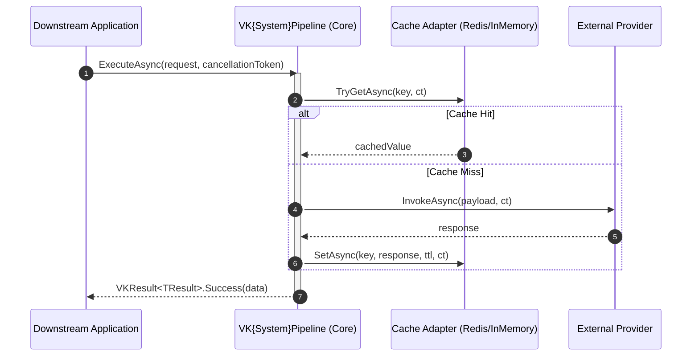

# Task: アーキテクチャ仕様書およびシステム全景の策定 (Architecture Blueprint)

# Role

あなたは、エンタープライズ C4 モデル（Context, Container, Component）、厳格な単方向レイヤリング（`ARCH-01`）、ポート＆アダプター分離（`ARCH-02`）、および Vertical Slice Architecture（`BB.01`）を統括するチーフ・システムアーキテクトです。

# Goal

`VK.Blocks` におけるアーキテクチャ仕様書を、**「全社グローバル全景 (Global Landscape)」** と **「個別モジュール・サブシステム仕様 (Module Architecture)」** の二層構造で明文化し、人間および AI が大局観と境界ルールを完全に把握できる仕様書体系を策定します。

---

## 🏛️ アーキテクチャドキュメント二層体系と生成成果物一覧

アーキテクチャドキュメントは、対象スコープに応じて以下の Markdown ファイルとして生成・管理されます：

```text
docs/03-Architecture/
├── README.md                                  # 🌍 [Tier 1: 必須] グローバル・システムアーキテクチャ全景
│
├── {ModuleName}/                              # 📦 [Tier 2: 必須] 個別モジュール・サブシステム別ディレクトリ
│   ├── README.md                              # 🏛️ [必須] モジュールアーキテクチャ仕様書 (C4, 境界, 主要シーケンス, ADR索引)
│   ├── api-surface.md                         # 📜 [強く推奨] 公開 API 面・内部型境界と SemVer 互換性契約
│   ├── extension-guide.md                     # 🔌 [強く推奨] プラグイン・カスタム Provider/Strategy 実装ガイド
│   ├── failure-modes.md                       # 💥 [I/O・外部依存時] 障害モード・縮退挙動と呼び出し側ハンドリング
│   ├── threat-model.md                        # 🛡️ [セキュリティ重要時] STRIDE 脅威分析と境界防衛
│   ├── data-flow.md                           # 🔄 [複雑連携時] 詳細プロトコルデータフロー・状態機械
│   ├── deployment-topologies.md               # 🌐 [インフラ複雑時] 配備トポロジーと統合パターン
│   ├── observability.md                       # 📡 [運用重要時] 運用可観測性トポロジーと推奨アラート
│   └── configuration.md                       # ⚙️ [構成多様時] 構成オプションリファレンスと環境別設定（自動生成推奨）
```

| 階層 / 種別 | ファイルパス | 責務と主な記述内容 | 作成・更新タイミング |
| :--- | :--- | :--- | :--- |
| **Tier 1<br/>Global** | `docs/03-Architecture/README.md` | **全社システム全景・横断アーキテクチャ**<br/>• 全 30+ モジュールの C4 Context と全体分層地図（L1〜L3、Edge）<br/>• 共通実行コンテキスト中枢（`TenantId`/`UserId`/`TraceId` の貫通伝搬）<br/>• モジュール間依存マトリクスと境界規約 | 全社基盤刷新時、新領域（例: AI）立ち上げ時 |
| **Tier 2<br/>Module** | `docs/03-Architecture/{ModuleName}/README.md` | **モジュールアーキテクチャ仕様書（本 blueprint の主対象）**<br/>• 当該サブシステム（Core + アダプター群）の C4 Context & Container<br/>• 内部 Vertical Slice 物理構造と依存方向<br/>• 2〜3 個の主要ランタイム時系列図（Sequence View）<br/>• キャッシュ・データ設計、横断関心事、主要 ADR 索引 | 新 BuildingBlock 立ち上げ時、大規模リファクタリング時 |
| **Tier 2<br/>Companion** | `docs/03-Architecture/{ModuleName}/api-surface.md` | **公開 API 面と後方互換性ポリシー (`ARCH-07`, `AP.03`, `FS-09`)**<br/>• Level 1 Public 契約（`VK` 型、インターフェース、DI 拡張）と `Internal/` の白黒分離<br/>• SemVer 破壊的変更（Breaking Changes）判定基準と非推奨化（`[Obsolete]` + ADR）プロセス<br/>• AI コーディングエージェントおよび外部利用者向けの「変更不可契約」明示 | 公開 API 策定時、破壊的変更審査時 |
| **Tier 2<br/>Companion** | `docs/03-Architecture/{ModuleName}/extension-guide.md` | **拡張・カスタマイズ実装ガイド (`ARCH-11`, `AP.06`)**<br/>• カスタム Provider / Store / Strategy の実装手順と最小ゴールデンコード（`ValueTask`, `CancellationToken`, `VKResult<T>` 準拠）<br/>• `builder.OverrideXxx<T>()` による明示的オーバーライドと DI 登録手順<br/>• 頻出アンチパターン（例外スロー、静的状態、ヒープ割り当て等）の回避策 | プラガブルな拡張点を持つモジュール提供時 |
| **Tier 2<br/>Companion** | `docs/03-Architecture/{ModuleName}/failure-modes.md` | **障害モードと耐障害性ハンドブック (`OR.03`, `CS.01`)**<br/>• 外部依存（Redis, IdP, DB, MQ）停止・瞬断時の基座の挙動（Fail-Closed vs Fail-Open / サーキットブレーカー開放）<br/>• 下流呼び出し側へ返却される `VKResult` エラーコード（`CS.01`）と推奨リトライ/縮退ハンドリング<br/>• SRE / 運用者向けのトラブルシューティングおよび Runbook 連携 | 外部 I/O・分散キャッシュ・メッセージング連携時 |
| **Tier 2<br/>Companion** | `docs/03-Architecture/{ModuleName}/threat-model.md` | **セキュリティ脅威モデル（補足）**<br/>• STRIDE 分析、PII 漏洩監査、トークン偽造/重放撃退、境界防壁 | 認証・認可・暗号・多租戸等のセキュリティ重要モジュール |
| **Tier 2<br/>Companion** | `docs/03-Architecture/{ModuleName}/data-flow.md` | **詳細プロトコルデータフロー（補足）**<br/>• OAuth/OIDC PKCE フロー、SAML 属性交換、分散状態機械の遷移 | 複雑な外部プロトコル・メッセージング連携時 |
| **Tier 2<br/>Companion** | `docs/03-Architecture/{ModuleName}/deployment-topologies.md` | **配備トポロジー（補足）**<br/>• 単体開発（InMemory）vs 本番分散（Redis/Azure）の組網図 | インフラ差し替えが多様なモジュール |
| **Tier 2<br/>Companion** | `docs/03-Architecture/{ModuleName}/observability.md` | **運用可観測性・アラート設計 (`OR.01`, `BB.04`, `FS-11`)**<br/>• 分布式分散トレーシング（W3C TraceContext）のスパン伝播関係<br/>• Grafana / Datadog で監視すべき推奨ゴールデンシグナルと Prometheus アラート閾値<br/>• ※ 静的なタグ・エラーコード辞書は `docs/05-DataDictionary/` に集約し、本稿は運用トポロジーに特化 | 本番運用監視が必要なコアモジュール |
| **Tier 2<br/>Companion** | `docs/03-Architecture/{ModuleName}/configuration.md` | **構成オプションリファレンス (`ARCH-13`, `BB.05`)**<br/>• `IVKBlockOptions` のプロパティ一覧、デフォルト値、起動時検証（`ValidateOnStart`）ルール<br/>• 開発環境（InMemory）vs 本番分散環境（Redis/Cloud）の設定差異と推奨ベストプラクティス<br/>• ※ 属性定義テーブルは C# Options / Source Generator からの自動同期を推奨 | 構成オプション追加時、環境テンプレート策定時 |

> 💡 **補足（移行手順書の配置）**: バージョン間のアップグレード手順書（`migration-guide.md`）は、時系列のリリースエンジニアリング成果物として [`08-ReleaseNoteBlueprint.md`](./08-ReleaseNoteBlueprint.md)（`docs/08-Releases/` またはモジュール CHANGELOG.md）で統括管理されます。

---

# Constraints & Language

1. **ファイル命名規則の統一**:
   - モジュールごとの主仕様書は必ず **`docs/03-Architecture/{ModuleName}/README.md`** と命名すること。
   - GitHub / IDE フォルダ参照時に**デフォルト自動レンダリング**されるため、閲覧性が最大化され、Tab 画面での同名衝突（`system-overview.md` が乱立する問題）を防止できる。
2. **SSOT 原則の徹底 (`BASE-01`, `BASE-12`)**:
   - 本ドキュメントは**「マクロ・アーキテクチャ全景図」**である。
   - クラスの可視性（`Internal/`）や `VK` 命名規則、1ファイル1型などの「ミクロな L3 規則」は `src/BuildingBlocks/{ModuleName}/.prompts/module-manifest.md` に集約し、第 4 章の表からハイパーリンクで参照すること。
3. **図解必須**: C4 Level 1（Context）、C4 Level 2（Container）、および重要ユースケース（Runtime View）には必ず Mermaid 図を含めること。
4. **出力言語**: ビジネスIT日本語（見出し・識別子・コード・図内英語ラベルは英語併記、`BASE-09` 準拠）。

---

# Module Architecture Template (Must Follow for `{ModuleName}/README.md`)

```markdown
# 🏛️ Architecture: {System / Module Name}

- **System ID / Package ID**: `VK.Blocks.{SystemName}`
- **Domain / Area**: `[Security / AI / Persistence / Observability / Web / Core]`
- **Primary Owner / Architect**: [Team or Lead Architect]
- **Target Layer**: [L1 Foundation / L2 Domain BuildingBlock / L3 Infrastructure Adapter / Edge & Web]
- **Status**: 📝 Draft / 🏛️ Accepted / 🔄 Superseded
- **Last Verified**: {YYYY-MM-DD}

---

## 1. 🎯 概要と範囲 (Overview & Scope)

### 1.1 エレベーターピッチ・要約 (Elevator Pitch)
- [このシステム／モジュールが解決する本質的なビジネス・技術課題を 1〜2 文で明確に定義]

### 1.2 スコープ境界 (Goals & Non-Goals — `BASE-06`)
- **包含する領域 (In-Scope / Goals)**:
  - [提供する主要機能、コア抽象、および保証する不変条件]
- **明確に除外する領域 (Out-of-Scope / Non-Goals)**:
  - [意図的に本システムでは実装せず、上位アプリケーションや外部サービスに委譲する関心事]

### 1.3 想定読者と適用バージョン
- **Target Audience**: フレームワーク開発者、下流マイクロサービスアーキテクト、AI コーディングエージェント
- **Target Runtime**: .NET 10+, C# 12+ (Strict Mode, Native AOT Ready)

---

## 2. ⚡ アーキテクチャ牽引要因 (Architectural Drivers)

### 2.1 主要品質属性 (Quality Attributes)
- **性能・ゼロアロケーション (`CS.04`, `AP.01`)**: [ホットパスにおける `ValueTask`, `Span<T>`, 不要なヒープ割り当ての排除]
- **決定論的振る舞い・状態隔離 (`BASE-02`, `CS.06`)**: [静的ミュータブル状態の禁止、`TimeProvider` / `IVKGuidGenerator` 抽象注入]
- **テスタビリティ・疎結合 (`DL.01`, `ARCH-02`)**: [外部インフラ不要な InMemory / Fake 実装による単体テスト完全網羅性]
- **セキュリティ・テナント隔離 (`CS.08`, `FS-07`, `OR.02`)**: [暗黙漏洩防止、テナント分離、PII マスク]

### 2.2 厳格な技術制約 (Constraints)
- **Zero Implicit Reflection (`AP.01`, `BB.02`)**: Source Generator 駆動によるコンパイル時メタデータ確定。
- **Contract-First (`BASE-01`)**: レベル 1 公開契約（`VK` プレフィックス）の事前確定。

---

## 3. 🌐 コンテキストビュー (C4 Level 1: System Context)

システム境界と、それを取り巻く外部アクター（API クライアント、下流マイクロサービス）および外部依存サービス（IdP, クラウド SDK, DB）との関係図：

```mermaid
graph TD
    User([Downstream Host Service / App]) --> |Registers & Calls| Sys[VK.Blocks.{SystemName}]
    Sys --> |Persists Data via Ports| DB[(Relational DB / EFCore)]
    Sys --> |Caches State| Cache[(Distributed Cache / Redis)]
    Sys --> |Invokes External APIs| ExtService[External Cloud Provider / IdP]
    Sys --> |Emits Telemetry| Observability[OpenTelemetry Collector]

    style Sys fill:#1e293b,stroke:#3b82f6,stroke-width:2px,color:#ffffff
```

**コンテキスト説明**:
- [各外部アクターおよびインフラ境界との接続プロトコル、通信責務、認証方式を説明]

---

## 4. 🧩 コンテナ／モジュールビュー (C4 Level 2: Containers & BuildingBlocks)

構成パッケージ（Core + 拡張アダプター群）の依存関係と、各モジュールの SSOT Manifest へのリンク：

```mermaid
graph TD
    Host[Host Application / Composition Root] --> Core[VK.Blocks.{System}]
    Host -.-> |Optional Adapter| Ext1[VK.Blocks.{System}.OpenIdConnect / EFCore]
    Host -.-> |Optional Adapter| Ext2[VK.Blocks.{System}.Redis]

    Ext1 --> Core
    Ext2 --> Core

    style Core fill:#1e293b,stroke:#3b82f6,stroke-width:2px,color:#fff
    style Ext1 fill:#334155,stroke:#f59e0b,stroke-width:1.5px,color:#fff
    style Ext2 fill:#334155,stroke:#f59e0b,stroke-width:1.5px,color:#fff
```

### 4.1 構成モジュール一覧と Manifest リンク

| モジュール (Package) | レイヤー (`ARCH-01`) | 主な責務・所有する機能 | L3 境界規則 (SSOT Manifest) |
| :--- | :---: | :--- | :--- |
| `VK.Blocks.{System}` | Core & Slices | コア抽象、垂直切片、InMemory 既定実装 | [Manifest](/src/BuildingBlocks/{Module}/.prompts/module-manifest.md) |
| `VK.Blocks.{System}.{Adapter}` | Infrastructure Adapter | 外部プロバイダー/インフラ連携アダプター | [Manifest](/src/BuildingBlocks/{Module}.{Adapter}/.prompts/module-manifest.md) |

---

## 5. 🏛️ レイヤリングおよび依存性ルール (Layering & Governance — `ARCH-01`〜`ARCH-03`)

### 5.1 レイヤー定義と依存方向
1. **Common Protocols / Models**: 最下層。他ブロックや具象アダプターへの参照禁止。
2. **Feature Slices**: 機能単位の垂直切片。スライス間の横断参照禁止（`AP.03`）。
3. **Infrastructure Adapters**: Core のポートを具象化。同階層アダプター間の参照禁止。
4. **Composition Root (Host DI)**: すべてのモジュールを統合し、オプションを確定する唯一の場所（`ARCH-08`）。

### 5.2 厳格な禁止事項 (Anti-Patterns)
- ❌ Core 層での具象インフラ（`DbContext`, `StackExchange.Redis`, `HttpClient` 等）の直接参照。
- ❌ レイヤー間の逆方向参照および未宣言の同階層（Peer）間横断参照。
- ❌ ドメインロジックのオーケストレーション層やコントローラへの漏洩。

---

## 6. 🔄 主要シーケンス（ランタイムビュー — Runtime Sequence）

> システムにおける最も重要な 2〜3 個のランタイムシナリオを Mermaid シーケンス図で図解します。

### 6.1 典型シナリオ A: [主要パイプライン実行フロー]


### 6.2 典型シナリオ B: [エラーハンドリング・失効またはレートリミット]

---

## 7. 💾 データアーキテクチャ (Data Architecture & Storage — `CS.04`, `CS.08`)

### 7.1 データ所有権とキー規約
- **所有権**: 本モジュールが管理する集約（Aggregate）または Key-Value キャッシュのキープレフィックス規約（`vk:{module}:*`）。
- **テナント分離 (`CS.08`, `OR.02`)**: `TenantId` はすべてのキーおよびクエリで必須。

### 7.2 永続化・キャッシュ戦略
- **整合性モデル**: [強整合性 (ACID) / 結果整合性 (Eventual Consistency)]
- **データカタログ連携**: 全エラーコード・Enum は [`docs/05-DataDictionary/`](/docs/05-DataDictionary/) に同期。

---

## 8. 🛡️ 横断的関心事 (Cross-Cutting Concerns)

| 関心事 (Concern) | 統一プラクティス (Standard Pattern) | 準拠ルール / 実装場所 |
| :--- | :--- | :--- |
| **エラーモデル** | `VKResult<T>` 統一。例外を制御フローに使用しない。固定エラーコード定数。 | `CS.01`, `BASE-05` / `Errors.cs` |
| **可観測性・ログ** | `[LoggerMessage]` Source Generator による構造化ログ。PII マスク。 | `OR.01`, `BB.04` / `Diagnostics.cs` |
| **レジリエンス・耐障害性** | Polly による外部呼び出し 3 回リトライ、Circuit Breaker、タイムアウト。 | `OR.03` / `Perimeter Middleware` |
| **時間・タイムスタンプ** | システムクロック直読禁止。`TimeProvider`, `IVKGuidGenerator` 経由。 | `CS.06`, `BASE-02` |
| **非同期保証** | 全 I/O で `CancellationToken` 伝搬。ライブラリ内部 `.ConfigureAwait(false)`。 | `CS.03` |
| **DI 冪等登録** | `TryAdd` 原則、`[VKBlockMarker]` 登録、Order: Check ➡️ Options ➡️ Mark ➡️ Core。 | `BB.03`, `AP.02` |

---

## 9. 📦 パッケージ配布・実行環境およびホストトポロジ (Packaging, Runtime & Host Constraints)

### 9.1 パッケージングと Source Generator 連携
- **NuGet 配布単位**: `VK.Blocks.{ModuleName}` および拡張パッケージ。
- **Source Generator 統合**: コンパイル時 DI 生成およびロギングコードの埋め込み。

### 9.2 ホストランタイム要件 (Host Container Requirements)
- **Target Framework**: .NET 10.0+（Native AOT 完全対応）。
- **DI ライフサイクル**: Scoped vs Singleton の厳格分離。
- **Host Startup Validation**: `.ValidateOnStart()` による起動時即時検証（Fail-Fast）。

---

## 10. 🔌 拡張ポイントと将来の進化方向 (Extension Points & Evolution — `ARCH-11`)

### 10.1 公式サポートされる拡張ポイント
- **Strategy & Resolver パターン (`ARCH-11`)**: 差し替え可能なプロバイダーインターフェイス。
- **ビルダーによる明示的オーバーライド (`AP.06`)**: `builder.OverrideXxxProvider<T>()`。

### 10.2 将来の進化ロードマップ
- **既知の技術的負債**: [`docs/07-Backlogs/`](/docs/07-Backlogs/) に起票されたタスク。
- **検討中の RFC 提案**: [`docs/02-RFCs/`](/docs/02-RFCs/) にリンク。

---

## 11. 📜 アーキテクチャ意思決定レコード索引 (Architecture Decision Records — `DL.03`, `PS.02`)

| ADR 番号 | タイトル (Title) | ステータス | 決定内容の要約と選定理由 |
| :---: | :--- | :---: | :--- |
| [ADR-001](/docs/04-ArchitectureDecisionRecords/{Module}/adr-001-*.md) | [決定タイトル] | ✅ Accepted | [選定した方式と却下した代替案の理由] |

---

## 12. ⚠️ リスクと未解決事項 (Risks & Open Questions)

| ID | 潜在リスク / 未決事項 (Risk / Question) | 影響度 | 緩和策 / 次のアクション | 担当 |
| :---: | :--- | :---: | :--- | :--- |
| **R-01** | [潜在リスク] | High/Med/Low | [緩和策] | Lead Arch |
```

---

# 📑 伴生ドキュメント（Tier 2 Companion Specifications）標準アウトライン

モジュール特性に応じて作成する伴生ドキュメントのアウトライン規範です。

---

## A. 公開 API 面・互換性ポリシー (`api-surface.md`)

````markdown
# 📜 Public API Surface & Compatibility: VK.Blocks.{ModuleName}

## 1. 公開契約型一覧 (Level 1 Public Exports — `AP.03`, `ARCH-07`)
- **DI Entry Points**: `AddVK{ModuleName}Block(...)`
- **Builder Interfaces**: `IVK{ModuleName}Builder`
- **Public Protocols / Ports**: `IVK{Service}Provider`, `IVK{Handler}`
- **Models & Errors**: `VK{Feature}Options`, `VK{Feature}Errors`

## 2. 内部実装のカプセル化 (Internal Boundaries)
- **`Internal/` 配下のすべての型**: `internal sealed` を義務付け、下流アセンブリからの参照を禁止（`InternalsVisibleTo` はテストプロジェクトのみ許可）。

## 3. SemVer 運用と破壊的変更 (Breaking Changes) 基準 (`FS-09`)
- **破壊的変更（Major 昇格必須・要 ADR）**:
  - 既存の public インターフェース／メソッド引数の変更・削除。
  - `VKError.Code` 定数の文字列変更（`FS-02`）。
  - Options の必須プロパティの追加、またはデフォルト動作の根本的変更。
- **後方互換変更（Minor / Patch）**:
  - オプトイン可能な新機能スライスの追加、`VKRequestOverride` 引数の省略可能追加。

## 4. 非推奨化（Deprecation）プロセス
- `[Obsolete("Use NewApi instead. Scheduled for removal in v{NextMajor}.", false)]` の付与。
- 移行先 ADR へのリンク明記。
````

---

## B. 拡張・カスタマイズ実装ガイド (`extension-guide.md`)

````markdown
# 🔌 Extension & Customization Guide: VK.Blocks.{ModuleName}

## 1. 拡張可能ポイント一覧 (Supported Extension Points — `ARCH-11`)
- `IVK{Custom}Provider`: [責務と拡張ユースケース]

## 2. 実装手順とゴールデンコード (Step-by-Step Golden Path)
1. **インターフェース実装**:
   - `ValueTask` によるゼロアロケーション（`CS.04`）。
   - `CancellationToken` の末尾伝搬（`CS.03`）。
   - 例外を投げず `VKResult<T>` を返却（`CS.01`）。
   - `TimeProvider` の利用（`CS.06`）。
2. **DI への組み込み (`AP.06`)**:
   ```csharp
   services.AddVK{ModuleName}Block(builder =>
   {
       builder.Override{Custom}Provider<MyCustomProvider>();
   });
   ```

## 3. よくあるアンチパターン (Anti-Patterns to Avoid)
- ❌ ビジネス失敗時に例外をスローする。
- ❌ スレッドセーフでない状態を Singleton 内で保持する。
````

---

## C. 障害モード・耐障害性ハンドブック (`failure-modes.md`)

````markdown
# 💥 Failure Modes & Resilience Runbook: VK.Blocks.{ModuleName}

## 1. 依存インフラ障害マトリクス (`OR.03`, `CS.01`)

| 依存コンポーネント | 障害事象 (Failure Scenario) | 基座の挙動 (System Behavior) | 返却 VKResult ErrorCode | 推奨される呼び出し元ハンドリング |
| :--- | :--- | :--- | :--- | :--- |
| **分散キャッシュ (Redis)** | 接続切断 / タイムアウト | Fail-Closed（安全側に倒して拒否）または短期メモリフォールバック | `{Module}.StoreUnavailable` | 503 応答、リトライせずアラート発報 |
| **外部 IdP / HTTP** | 応答遅延 / 5xx エラー | Polly 断路器開放（Circuit Breaker） | `{Module}.ExternalOutage` | キャッシュ済み構成の維持、グレースフル縮退 |

## 2. タイムアウト・リトライポリシー
- デフォルトタイムアウト値と Polly 再試行ポリシー設定。

## 3. SRE 運用トラブルシューティング (On-Call Runbook)
- 障害発生時のログシグネチャ、緊急回避設定フラグ。
````

---

## D. 運用可観測性・アラート設計 (`observability.md`)

````markdown
# 📡 Observability & Alerting: VK.Blocks.{ModuleName}

## 1. 分散トレーシングトポロジー (`FS-11`, `BB.04`)
- W3C `traceparent` の伝搬とスパン階層関係図（Mermaid）。

## 2. 推奨監視メトリクスとゴールデンシグナル
- **レイテンシ (Latency)**: `vk.{module}.duration.ms` (P95 / P99)
- **エラートラフィック (Traffic & Errors)**: 4xx / 5xx レート、`vk.error.code` 別カウント

## 3. 推奨アラートルール (Prometheus / Alertmanager 連携)
- [アラート名、条件式、Severity、初動対応]
````

---

## E. 構成オプションリファレンス (`configuration.md`)

````markdown
# ⚙️ Configuration Reference: VK.Blocks.{ModuleName}

> ⚠️ **注意**: 構成プロパティの詳細仕様は `VK{ModuleName}Options.cs`（`BB.05`）の XML ドキュメントおよび Source Generator から自動生成されます。

## 1. 構成セクション
- **構成パス**: `VK:Blocks:{ModuleName}`

## 2. 環境別推奨設定 (Environment Profiles)
- **Local Development**: InMemory プロバイダー、デバッグログ有効
- **Production Staging / Cluster**: Redis プロバイダー、厳格な `ValidateOnStart()`、PII マスキング必須
````
