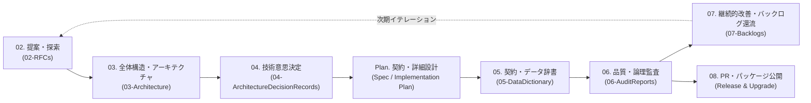

# 📐 VK.Blocks Enterprise Engineering Blueprints (`00-Blueprints`)

このディレクトリには、`VK.Blocks` のエンタープライズ開発ライフサイクル（**提案 → 境界定義 → 意思決定 → 契約・実装設計 → アーキテクチャ監査 → バックログ還流**）の各フェーズで使用する標準テンプレートおよび AI Agent 用プロンプト（Blueprints）が格納されています。

---

## 🔄 エンタープライズ開発ライフサイクルと Blueprints の対応表

| 順序 / 識別番号 | フェーズ (SDLC Stage) | Blueprint ファイル | 出力先ディレクトリ | 関連ルール / MCP ツール |
| :---: | :--- | :--- | :--- | :--- |
| **02** | **立項・概念探索 (Pre-Design)** | [02-RfcBlueprint.md](./02-RfcBlueprint.md) | `docs/02-RFCs/` | `PS.03`, `BASE-06` / `/vk-draft-rfc` |
| **03** | **全体構造・アーキテクチャ (Architecture)** | [03-ArchitectureBlueprint.md](./03-ArchitectureBlueprint.md) | `docs/03-Architecture/` | `BASE-12`, `ARCH-01`〜`13` / `/vk-draft-architecture` |
| **04** | **アーキテクチャ意思決定 (ADR)** | [04-AdrBlueprint.md](./04-AdrBlueprint.md) | `docs/04-ArchitectureDecisionRecords/` | `DL.03`, `PS.02` / `/vk-draft-adr` |
| **Plan** | **契約先行・詳細実装計画 (Contract & Spec)** | [Plan-ContractAndImplementationBlueprint.md](./Plan-ContractAndImplementationBlueprint.md) | Implementation Plan | `BASE-01`, `PS.01`, `BB.01`〜`08`, `CS.01`〜`08` / `/vk-draft-impl-plan` |
| **05** | **データ辞書・公開契約カタログ (Data Dictionary)** | [05-DataDictionaryBlueprint.md](./05-DataDictionaryBlueprint.md) | `docs/05-DataDictionary/` | `FS-01`, `FS-02`, `BB.04`, `CS.08` |
| **06** | **深層アーキテクチャ監査 (Audit)** | [06-ArchitectureAuditBlueprint.md](./06-ArchitectureAuditBlueprint.md) | `docs/06-AuditReports/` | `/vk-audit-architecture`, `/vk-audit-fast`, `/vk-audit-semantic` |
| **07** | **技術的負債・タスク管理 (Backlog)** | [07-BacklogItemBlueprint.md](./07-BacklogItemBlueprint.md) | `docs/07-Backlogs/` | `DL.04` / `/vk-add-backlog` |
| **Gate** | **納品・PR完了条件 (DoD Gate)** | [PULL_REQUEST_TEMPLATE.md](/.github/PULL_REQUEST_TEMPLATE.md) | `.github/` | `BASE-03`, `DL.01`, `DL.02` / `/vk-generate-pr-summary` |
| **08** | **パッケージ公開・移行ガイド (Release & Upgrade)** | [08-ReleaseNoteBlueprint.md](./08-ReleaseNoteBlueprint.md) | Release Notes / Changelog | `ARCH-04`, `ARCH-07`, `FS-09` |

---

## 🎯 使い分けガイド (When to Use Which Blueprint)

1. **新しい BuildingBlock や複雑なアルゴリズム（AI・分散制御等）を立ち上げるとき**
   - まず [02-RfcBlueprint.md](./02-RfcBlueprint.md) を使って `docs/02-RFCs/` に提案を作成し、`Goals` / `Non-Goals` と概念メタファー（Metaphor）を合意します。
   - 続いて [03-ArchitectureBlueprint.md](./03-ArchitectureBlueprint.md) に従い、`docs/03-Architecture/{ModuleName}/` にシステム全景図（C4 Context / Container / Sequence）および必要に応じた伴生仕様書（`api-surface.md`、`extension-guide.md`、`failure-modes.md` 等）を策定します（個別モジュールの L3 境界ルールは `src/BuildingBlocks/{ModuleName}/.prompts/module-manifest.md` に集約）。
2. **設計上のトレードオフや Public API の重要決定を行うとき**
   - [04-AdrBlueprint.md](./04-AdrBlueprint.md)（または `/vk-draft-adr`）を使用し、`docs/04-ArchitectureDecisionRecords/{Module}/` に決定事項と代替案の却下理由を記録します。
3. **具体的な機能スライスの実装に入る前**
   - [Plan-ContractAndImplementationBlueprint.md](./Plan-ContractAndImplementationBlueprint.md)（`/vk-draft-impl-plan`）に従い、`PS.01` 監査チェック、ファイル配置（`BB.01`）、エラー定数（`CS.01`）、4経路の受け入れ基準（Given-When-Then）、非機能・セキュリティ境界（`CS.04`, `OR.02`）、DI 構成（`BB.03`）を確定させてからコーディングを開始します。
4. **エラーコード・Enum・テレメトリタグ・DB スキーマの横断カタログを整備するとき**
   - [05-DataDictionaryBlueprint.md](./05-DataDictionaryBlueprint.md) に従い、`docs/05-DataDictionary/` の公開契約カタログおよび `Enums.md`（自動生成）を同期します。
5. **実装完了後のレビュー・品質検証を行うとき**
   - [06-ArchitectureAuditBlueprint.md](./06-ArchitectureAuditBlueprint.md) に基づいて Phase 1〜4 の深層監査を実施し、レポートを `docs/06-AuditReports/{Module}/` に保存します。
6. **監査で検出された課題や将来のロードマップをタスク化するとき**
   - [07-BacklogItemBlueprint.md](./07-BacklogItemBlueprint.md)（`/vk-add-backlog`）を使用し、`docs/07-Backlogs/{Module}/` に優先度付きのアトミックなタスクとして登録します。
7. **コードをマージ・PR 提出およびパッケージをリリースするとき (Delivery & Release)**
   - [PULL_REQUEST_TEMPLATE.md](/.github/PULL_REQUEST_TEMPLATE.md) の Definition of Done (DoD) に従い、ビルド警告ゼロ、テスト4経路、ADR 要否確認を完了します（`/vk-generate-pr-summary`）。
   - バージョン公開時は [08-ReleaseNoteBlueprint.md](./08-ReleaseNoteBlueprint.md) に従い、Breaking Changes の有無と Before/After の移行コードを含むリリースノートを作成します。
