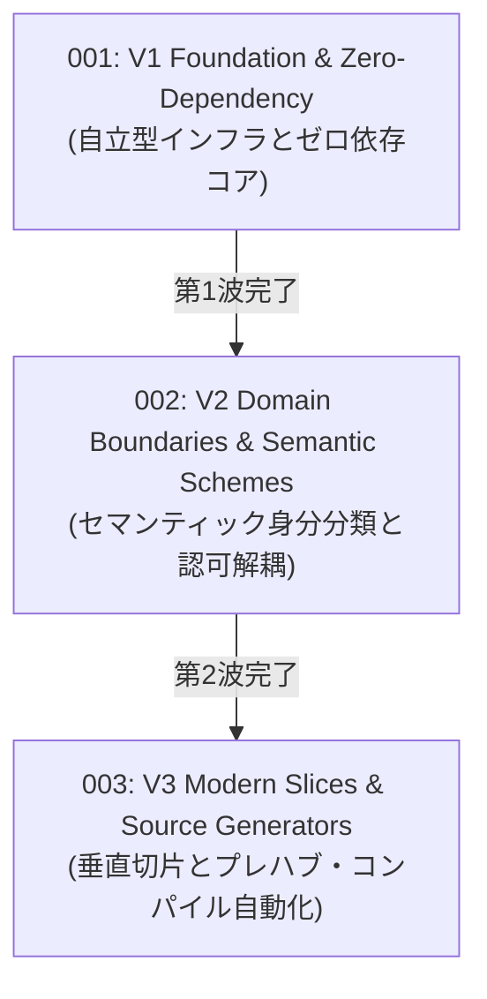

# Authentication RFCs — Evolution Wave Index

このディレクトリには、`VK.Blocks.Authentication` モジュールの歴史的アーキテクチャ進化を記録した Top-Down 概念設計書（RFC）が格納されています。

現存する **23 篇の ADR（Architecture Decision Records）** に記録された具体的な技術的意思決定とトレードオフを、3 つの主要な進化の波（Evolution Waves）として体系化しています。

---

## 🌊 3 つの進化の波 (Three Evolution Waves)

| RFC 番号 / ファイル | 進化の波 (Wave) | コアテーマ & 概念メタファー | 統合・包含された ADR 群 | 状態 |
| :--- | :--- | :--- | :--- | :---: |
| [rfc-001-v1-foundation-and-zero-dependency.md](./rfc-001-v1-foundation-and-zero-dependency.md) | **第1波: 基盤脱却** | **国境検問所の自立型インフラ整備** 外部依存（Redis）の剥離、InMemory デフォルト、ValueTask ゼロアロケーション、自律型ライフサイクル管理 | `ADR-001`〜`007` `ADR-012`, `013`, `017` | ✅ Approved *(Implemented)* |
| [rfc-002-v2-domain-boundaries-and-semantic-schemes.md](./rfc-002-v2-domain-boundaries-and-semantic-schemes.md) | **第2波: 境界確立** | **外交儀典とセマンティック身分証プロトコル** Claims SSOT 解析、認可との完全解耦、セマンティック認証グループ（`User`/`Service`）、Fail-Fast 即時検証 | `ADR-008`〜`011` `ADR-014`, `018`〜`020` | ✅ Approved *(Implemented)* |
| [rfc-003-v3-modern-slices-and-source-generators.md](./rfc-003-v3-modern-slices-and-source-generators.md) | **第3波: 現代化昇格** | **近代モジュラー建築と事前ファブリケーション工場** Source Generator によるリフレクション全廃、高凝集な垂直切片（Vertical Slice）、VK プレフィックス規約 | `ADR-015`, `016` `ADR-021`〜`023` | ✅ Approved *(Implemented)* |

---

## 🔗 関連ドキュメント

- [Architecture Decision Records (ADR)](/docs/04-ArchitectureDecisionRecords/Authentication/README.md) — 23 篇の具体的技術意思決定の原典
- [Module Manifest](/src/BuildingBlocks/Authentication/.prompts/module-manifest.md) — Layer 3 境界ルールと不変条件
- [RFC Blueprint](/docs/00-Blueprints/02-RfcBlueprint.md) — RFC 策定のための標準テンプレート

