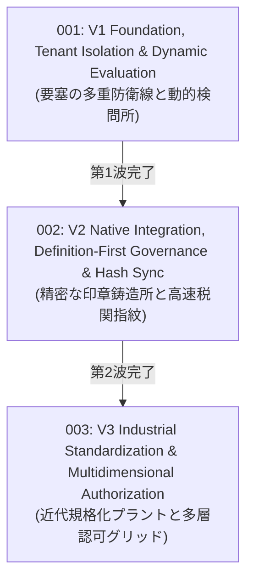

# Authorization RFCs — Evolution Wave Index

このディレクトリには、`VK.Blocks.Authorization` モジュールの歴史的アーキテクチャ進化を記録した Top-Down 概念設計書（RFC）が格納されています。

現存する **17 篇の ADR（Architecture Decision Records）** に記録された具体的な技術的意思決定とトレードオフを、3 つの主要な進化の波（Evolution Waves）として体系化しています。

---

## 🌊 3 つの進化の波 (Three Evolution Waves)

| RFC 番号 / ファイル | 進化の波 (Wave) | コアテーマ & 概念メタファー | 統合・包含された ADR 群 | 状態 |
| :--- | :--- | :--- | :--- | :---: |
| [rfc-001-v1-foundation-and-dynamic-evaluation.md](./rfc-001-v1-foundation-and-dynamic-evaluation.md) | **第1波: 基盤確立と動的評価** | **要塞の多重防衛線と動的検問所** ゼロトラスト・テナント隔離防壁、PBAC 動的ポリシー生成、属性評価器（Attribute Evaluator）パターン、Source Generator による DI 登録・権限カタログ自動化、Result パターンへの準拠 | `ADR-001`〜`005` | ✅ Approved *(Implemented)* |
| [rfc-002-v2-native-integration-and-permission-governance.md](./rfc-002-v2-native-integration-and-permission-governance.md) | **第2波: ネイティブ統合と権限治理** | **精密な印章鋳造所と高速税関指紋** .NET 8+ `IAuthorizationRequirementData` ネイティブ統合、定義優先（Definition-First）スキャン戦略、FNV-1a ハッシュによる $O(1)$ 起動時メタデータ同期、モジュールプレフィックス強制と Misc 治理、垂直スライス階層標準化 | `ADR-006`〜`010` | ✅ Approved *(Implemented)* |
| [rfc-003-v3-industrial-standardization-and-multidimensional-authorization.md](./rfc-003-v3-industrial-standardization-and-multidimensional-authorization.md) | **第3波: 工業規格化と多次元認可** | **近代規格化プラントと多層認可グリッド** Building Block Blueprint (BB.01–BB.05) 完全準拠、`IVKBlockMarker` SG 合成、`IVKAuthorizationBuilder` による 8 段階モジュラー登録、テナント機能認可（Entitlements）、Semantic-Priority パターン、`MergeWith` 拡張、"Settings" 語彙撤廃と `IVKToggleableBlockOptions` 階層 | `ADR-011`〜`017` | ✅ Approved *(Implemented)* |

---

## 🗺️ 全 17 篇 ADR と RFC 進化の波の完全トレーサビリティ対応表 (Traceability Matrix)

各 ADR の個別意思決定がどの RFC 進化の波に統合され、どの技術的ブレークスルーをもたらしたかの対応関係です：

| ADR 識別子 | タイトル / 主題 | 所属 RFC | 中核イノベーション・技術的決定 |
| :--- | :--- | :---: | :--- |
| **[ADR-001](/docs/04-ArchitectureDecisionRecords/Authorization/adr-001-centralize-tenant-isolation-in-authorization-pipeline.md)** | Centralize Tenant Isolation in Authorization Pipeline | **RFC-001** | 認可パイプライン直下に `TenantAuthorizationHandler` を配置し、横断データ漏洩を原理的防御するゼロトラスト防壁を確立 |
| **[ADR-002](/docs/04-ArchitectureDecisionRecords/Authorization/adr-002-establish-dynamic-policy-generation-for-permission-based-authorization.md)** | Establish Dynamic Policy Generation for Permission-Based Authorization | **RFC-001** | `PermissionPolicyProvider` により実行時オンザフライでポリシーを動的生成し、静的登録による Startup 負荷を $O(1)$ 化 |
| **[ADR-003](/docs/04-ArchitectureDecisionRecords/Authorization/adr-003-adopt-attribute-evaluator-pattern-for-extensible-custom-requirements.md)** | Adopt Attribute Evaluator Pattern for Extensible Custom Requirements | **RFC-001** | `IAttributeEvaluator` と `DynamicRequirement` により、業務時間や役職ランク等の認可判定を属性メタデータ駆動で一元化 |
| **[ADR-004](/docs/04-ArchitectureDecisionRecords/Authorization/adr-004-introduce-source-generators-for-authorization-handlers-and-permissions-catalog.md)** | Introduce Source Generators for Authorization Handlers and Permissions Catalog | **RFC-001** | Roslyn Incremental Generator でハンドラー DI 自動登録と権限定数カタログ生成を行い、手動登録漏れとタイポをコンパイル時排除 |
| **[ADR-005](/docs/04-ArchitectureDecisionRecords/Authorization/adr-005-refactor-authorization-evaluation-to-specialized-permission-evaluator-pattern-and-retain-automation.md)** | Refactor Authorization Evaluation to Specialized Permission Evaluator Pattern | **RFC-001** | 汎用ハンドラーを `IPermissionEvaluator` へ特化・昇格させ、`Task<Result<bool>>` による構造化失敗コンテキスト伝搬を確立（`CS.01`） |
| **[ADR-006](/docs/04-ArchitectureDecisionRecords/Authorization/adr-006-iauthorizationrequirementdata.md)** | Modernize Dynamic Policy Evaluation with IAuthorizationRequirementData | **RFC-002** | .NET 8+ `IAuthorizationRequirementData` ネイティブ統合により文字列ポリシーパースを排除し、タグ付き細粒度メトリクス観測性を実現 |
| **[ADR-007](/docs/04-ArchitectureDecisionRecords/Authorization/adr-007-definition-first-permission-discovery-strategy.md)** | Definition-First Permission Discovery Strategy | **RFC-002** | `[GeneratePermissions]` と `[Display]` 定数を唯一の事実ソース (SSOT) とし、強タイプ属性と全量カタログをコンパイル時合成 |
| **[ADR-008](/docs/04-ArchitectureDecisionRecords/Authorization/adr-008-hash-based-metadata-synchronization.md)** | Hash-Based Metadata Synchronization for Startup Performance | **RFC-002** | FNV-1a 64-bit `MetadataHash` による差分判定で起動時 DB 同期を $O(1)$ 最適化し、コールドスタート遅延を 99% 削減 |
| **[ADR-009](/docs/04-ArchitectureDecisionRecords/Authorization/adr-009-permission-naming-and-isolation-strategy.md)** | Permission Naming and Isolation Strategy | **RFC-002** | モジュール名プレフィックス強制と直接文字列属性への `Misc` 治理タグ付与により、大規模マルチモジュール統合時の命名衝突を根絶 |
| **[ADR-010](/docs/04-ArchitectureDecisionRecords/Authorization/adr-010-standardization-of-authorization-vertical-slice-structure-and-delegated-registration.md)** | Standardization of Authorization Vertical Slice Structure and Delegated Registration | **RFC-002** | 各スライスを `[Root]`, `Metadata/`, `Internal/`, `Persistence/` の 4 層に標準化し、中央 DI 登録をスライス委譲型へリファクタリング |
| **[ADR-011](/docs/04-ArchitectureDecisionRecords/Authorization/adr-011-refactor-authorization-building-block-structure-and-naming.md)** | Refactor Authorization Building Block Structure and Naming | **RFC-003** | ルート名前空間への集約（フラット化）、公開型への `VK` プレフィックス強制、および `Internal/` 隔離による利用側 DX の劇的改善 |
| **[ADR-012](/docs/04-ArchitectureDecisionRecords/Authorization/adr-012-authorization-library-architecture-normalization.md)** | Authorization Library Architecture Normalization | **RFC-003** | 全社 Building Block Blueprint (BB.01–BB.05) に完全準拠させ、`IVKBlockMarker` の実装と内部型の隠蔽深度を確立 |
| **[ADR-013](/docs/04-ArchitectureDecisionRecords/Authorization/adr-013-feature-sliced-modular-registration-pattern.md)** | Feature-Sliced Modular Registration Pattern | **RFC-003** | `IVKAuthorizationBuilder` による流暢なチェーン登録 API と、各スライス独立の 8 段階べき等登録シーケンス（`BB.03`）を実装 |
| **[ADR-014](/docs/04-ArchitectureDecisionRecords/Authorization/adr-014-automated-block-identity--metadata-via-source-generation.md)** | Automated Block Identity & Metadata via Source Generation | **RFC-003** | `[VKBlockMarker]` から URN（`"VK.Blocks.Authorization"`）とアセンブリバージョンを Source Generator で自動合成し型安全性を確保 |
| **[ADR-015](/docs/04-ArchitectureDecisionRecords/Authorization/adr-015-tenant-level-capability-authorization-entitlements.md)** | Tenant-Level Capability Authorization (Entitlements) | **RFC-003** | テナント契約プラン認可（Entitlements）を属性ベース（`[VKRequireTenantFeature]`）で制御し、ユーザー PBAC との多次元認可グリッドを構築 |
| **[ADR-016](/docs/04-ArchitectureDecisionRecords/Authorization/adr-016-authorization-block-normalization-and-core-protocol-standardization.md)** | Authorization Block Normalization and Core Protocol Standardization | **RFC-003** | Semantic-Priority パターン（明示的インターフェース実装）と `MergeWith` 拡張によるゼロオーバーヘッドな設定合成（`AP.05`）を標準化 |
| **[ADR-017](/docs/04-ArchitectureDecisionRecords/Authorization/adr-017-rename-feature-settings-to-options-and-align-with-toggleable-contract.md)** | Rename Feature Settings to Options and Align with Toggleable Contract | **RFC-003** | "Settings" 語彙を全廃し "Options" に統一。`IVKToggleableBlockOptions` 契約階層の二者択一化と Source Generator の一本化を完備 |

---

## 🔗 関連ドキュメント

- [Global RFC Landscape (全社 RFC 全景)](/docs/02-RFCs/README.md) — 各サブシステムの概念設計書インデックス
- [Architecture Decision Records (ADR)](/docs/04-ArchitectureDecisionRecords/Authorization/README.md) — 17 篇の具体的技術意思決定の原典
- [Module Manifest](/src/BuildingBlocks/Authorization/.prompts/module-manifest.md) — Layer 3 境界ルールと不変条件
- [RFC Blueprint](/docs/00-Blueprints/02-RfcBlueprint.md) — RFC 策定のための標準テンプレート
- [Architecture Audit Report](/docs/06-AuditReports/Authorization/Authorization_20260409.md) — 包括的アーキテクチャ監査レポート
