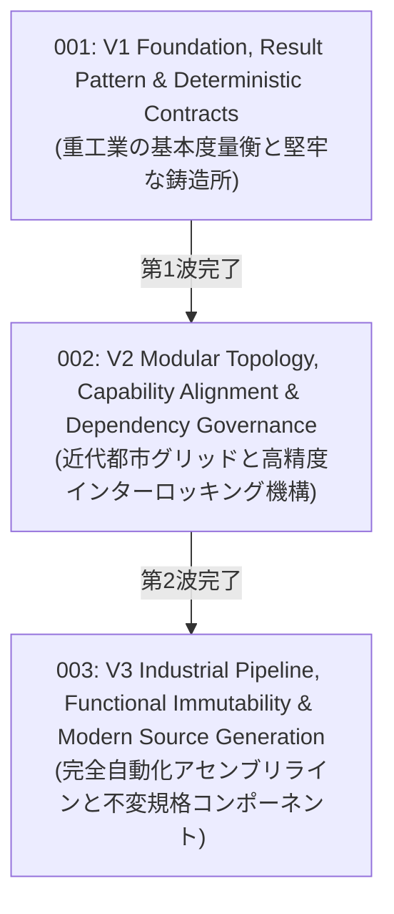

# Core RFCs — Evolution Wave Index

このディレクトリには、`VK.Blocks.Core` モジュールの歴史的アーキテクチャ進化を記録した Top-Down 概念設計書（RFC）が格納されています。

現存する **20 篇の ADR（Architecture Decision Records）** に記録された具体的な技術的意思決定とトレードオフを、3 つの主要な進化の波（Evolution Waves）として体系化しています。

---

## 🌊 3 つの進化の波 (Three Evolution Waves)

| RFC 番号 / ファイル | 進化の波 (Wave) | コアテーマ & 概念メタファー | 統合・包含された ADR 群 | 状態 |
| :--- | :--- | :--- | :--- | :---: |
| [rfc-001-v1-foundation-result-pattern-and-deterministic-contracts.md](./rfc-001-v1-foundation-result-pattern-and-deterministic-contracts.md) | **第1波: 基盤確立と決定論的コア契約** | **重工業の基本度量衡と堅牢な鋳造所** 全局 ErrorType 拡張、VKResult/VKError 標準化、成功インスタンスキャッシュ、ゼロアロケーション最適化、VKBaseException と RFC 7807 障害モデル、決定論的抽象（IVKGuidGenerator, TimeProvider）、同期状態抽象（ISyncStateStore） | `ADR-001`, `002` `ADR-004`, `010` `ADR-011`, `013` `ADR-015` | ✅ Approved *(Implemented)* |
| [rfc-002-v2-modular-topology-capability-alignment-and-dependency-governance.md](./rfc-002-v2-modular-topology-capability-alignment-and-dependency-governance.md) | **第2波: モジュラー形態学と依存性統治** | **近代都市グリッドと高精度インターロッキング機構** サービスマーカーパターン（IVKBlockMarker）、C# 11 Static Abstract による構成セクション解決（IVKBlockOptions）、12 機能スライスへの解体・アライメント、Source Generator による Instance 注入、先行走査（Pre-order）と循環依存検知（Cycle Detection）、VK プレフィックス規約と Internal 隠蔽、DI 拡張 3 分割（Registration/Query/Builder） | `ADR-003`, `005` `ADR-006`, `007` `ADR-008`, `009` `ADR-012` | ✅ Approved *(Implemented)* |
| [rfc-003-v3-industrial-pipeline-functional-immutability-and-source-generation.md](./rfc-003-v3-industrial-pipeline-functional-immutability-and-source-generation.md) | **第3波: 工業化パイプライン、関数型不変性とコード生成統合** | **完全自動化アセンブリラインと不変規格コンポーネント** 階層的構成パターン（Options 既定値 + リクエスト Args 動的上書き）、Func&lt;T, T&gt; と with 式による関数型不変オプション変換、二重バインド排除と services.Replace による順序非依存 DI 登録、汎用エントリー判定エンジン（IVKEntryFilter / VKFilterVerdict）、多段パイプライン実行基底（IVKPipeline / VKPipelineExecutorBase）、[VKOptions] への Args 生成責務集約とゼロオーバーヘッド | `ADR-014`, `016` `ADR-017`, `018` `ADR-019`, `020` | ✅ Approved *(Implemented)* |

---

## 🔗 関連ドキュメント

- [Architecture Decision Records (ADR)](/docs/04-ArchitectureDecisionRecords/Core/README.md) — 20 篇の具体的技術意思決定の原典
- [Module Manifest](/src/BuildingBlocks/Core/.prompts/module-manifest.md) — Layer 3 境界ルールと不変条件
- [RFC Blueprint](/docs/00-Blueprints/02-RfcBlueprint.md) — RFC 策定のための標準テンプレート
- [Architecture Specification](/src/BuildingBlocks/Core/README.md) — Core ライブラリの包括的アーキテクチャ仕様書
