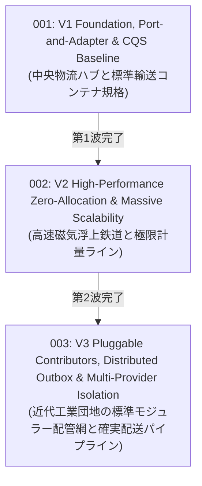

# Persistence RFCs — Evolution Wave Index

このディレクトリには、`VK.Blocks` 永続化サブシステム（`Persistence`, `Persistence.EFCore`, `Persistence.EFCore.Cosmos`, `Persistence.EFCore.Sqlite`）の歴史的アーキテクチャ進化を記録した Top-Down 概念設計書（RFC）が格納されています。

現存する **22 篇の ADR（Architecture Decision Records）** に記録された具体的な技術的意思決定とトレードオフを、3 つの主要な進化の波（Evolution Waves）として体系化しています。

---

## 🌊 3 つの進化の波 (Three Evolution Waves)

| RFC 番号 / ファイル | 進化の波 (Wave) | コアテーマ & 概念メタファー | 統合・包含された ADR 群 | 状態 |
| :--- | :--- | :--- | :--- | :---: |
| [rfc-001-v1-foundation-port-and-adapter-and-cqs-baseline.md](./rfc-001-v1-foundation-port-and-adapter-and-cqs-baseline.md) | **第1波: 基盤確立とポート分離** | **中央物流ハブと標準輸送コンテナ規格** ORM 非依存の純粋コア抽出（`ARCH-02`, `ARCH-03`）、CQS/ISP に基づくリポジトリ直交分離（Read/Write/Bulk/System）、Unit of Work によるコミット責務一元化、監査基盤の疎結合化と Null Object パターン | `Persistence`: `ADR-001`, `002`  `Persistence.EFCore`: `ADR-001`, `006` `ADR-007`, `010`, `011` | ✅ Approved *(Implemented)* |
| [rfc-002-v2-high-performance-zero-allocation-and-massive-scalability.md](./rfc-002-v2-high-performance-zero-allocation-and-massive-scalability.md) | **第2波: 高性能と極限最適化** | **高速磁気浮上鉄道と極限計量ライン** CLR 静的ジェネリック型メタデータキャッシュ、Expression Tree 式木コンパイル結果のメモ化、`IAsyncEnumerable` による 95% メモリ削減ストリーミング、Deep Pagination を解決する双方向カーソルページネーション、HMAC-SHA256 カーソルシリアライザー、.NET 10 Bulk 更新アダプター | `Persistence.EFCore`: `ADR-002`〜`005` `ADR-008`, `009`, `012` | ✅ Approved *(Implemented)* |
| [rfc-003-v3-pluggable-contributors-distributed-outbox-and-multi-provider-isolation.md](./rfc-003-v3-pluggable-contributors-distributed-outbox-and-multi-provider-isolation.md) | **第3波: 工業化拡張と分散協調** | **近代工業団地の標準モジュラー配管網と確実配送パイプライン** `IVKModelCreatingContributor` 等によるモデル構成・グローバルフィルターの完全 OCP プラガブル化、Dual-Write 消失を根絶する Transactional Outbox インターセプター、決定論的物理カラム順序規約、Cosmos DB の Session Token 透伝と TransactionalBatch、SQLite の EF1001 内部 API 撤廃と Model Convention 標準化 | `Persistence.EFCore`: `ADR-013`〜`015`  `Persistence.EFCore.Cosmos`: `ADR-001`〜`003`  `Persistence.EFCore.Sqlite`: `ADR-001`, `002` | ✅ Approved *(Implemented)* |

---

## 🔗 関連ドキュメント

- **Architecture Decision Records (ADR)**:
  - [Persistence Core ADRs](/docs/04-ArchitectureDecisionRecords/Persistence/README.md) — 2 篇の純粋永続化ポート設計原典
  - [Persistence.EFCore ADRs](/docs/04-ArchitectureDecisionRecords/Persistence.EFCore/README.md) — 15 篇の EF Core 基座・性能最適化原典
  - [Persistence.EFCore.Cosmos ADRs](/docs/04-ArchitectureDecisionRecords/Persistence.EFCore.Cosmos/README.md) — 3 篇の Cosmos DB 分散設計原典
  - [Persistence.EFCore.Sqlite ADRs](/docs/04-ArchitectureDecisionRecords/Persistence.EFCore.Sqlite/README.md) — 2 篇の SQLite 安定化設計原典
- **Module Manifests**:
  - [Persistence Manifest](/src/BuildingBlocks/Persistence/.prompts/module-manifest.md)
  - [Persistence.EFCore Manifest](/src/BuildingBlocks/Persistence.EFCore/.prompts/module-manifest.md)
- **RFC Blueprint**:
  - [02-RfcBlueprint.md](/docs/00-Blueprints/02-RfcBlueprint.md)

