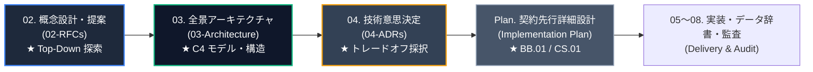
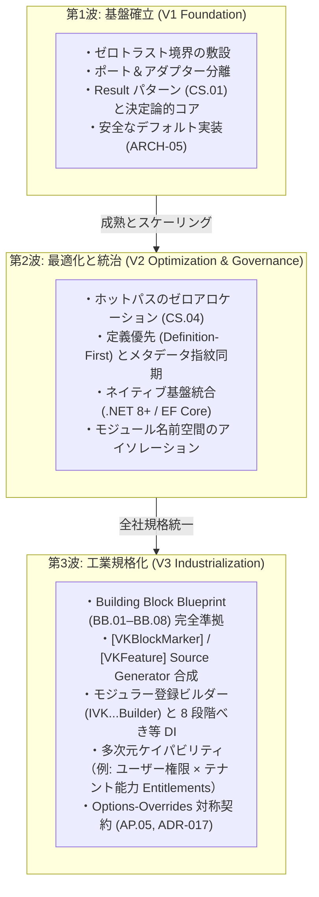

# 🧭 VK.Blocks Global RFC Landscape (`docs/02-RFCs`)

本文書は、`VK.Blocks` 全社マイクロサービス共通基盤における **Top-Down 概念設計書（RFC: Request for Comments）体系** を統括するルートドキュメントです。

複雑な新規 BuildingBlock、大規模な機能スライス、あるいは破壊的変更を伴うアーキテクチャ刷新において、コード実装やバックログ分解に先立ち、人間の直感に訴える「メンタルモデル（概念メタファー）」、明確な「目標と非目標（Goals & Non-Goals）」、および「主要インターフェース契約（Contract Blueprint）」を合意形成するための単一事実ソース（SSOT）として機能します（`PS.03`, `BASE-06` 準拠）。

---

## 🔄 エンタープライズ開発ライフサイクルにおける RFC の位置づけ

各サブシステムは、多数の個別 ADR（Architecture Decision Records）に蓄積された技術的意思決定を、**3 つの歴史的進化の波（Evolution Waves: V1 基盤確立 ➡️ V2 最適化・統治 ➡️ V3 工業規格化）** として RFC に統合・再構成しています。

---

## 📦 サブシステム別 RFC インデックス一覧 (Subsystem RFC Index)

| サブシステム (Domain) | 主管パッケージ (Target Modules) | RFC インデックス (Subsystem README) | 進化の波 (RFC Waves) | 統合・包含された ADR 数 | 状態 |
| :--- | :--- | :--- | :--- | :---: | :---: |
| **Authorization** | `VK.Blocks.Authorization` `VK.Blocks.MultiTenancy.Authorization` `VK.Tools.SourceGenerators` | [Authorization/README.md](./Authorization/README.md) | • [001: V1 Foundation & Dynamic Evaluation](./Authorization/001-v1-foundation-and-dynamic-evaluation.md) • [002: V2 Native Integration & Governance](./Authorization/002-v2-native-integration-and-permission-governance.md) • [003: V3 Industrial & Multidimensional Entitlements](./Authorization/003-v3-industrial-standardization-and-multidimensional-authorization.md) | 17 篇 (`ADR-001`〜`017`) | ✅ Approved |
| **Authentication** | `VK.Blocks.Authentication` `VK.Blocks.Authentication.OpenIdConnect` `VK.Blocks.Authentication.Saml` `VK.Blocks.Authentication.StackExchangeRedis` | [Authentication/README.md](./Authentication/README.md) | • [001: V1 Foundation & Zero-Dependency](./Authentication/001-v1-foundation-and-zero-dependency.md) • [002: V2 Domain Boundaries & Semantic Schemes](./Authentication/002-v2-domain-boundaries-and-semantic-schemes.md) • [003: V3 Modern Slices & Source Generators](./Authentication/003-v3-modern-slices-and-source-generators.md) | 23 篇 (`ADR-001`〜`023`) | ✅ Approved |
| **Core** | `VK.Blocks.Core` `VK.Blocks.Core.Diagnostics` | [Core/README.md](./Core/README.md) | • [001: V1 Foundation, Result & Determinism](./Core/001-v1-foundation-result-pattern-and-deterministic-contracts.md) • [002: V2 Modular Topology & Governance](./Core/002-v2-modular-topology-capability-alignment-and-dependency-governance.md) • [003: V3 Industrial Pipeline & Immutability](./Core/003-v3-industrial-pipeline-functional-immutability-and-source-generation.md) | 20 篇 (`ADR-001`〜`020`) | ✅ Approved |
| **Persistence** | `VK.Blocks.Persistence` `VK.Blocks.Persistence.EFCore` `VK.Blocks.Persistence.EFCore.Cosmos` `VK.Blocks.Persistence.EFCore.Sqlite` | [Persistence/README.md](./Persistence/README.md) | • [001: V1 Foundation Port & CQS Baseline](./Persistence/001-v1-foundation-port-and-adapter-and-cqs-baseline.md) • [002: V2 High-Performance Zero-Allocation](./Persistence/002-v2-high-performance-zero-allocation-and-massive-scalability.md) • [003: V3 Pluggable Contributors & Distributed Outbox](./Persistence/003-v3-pluggable-contributors-distributed-outbox-and-multi-provider-isolation.md) | 22 篇 (`Persistence` 2篇, `EFCore` 15篇, `Cosmos` 3篇, `Sqlite` 2篇) | ✅ Approved |
| **Resilience** | `VK.Blocks.Resilience` `VK.Blocks.Resilience.Polly` | [Resilience/README.md](./Resilience/README.md) | • [001: V1 Foundation & Polly Separation](./Resilience/001-v1-foundation-resilience-abstractions-and-polly-separation.md) • [002: V2 Modular Slices & Composite Pipeline](./Resilience/002-v2-modular-vertical-slices-and-composite-pipeline.md) • [003: V3 Thin Contract & Polly v8 Engine](./Resilience/003-v3-thin-contract-pure-delegation-and-polly-v8-engine.md) | 5 篇 (`ADR-001`〜`005`) | ✅ Approved |
| **VectorStore** | `VK.Blocks.VectorStore` `VK.Blocks.VectorStore.Pgvector` `VK.Blocks.VectorStore.Qdrant` `VK.Blocks.VectorStore.Cosmos` `VK.Blocks.VectorStore.Sqlite` | [VectorStore/README.md](./VectorStore/README.md) | • [001: V1 Foundation Promotion, Bulk Operations & In-Process SQLite Engine](./VectorStore/001-v1-foundation-promotion-and-bulk-operations.md) • [002: V2 Vector Ecosystem Modernization & Multi-Provider Architecture](./VectorStore/002-v2-vector-ecosystem-modernization.md) | 6 篇 (`VectorStore` 4篇, `VectorStore.Sqlite` 2篇) | ✅ Approved |
| **VectorSearch** | `VK.Blocks.VectorSearch` `VK.Blocks.VectorSearch.Sqlite` | [VectorSearch/README.md](./VectorSearch/README.md) | • [001: V1 Standalone Rank Fusion & RRF Engine](./VectorSearch/001-v1-standalone-rank-fusion-engine-and-rrf.md) • [002: V2 Pipeline Orchestration & Context Compression](./VectorSearch/002-v2-pipeline-orchestration-and-context-compression.md) | 3 篇 (`ADR-001`〜`003`) | ✅ Approved |
| **VectorIngest** | `VK.Blocks.VectorIngest` | [VectorIngest/README.md](./VectorIngest/README.md) | • [001: V1 Modular Ingestion & Multi-Strategy Chunking](./VectorIngest/001-v1-modular-document-ingestion-parsing-and-multi-strategy-chunking.md) | 2 篇 (`ADR-001`〜`002`) | ✅ Approved |

---

## 🌊 3 つの進化の波（Evolution Waves）設計方法論

`VK.Blocks` におけるアーキテクチャの成熟プロセスは、以下の共通パターンに従って展開されます：

---

## 🛡️ RFC 策定基準と品質ゲート (Compliance & Quality Gates)

すべての新規 RFC は、以下の原則およびテンプレートを厳格に満たす必要があります：

1. **RFC 策定ブループリント準拠 (`PS.03`)**:
   - 必ず [00-Blueprints/02-RfcBlueprint.md](/docs/00-Blueprints/02-RfcBlueprint.md) の標準見出し構造（1. Motivation ➡️ 2. Goals & Non-Goals ➡️ 3. Metaphor & Mapping ➡️ 4. Contract Blueprint ➡️ 5. Trade-offs ➡️ 6. Implementation Plan）に従うこと。
2. **過剰設計の排除 (Radical YAGNI, `BASE-06`)**:
   - 具体的なコンシューマが存在しない抽象化は禁止。必ず「なぜ今やるのか」および `Non-Goals`（スコープ外）を明記すること。
3. **概念メタファーと対応マッピング (`PS.03`)**:
   - 人間の認知負荷を低減するため、生物学的・物理的・産業的な比喩モデルと技術要素の対照表を必ず含めること。
4. **契約先行・型安全設計 (`BASE-01`, `CS.01`, `AP.01`)**:
   - 実装に先立ち、Level 1 Public API（`VK` プレフィックス）、Options、Args、および `{Module}.{Feature}.{Reason}` 形式のエラー定数を定義すること。
5. **ドキュメントリンク整合性 (`BASE-11`)**:
   - ディレクトリを跨ぐ内部ドキュメントリンクは必ずリポジトリルート相対パス（`/docs/...`, `/src/...`）を使用すること。

---

## 🔗 関連ドキュメント体系

- [00-Blueprints/02-RfcBlueprint.md](/docs/00-Blueprints/02-RfcBlueprint.md) — Top-Down 概念設計書策定プロンプト & テンプレート
- [03-Architecture/README.md](/docs/03-Architecture/README.md) — システム全景アーキテクチャ仕様書インデックス
- [04-ArchitectureDecisionRecords/Authorization/README.md](/docs/04-ArchitectureDecisionRecords/Authorization/README.md) — Authorization 17 篇の技術意思決定原典
- [00-Blueprints/Plan-ContractAndImplementationBlueprint.md](/docs/00-Blueprints/Plan-ContractAndImplementationBlueprint.md) — 詳細実装計画ブループリント

