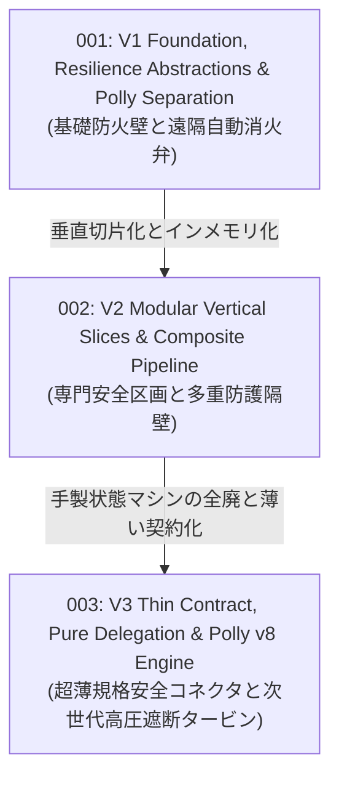

# Resilience RFCs — Evolution Wave Index

このディレクトリには、`VK.Blocks` 耐障害性サブシステム（`VK.Blocks.Resilience`, `VK.Blocks.Resilience.Polly`）の歴史的アーキテクチャ進化を記録した Top-Down 概念設計書（RFC）が格納されています。

現存する **5 篇の ADR（Architecture Decision Records）** に記録された具体的な技術的意思決定とトレードオフを、3 つの主要な進化の波（Evolution Waves）として体系化しています。

---

## 🌊 3 つの進化の波 (Three Evolution Waves)

| RFC 番号 / ファイル | 進化の波 (Wave) | コアテーマ & 概念メタファー | 統合・包含された ADR 群 | 状態 |
| :--- | :--- | :--- | :--- | :---: |
| [rfc-001-v1-foundation-resilience-abstractions-and-polly-separation.md](./rfc-001-v1-foundation-resilience-abstractions-and-polly-separation.md) | **第1波: 基盤確立とエンジン分離** | **基礎防火壁と遠隔自動消火弁** サードパーティ製ライブラリ（Polly）への直接依存を排除し、中立な契約パッケージと具象アダプターを分離。`IResiliencePipeline` と各戦略インターフェース（Retry, Timeout, CircuitBreaker, Bulkhead）の策定。 | `Resilience`: `ADR-001` | ❌ Superseded *(Historic)* |
| [rfc-002-v2-modular-vertical-slices-and-composite-pipeline.md](./rfc-002-v2-modular-vertical-slices-and-composite-pipeline.md) | **第2波: 切片化と手製インメモリ合成** | **専門安全区画と多重防護隔壁** `[VKFeature]` マーカーによる垂直切片化（`BB.01`）、外部 Polly なしで動く手製 In-Memory デフォルト（`Local*`）、`VKResilienceErrors` による Result パターン（`CS.01`）統合、`DefaultPolicyBuilder` による複合パイプライン合成、およびステップ複合設定 `VKStepResiliencePolicy`。 | `Resilience`: `ADR-002`, `ADR-003` `ADR-004` | ❌ Superseded *(Historic)* |
| [rfc-003-v3-thin-contract-pure-delegation-and-polly-v8-engine.md](./rfc-003-v3-thin-contract-pure-delegation-and-polly-v8-engine.md) | **第3波: 薄契约化と Polly v8 委任** | **超薄規格安全コネクタと次世代高圧遮断タービン** 手製状態マシン（自作セマフォ/断路器/リトライループ）約 1,000 行を完全撤廃。`IVKResilienceExecutor` を唯一の実行ポートとする「薄い契約」への純化、`NoOpResilienceExecutor` の Fallback 同梱、Polly v8（`Microsoft.Extensions.Resilience`）への全面委譲、Adapter 内部閉環例外ブリッジによる `VKResult<T>` の結果感知、および AI P99 尾遅延対衝（Hedging）。 | `Resilience`: `ADR-005` | ✅ Approved *(Implemented)* |

---

## 🔗 関連ドキュメント

- **Architecture Decision Records (ADR)**:
  - [Resilience ADR Index](/docs/04-ArchitectureDecisionRecords/Resilience/README.md) — 5 篇の耐障害性設計決定原典
- **System Architecture**:
  - [Resilience Architecture Specification](/docs/03-Architecture/Resilience/README.md) — サブシステム全景と C4 仕様書
- **RFC Blueprint**:
  - [02-RfcBlueprint.md](/docs/00-Blueprints/02-RfcBlueprint.md)

