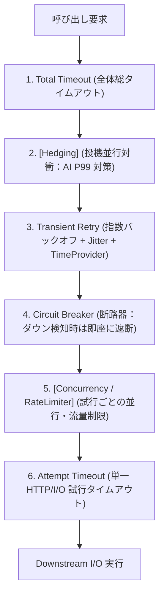

# RFC-003: V3 Thin Contract, Pure Delegation & Polly v8 Engine

- **Status**: ✅ Approved *(Implemented)*
- **Author**: Architecture Core Team
- **Date**: 2026-10-30
- **Target Module(s)**: `VK.Blocks.Resilience`, `VK.Blocks.Resilience.Polly`
- **Related ADRs**: [ADR-005](/docs/04-ArchitectureDecisionRecords/Resilience/adr-005-transition-to-thin-contract-and-polly-v8-engine.md)

---

## 1. 🎯 Motivation & Problem Statement (背景と課題定義)

### 1.1 現状の課題 (Current Pain Points)
V2（RFC-002）で導入した手製の In-Memory 実装（`LocalBulkhead`, `LocalCircuitBreaker`, `LocalRateLimiter`, `LocalRetryExecutor`）は、産業標準の Polly v8 と比較して以下の決定的な課題を抱えていた：
1. **車輪の再発明と並行性リスク（`BASE-06` 違反）**: 自作のセマフォや状態マシンは約 1,000 行に達し、指数退避の Jitter 計算や正確な失敗率サンプリング窓の管理において潜在的リスクを抱えていた。
2. **多面的な依存注入の肥大化**: 呼び出し元が `IVKRetryExecutor`, `IVKTimeoutExecutor`, `IVKCircuitBreaker` などを個別に注入する必要があった。
3. **VKResult と例外制御流の不整合（`BASE-05` 違反）**: Polly 等の外部エンジンは例外（Exception）で動作するが、VK.Blocks では一過性エラーも `VKResult<T>` で表現する。この橋渡しが未整備であった。

### 1.2 なぜ今やるのか (Why Now / Consumer)
.NET 8+ / .NET 10 環境において、マイクロソフトと Polly チームが共同開発した `Microsoft.Extensions.Resilience`（Polly v8）が業界デファクトとなり、ゼロアロケーション（`CS.04`）、高速な実行パイプライン、およびネイティブな OpenTelemetry / `TimeProvider` 統合を提供している。
`AI.Cortex`（LLM 推論）や `Workflow` は、手製の不安定なループではなく、最高峰のパフォーマンスと P99 尾遅延対衝（Hedging）を必要としている。

## 2. 🧭 Goals & Non-Goals (目標と非目標)

- **Goals**:
  - `VK.Blocks.Resilience` を **薄い契約（Thin Contract）** に純化し、手製状態マシンを完全排出。
  - 単一の統一実行ポート **`IVKResilienceExecutor`**（`CS.03` に従い戻り値は `Task<T>`）を策定。
  - パススルーで即時完了する `NoOpResilienceExecutor` を Fallback Tier（`ARCH-05`）として契約内に同梱。
  - `VK.Blocks.Resilience.Polly` を唯一の実行エンジンとし、`services.Replace()`（Provided Tier, `AP.06`）で決定論的に上書き。
  - **Adapter 内部閉環例外ブリッジパターン** により、Application 層には一切例外を出さずに `VKResult<T>` の一過性エラーによるリトライ・熔断を実現。
  - AI P99 尾遅延削減のための **Hedging（対衝投機実行）** ストラテジーの正式導入。
- **Non-Goals (`BASE-06`)**:
  - Polly 固有の型（`ResiliencePipeline` 等）を公共 API に露出させること（すべて `internal` に完全封じ込め）。

## 3. 🧬 Metaphor & Mapping (メンタルモデルと構造マッピング)

- **Metaphor (超薄規格安全コネクタと次世代高圧遮断タービン)**:
  壁面には規格化された超薄型の「安全コネクタ（`IVKResilienceExecutor`）」のみを埋め込み、配管の奥には最新鋭の「高圧遮断タービン（Polly v8 エンジン）」を直結する。タービンが未接続の現場でも、コネクタ内部のバイパス弁（`NoOpResilienceExecutor`）が作動して業務は停止しない。

| Metaphor Component (概念要素) | Technical Artifact (技術要素) | Layer / Scope | Responsibility (責務) |
| :--- | :--- | :--- | :--- |
| 超薄規格安全コネクタ | `IVKResilienceExecutor` | Public Protocol (`Resilience`) | 統一実行ポート（Task&lt;T&gt; 返却） |
| 自動バイパス弁 (Fallback) | `NoOpResilienceExecutor` | `Internal/` (`Resilience`) | エンジン非導入時のパススルー実行 |
| 高圧遮断タービン (Engine) | `PollyResilienceExecutor` | `Internal/` (`Resilience.Polly`) | Polly v8 パイプライン委任実行 |
| 内部安全減圧弁 (Bridge) | `VKResilienceTransientFailureException` | `Internal/` (`Resilience.Polly`) | Adapter 内完結の VKResult 橋渡し例外 |

## 4. 🏗️ Contract & Code Blueprint (契約と主要インターフェース設計)

```csharp
// [BASE-01, CS.03, AP.01]
namespace VK.Blocks.Resilience;

public interface IVKResilienceExecutor
{
    Task<T> ExecuteAsync<T>(
        string pipelineName,
        Func<CancellationToken, Task<T>> action,
        CancellationToken cancellationToken = default);

    Task<T> ExecuteAsync<T>(
        string pipelineName,
        Func<CancellationToken, ValueTask<T>> action,
        CancellationToken cancellationToken = default);

    Task<VKResult<T>> ExecuteResultAsync<T>(
        string pipelineName,
        Func<CancellationToken, Task<VKResult<T>>> action,
        CancellationToken cancellationToken = default);
}
```

### 4.1 パイプライン固定スタッキング順序 (`OR.03`)



## 5. 達成された価値と波及効果

1. **約 1,000 行の手製並行コードの全廃**: 保守負債と潜在的死鎖リスクを根絶。
2. **呼び出し元の簡素化**: `AI.Cortex` などの上位オーケストレーターは `IVKResilienceExecutor` 1 本に依存するだけで、すべての耐障害性ポリシーを享受可能。
3. **無例外制御流の完全防護**: 外部通信失敗が `VKResult<T>` で戻る場合も、Adapter 内部で安全にリトライが起動し、ビジネス層へは例外が漏洩しない。

