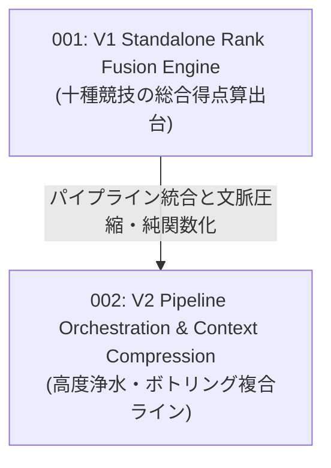

# VectorSearch RFCs — Evolution Wave Index

このディレクトリには、`VK.Blocks.VectorSearch` モジュールのアーキテクチャ進化を記録した Top-Down 概念設計書（RFC）が格納されています。

現存する **3 篇の ADR（Architecture Decision Records）** に記録された技術的意思決定を、2 つの主要な進化の波（Evolution Waves）として体系化しています。

---

## 🌊 2 つの進化の波 (Two Evolution Waves)

| RFC 番号 / ファイル | 進化の波 (Wave) | コアテーマ & 概念メタファー | 統合・包含された ADR 群 | 状態 |
| :--- | :--- | :--- | :--- | :---: |
| [rfc-001-v1-standalone-rank-fusion-engine-and-rrf.md](./rfc-001-v1-standalone-rank-fusion-engine-and-rrf.md) | **第1波: スコア融合エンジンの独立** | **十種競技の総合得点算出台** 密ベクトル類似度とテキスト BM25 頻度スコアという単位の異なる結果を公平に統合する、相互ランク融合（RRF）および加重スコア融合（Weighted）のアルゴリズムカプセル化。 | `VectorSearch`: `ADR-001` | ❌ Superseded *(Historic)* |
| [rfc-002-v2-pipeline-orchestration-and-context-compression.md](./rfc-002-v2-pipeline-orchestration-and-context-compression.md) | **第2波: パイプライン統治と文脈圧縮** | **高度浄水・ボトリング複合ライン** 検索ライフサイクルのパイプライン化（Search Guard、セマンティックキャッシュ、クエリ書き換え、リランキング）。検索戦略の抽象化（`IVKSearchStrategy`）と LLM トークン上限を守る文脈圧縮（Context Compression）。RRF の I/O フリー純関数化（`ARCH-03`）とエンジン下推能力交渉。 | `VectorSearch`: `ADR-002`, `ADR-003` `VectorStore`: `ADR-004` | ✅ Approved *(Implemented)* |

---

## 🔗 関連ドキュメント

- **Architecture Decision Records (ADR)**:
  - [VectorSearch ADR Index](/docs/04-ArchitectureDecisionRecords/VectorSearch/README.md) — 3 篇の検索設計決定原典
- **System Architecture**:
  - [VectorSearch Architecture Specification](/docs/03-Architecture/VectorSearch/README.md) — サブシステム全景仕様書
- **RFC Blueprint**:
  - [02-RfcBlueprint.md](/docs/00-Blueprints/02-RfcBlueprint.md)

