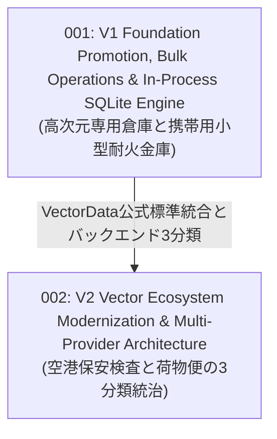

# VectorStore RFCs — Evolution Wave Index

このディレクトリには、`VK.Blocks` ベクトルストア基盤（`VK.Blocks.VectorStore` および各種 Provider: `Pgvector`, `Qdrant`, `Cosmos`, `Sqlite`）のアーキテクチャ進化を記録した Top-Down 概念設計書（RFC）が格納されています。

現存する **6 篇の ADR（VectorStore 4 篇, VectorStore.Sqlite 2 篇）** に記録された技術的意思決定を、2 つの主要な進化の波（Evolution Waves）として体系化しています。

---

## 🌊 2 つの進化の波 (Two Evolution Waves)

| RFC 番号 / ファイル | 進化の波 (Wave) | コアテーマ & 概念メタファー | 統合・包含された ADR 群 | 状態 |
| :--- | :--- | :--- | :--- | :---: |
| [rfc-001-v1-foundation-promotion-and-bulk-operations.md](./rfc-001-v1-foundation-promotion-and-bulk-operations.md) | **第1波: 基盤確立と組込 SQLite** | **高次元専用倉庫と携帯用小型耐火金庫** AI ドメイン配下のサブ名前空間からルートレベル BuildingBlock への昇格。`IVKVectorStore` / `IVKVectorCollection` コア抽象、大量ドキュメント書き込みスループットを確保する `IVKBulkCapableVectorStore` バルクインターフェースの確立、および外部 Docker 不要でローカルディスクに永続化可能な `sqlite-vec` 組込エンジンの確立。 | `VectorStore`: `ADR-001`, `ADR-002`  `VectorStore.Sqlite`: `ADR-001`, `ADR-002` | ❌ Superseded *(Historic)* |
| [rfc-002-v2-vector-ecosystem-modernization.md](./rfc-002-v2-vector-ecosystem-modernization.md) | **第2波: エコシステム標準化とガバナンス** | **空港保安検査と荷物便の3分類統治** `Microsoft.Extensions.VectorData.Abstractions` を公式基盤として取り込み、VK は `VKResult`・強制テナント分離・診断に特化。バックエンドを専用エンジン（Qdrant）・リレーショナル列（pgvector）・組み込み（SQLite/InMemory）の 3 分類に再編し、EF Core との責務衝突を解消。RRF 融合の純関数化と下推能力交渉。 | `VectorStore`: `ADR-003`, `ADR-004` | ✅ Approved *(Implemented)* |

---

## 🔗 関連ドキュメント

- **Architecture Decision Records (ADR)**:
  - [VectorStore ADR Index](/docs/04-ArchitectureDecisionRecords/VectorStore/README.md) — 4 篇のベクトルストア設計決定原典
  - [VectorStore.Sqlite ADR Index](/docs/04-ArchitectureDecisionRecords/VectorStore.Sqlite/README.md) — 2 篇の SQLite 組込ベクトルストア設計決定原典
- **System Architecture**:
  - [VectorStore Architecture Specification](/docs/03-Architecture/VectorStore/README.md) — サブシステム全景仕様書
- **RFC Blueprint**:
  - [02-RfcBlueprint.md](/docs/00-Blueprints/02-RfcBlueprint.md)
