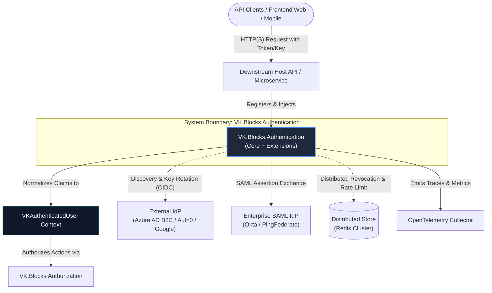
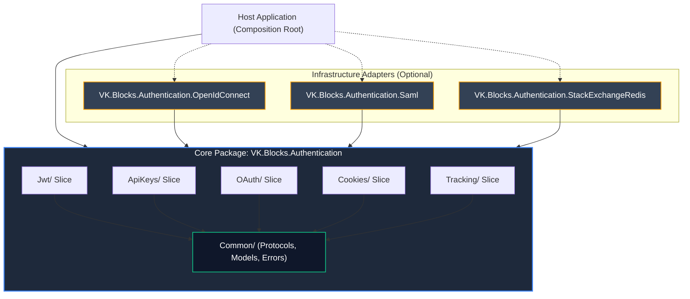
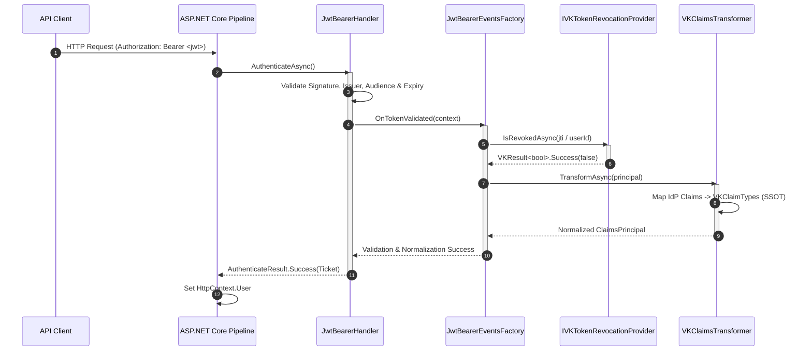
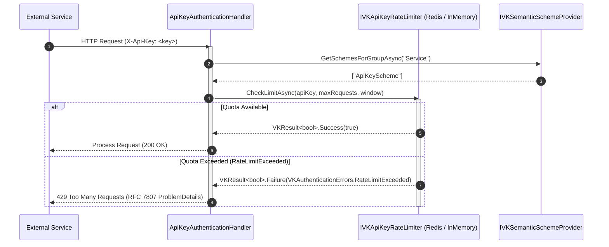
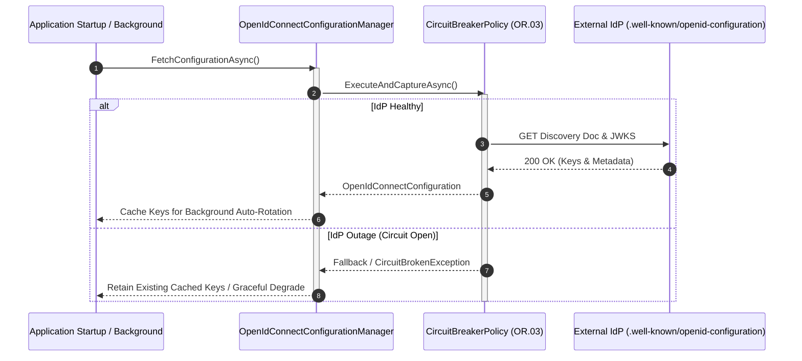

# 🏛️ Architecture: VK.Blocks.Authentication

- **System ID / Package ID**: `VK.Blocks.Authentication`
- **Domain / Area**: `Security`
- **Primary Owner / Architect**: Security Architecture Team & AI Pair
- **Target Layer**: L2 Domain BuildingBlock / L3 Infrastructure Adapters
- **Status**: 🏛️ Accepted
- **Last Verified**: 2026-10-29

---

## 1. 🎯 概要と範囲 (Overview & Scope)

### 1.1 エレベーターピッチ・要約 (Elevator Pitch)
`VK.Blocks.Authentication` は、ASP.NET Core 向けに設計された**構成駆動型・零外部依存・セマンティック認証基盤**です。JWT（ローカル対称鍵 / OIDC JWKS）、API Key、OAuth などの多様な物理プロトコルを透過的に束ね、高頻度ホットパスにおけるゼロアロケーション（`ValueTask`）と Native AOT（Source Generator 駆動）を保証しつつ、下流アプリケーションへ統一された身份識別情報（`VKAuthenticatedUser`）を提供します。

### 1.2 スコープ境界 (Goals & Non-Goals — `BASE-06`)

- **包含する領域 (In-Scope / Goals)**:
  - **Zero-Dependency Core & InMemory Default (`ARCH-05`)**: 外部 Redis を必要とせず、ローカル開発・テストが即座に動作するスレッドセーフな InMemory 実装の同梱。
  - **セマンティック認証グループ (`ADR-020`)**: 物理スキーム（Bearer, ApiKey 等）を `[VKAuthGroup("User")]` などの業務的セマンティクスへ抽象化する `IVKSemanticSchemeProvider` の提供。
  - **単一検証・Claims SSOT (`ADR-008`)**: すべての ID 属性抽出を `VKClaimsPrincipalExtensions` および `VKClaimTypes` に集約し、IdP 間の表記揺れを吸収。
  - **失効・レート制限ガバナンス**: JTI / ユーザー単位の即時失効照合と、API Key のアトミック流量制限。
  - **自律的ライフサイクル管理 (`ADR-013`)**: 分散ストア（Redis）接続時に InMemory クリーンアップタイマーを自動停止する自己適応設計。

- **明確に除外する領域 (Out-of-Scope / Non-Goals)**:
  - **アクセス認可・ポリシー判定 (`ADR-019`)**: ロール、権限、RBAC/PBAC の評価は `VK.Blocks.Authorization` の排他的責務とし、本ブロック内では一切関与しない。
  - **ユーザーアカウント管理・資格情報永続化**: ユーザー登録、パスワードハッシュ、MFA 秘密鍵の保存は `VK.Blocks.Identity` の責務とし、本モジュールでは扱わない。
  - **強制ステートフルセッション**: トークンベースのステートレス検証を原則とし、Cookie セッションはオプトイン拡張にとどめる。

### 1.3 想定読者と適用バージョン
- **Target Audience**: プラットフォームアーキテクト、マイクロサービス開発者、セキュリティ監査員、AI コーディングエージェント
- **Target Runtime**: .NET 10+, C# 12+ (Strict Mode, Native AOT Ready)

### 1.4 伴生仕様書体系 (Companion Specifications)
本主アーキテクチャ仕様書を補完する個別特化仕様書：
- [api-surface.md](./api-surface.md) 📜: Level 1 公開契約型、`Internal/` カプセル化境界、SemVer 破壊的変更基準
- [extension-guide.md](./extension-guide.md) 🔌: カスタム Provider / Store の実装手順と最小ゴールデンコード
- [failure-modes.md](./failure-modes.md) 💥: 外部ストア・IdP 障害時の挙動、エラーコードハンドブック、SRE 運用 Runbook
- [threat-model.md](./threat-model.md) 🛡️: STRIDE 脅威分析、PII 脱敏、テナント分離境界防護

---

## 2. ⚡ アーキテクチャ牽引要因 (Architectural Drivers)

### 2.1 主要品質属性 (Quality Attributes)

- **性能・ゼロアロケーション (`CS.04`, `AP.01`, `ADR-007`)**:
  - 全 HTTP リクエストが通過する高頻度認証インターフェイス（`IVKApiKeyRateLimiter`, `IVKTokenRevocationProvider`）はすべて `ValueTask` を採用し、キャッシュヒット時のヒープ割り当てをゼロ（$0$ B）に抑制。
  - スキーム解決結果を `FrozenDictionary<string, string[]>` でプリコンパイルし、ランタイムルックアップを $O(1)$ 化。
- **決定論的振る舞い・状態隔離 (`BASE-02`, `CS.06`)**:
  - `DateTime.UtcNow` の直呼びを禁止し、`TimeProvider` 経由で時刻を取得。トークン有効期限・クリーンアップ周期の完全なテスト再現性を担保。
- **テスタビリティ・疎結合 (`DL.01`, `ARCH-02`, `ADR-006`)**:
  - Redis などの外部インフラをモックすることなく、Core 単体で単体テストおよび統合テストが 100% 実行可能。
- **セキュリティ・テナント隔離 (`CS.08`, `FS-07`, `OR.02`)**:
  - 認証済みトークンに `TenantId` が欠落、または無効な場合は即座に `Auth.TenantIsolationFailed`（403 Forbidden）としてブロック。
  - 全ログ出力から Bearer トークン、API Key、PII（メールアドレス・氏名）を Source Generator レベルでマスキング。

### 2.2 厳格な技術制約 (Constraints)
- **Zero Implicit Reflection (`AP.01`, `BB.02`, `ADR-021`)**:
  - アセンブリ走査（Scrutor 等）を全廃。DI 登録およびプロバイダー検出は `VK.Tools.SourceGenerators` によりコンパイル時に確定。
- **Contract-First (`BASE-01`, `ADR-022`)**:
  - 公開インターフェイスおよびモデルには `VK` プレフィックスを義務付け、モジュール主根名前空間（`VK.Blocks.Authentication`）に平坦化。

---

## 3. 🌐 コンテキストビュー (C4 Level 1: System Context)

システム境界と、それを取り巻く外部アクターおよび依存サービスとの全体関係図：

**コンテキスト説明**:
- **Downstream Host**: `AddVKAuthenticationBlock()` を呼び出し、パイプラインに認証ミドルウェアを組み込むホストアプリケーション。
- **External IdP / SAML**: `Authentication.OpenIdConnect` および `Authentication.Saml` アダプターが非同期でディスカバリー情報を取得（Polly 断路器で保護）。
- **Redis Cluster**: 単一ノード時は InMemory が担い、マルチノード分散時のみ `Authentication.StackExchangeRedis` が接続。

---

## 4. 🧩 コンテナ／モジュールビュー (C4 Level 2: Containers & BuildingBlocks)

物理パッケージの構成、依存関係の方向、および各モジュールの SSOT Manifest へのリンク：

### 4.1 構成モジュール一覧と Manifest リンク

| モジュール (Package) | レイヤー (`ARCH-01`) | 主な責務・所有する機能 | L3 境界規則 (SSOT Manifest) |
| :--- | :---: | :--- | :--- |
| **`VK.Blocks.Authentication`** | Core & Slices | 認証抽象プロトコル、垂直切片（Jwt, ApiKeys, OAuth, Tracking）、InMemory 既定実装 | [Manifest](/src/BuildingBlocks/Authentication/.prompts/module-manifest.md) |
| **`VK.Blocks.Authentication.OpenIdConnect`** | Adapter (External IdP) | Azure AD B2C / Auth0 等との OIDC ディスカバリー、JWKS ローテーション、Backchannel | [Manifest](/src/BuildingBlocks/Authentication.OpenIdConnect/.prompts/module-manifest.md) |
| **`VK.Blocks.Authentication.Saml`** | Adapter (Enterprise SAML) | エンタープライズ SAML 2.0 アサーション検証およびリダイレクトフロー | [Manifest](/src/BuildingBlocks/Authentication.Saml/.prompts/module-manifest.md) |
| **`VK.Blocks.Authentication.StackExchangeRedis`** | Adapter (Distributed Cache) | 分散環境における Redis Lua スクリプト駆動のアトミック失効・レート制限プロバイダー | [Manifest](/src/BuildingBlocks/Authentication.StackExchangeRedis/.prompts/module-manifest.md) |

---

## 5. 🏛️ レイヤリングおよび依存性ルール (Layering & Governance — `ARCH-01`〜`ARCH-03`)

### 5.1 レイヤー定義と依存方向
1. **Common Protocols / Models (`Common/`)**: 最下層。他ブロックや具象アダプターへの参照は一切禁止。
2. **Feature Slices (`Jwt/`, `ApiKeys/`, etc.)**: `Common/` のみを参照。**スライス間の横断参照は禁止**（`AP.03`）。共通ロジックが必要な場合は `Common/Shared/`（`internal`）に昇格させる。
3. **Extension Adapters (`*.OpenIdConnect`, `*.StackExchangeRedis`)**: Core を参照してインターフェイスを具象化。上位層や同階層の別アダプターへの参照は禁止。
4. **Composition Root (Host DI)**: `AddVKAuthenticationBlock().AddVKJwt()` 等のチェーン呼び出しにより、依存関係をアセンブルする唯一の場所（`ARCH-08`）。

### 5.2 厳格な禁止事項 (Anti-Patterns)
- ❌ **認証内での権限評価**: 認証ハンドラ内でロール判定やポリシー評価を実施すること（`ADR-019` 違反）。
- ❌ **Core での外部クライアント直接参照**: Core 内で `StackExchange.Redis` や外部 SDK を直接参照すること（`ARCH-04` 違反）。
- ❌ **非決定的な DI 順序**: 登録順序によって挙動が変わるコード（`TryAdd` による順序非依存・べき等性の遵守）。

---

## 6. 🔄 主要シーケンス（ランタイムビュー — Runtime Sequence）

### 6.1 シナリオ A: JWT 検証・失効チェックおよび Claims SSOT 変換

### 6.2 シナリオ B: API Key によるセマンティック認証とアトミックレート制限

### 6.3 シナリオ C: 外部 OIDC ディスカバリーとサーキットブレーカー保護

---

## 7. 💾 データアーキテクチャ (Data Architecture & Storage — `CS.04`, `CS.08`)

### 7.1 キャッシュキー設計と失効データ所有権
本モジュールはリレーショナルデータベースへの直接永続化テーブルを所有しません。データは失効トークン（JTI）およびレート制限カウンターのみであり、Key-Value キャッシュとして管理されます。

| データ種別 | キープレフィックス規約 (`ARCH-12`) | TTL (生存期間) | ストレージ媒体 |
| :--- | :--- | :--- | :--- |
| **JTI ブラックリスト** | `vk:auth:revocation:jti:{tenantId}:{jti}` | トークンの残り Expiry 時間 | InMemory / Redis |
| **ユーザー全デバイス失効** | `vk:auth:revocation:user:{tenantId}:{userId}` | 最大リフレッシュトークン有効期限 | InMemory / Redis |
| **API Key レート制限** | `vk:auth:ratelimit:apikey:{apiKeyHash}` | レート制限ウィンドウ期間 (例: 60秒) | InMemory / Redis (Lua) |

### 7.2 整合性モデルと自律クリーンアップ
- **整合性**: 結果整合性（Eventual Consistency）。失効伝播は分散環境において数ミリ秒〜数百ミリ秒以内に同期。
- **メモリリーク防止 (`ADR-013`, `ADR-017`)**:
  - `InMemory` モードでは `InMemoryCleanupBackgroundService` が定期実行され、期限切れエントリを自動パージ。
  - 分散プロバイダー（Redis）接続時は、Redis 自身のキー TTL 機能に委ねられ、バックグラウンドワーカーは自動停止。

---

## 8. 🛡️ 横断的関心事 (Cross-Cutting Concerns)

| 関心事 (Concern) | 統一プラクティス (Standard Pattern) | 準拠ルール / 実装場所 |
| :--- | :--- | :--- |
| **エラーモデル** | `VKResult<T>` 統一。例外を制御フローに使用しない。固定エラーコード定数。 | `CS.01`, `BASE-05` / `VKAuthenticationErrors.cs` |
| **可観測性・ログ** | `[LoggerMessage]` 部分クラスによるゼロアロケーション構造化ログ。PII マスク。 | `OR.01`, `BB.04` / `JwtLog.cs`, `ApiKeyLog.cs` |
| **レジリエンス・耐障害性** | Polly による外部 OIDC バックチャネルのサーキットブレーカー保護。 | `OR.03` / `OpenIdConnectBackchannel` |
| **時間・タイムスタンプ** | `DateTime.UtcNow` 直読禁止。`TimeProvider` 経由で取得。 | `CS.06`, `BASE-02` |
| **非同期保証** | 全 I/O で `CancellationToken` 伝搬。ライブラリ内部 `.ConfigureAwait(false)`。 | `CS.03` |
| **DI 冪等登録** | `TryAdd` 原則、`[VKBlockMarker]` 登録、Order: Check ➡️ Options ➡️ Mark ➡️ Core。 | `BB.03`, `AP.02` / `VKAuthenticationBlock.cs` |

---

## 9. 📦 パッケージ配布・実行環境およびホストトポロジ (Packaging, Runtime & Host Constraints)

### 9.1 パッケージングと Source Generator 連携
- **NuGet 配布単位**:
  - `VK.Blocks.Authentication` (コア)
  - `VK.Blocks.Authentication.OpenIdConnect` (IdP 拡張)
  - `VK.Blocks.Authentication.Saml` (SAML 拡張)
  - `VK.Blocks.Authentication.StackExchangeRedis` (Redis 拡張)
- **Source Generator 統合**:
  - `VK.Tools.SourceGenerators` により、DI 登録、SectionName 定数、ロギングコードがコンパイル時にバイナリ直接埋め込み。

### 9.2 ホストランタイム要件 (Host Container Requirements)
- **Target Framework**: .NET 10.0+（Native AOT 完全対応）。
- **DI ライフサイクル要件**:
  - `IVKJwtAuthService`, `IVKApiKeyRateLimiter`: `Scoped` または `Singleton`
  - `VKAuthenticationOptions`: `Singleton` (`IOptions<T>` / 不変レコード)
- **Host Startup Validation**: ホスト起動時の `.ValidateOnStart()`（`ADR-009`）により、不正なオプション設定時はコンテナ起動を即時中断。

---

## 10. 🔌 拡張ポイントと将来の進化方向 (Extension Points & Evolution — `ARCH-11`)

### 10.1 公式サポートされる拡張ポイント
- **カスタム失効プロバイダーの差し替え (`AP.06`)**:
  - `builder.Services.AddSingleton<IVKTokenRevocationProvider, CustomRevocationProvider>();` により、データベースや DynamoDB 等の外部失効ストアへ差し替え可能。
- **カスタム Claims 変換ステージ**:
  - `IVKClaimsProvider` を実装し、ドメイン固有の追加属性を ClaimsPrincipal に安全に注入可能。

### 10.2 将来の進化ロードマップ (RFCs & Backlogs)
- **全デバイス一斉ログアウト (`ADR-014`)**: ユーザーの `SecurityStamp` 変更に伴うグローバルセッション無効化の標準化。
- **Passkey / WebAuthn 切片の追加**: FIDO2 生体認証を `WebAuthn/` 垂直スライスとしてコアへ増設予定。

---

## 11. 📜 アーキテクチャ意思決定レコード索引 (Architecture Decision Records — `DL.03`, `PS.02`)

本アーキテクチャの変遷を決定づけた 23 篇の ADR から抜粋した主要マイルストーン：

| ADR 番号 | タイトル (Title) | ステータス | 決定内容の要約と選定理由 |
| :---: | :--- | :---: | :--- |
| [ADR-006](/docs/04-ArchitectureDecisionRecords/Authentication/adr-006-refactor-authentication-core-for-zero-dependency.md) | Refactor Core for Zero-Dependency & InMemory | ✅ Accepted | コアから Redis 依存を完全排除し、単一ノード高速 InMemory を標準化 |
| [ADR-007](/docs/04-ArchitectureDecisionRecords/Authentication/adr-007-optimize-high-frequency-auth-interfaces-with-valuetask.md) | Optimize High-Frequency Auth with ValueTask | ✅ Accepted | 高頻度認証パスの戻り値を ValueTask 化し、ヒープアロケーションをゼロ化 |
| [ADR-008](/docs/04-ArchitectureDecisionRecords/Authentication/adr-008-centralized-identity-claims-resolution-as-ssot.md) | Centralized Identity Claims Resolution as SSOT | ✅ Accepted | ClaimsPrincipalExtensions に ID 抽出を一元化し、VKClaimTypes を SSOT 化 |
| [ADR-019](/docs/04-ArchitectureDecisionRecords/Authentication/adr-019-decoupling-authentication-and-authorization-via-dependency-inversion.md) | Decoupling Authentication & Authorization | ✅ Accepted | 認証から認可への直接参照を断ち、ISemanticSchemeProvider による依存性逆転を適用 |
| [ADR-020](/docs/04-ArchitectureDecisionRecords/Authentication/adr-020-adoption-of-semantic-authentication-schemes-for-group-based-authorization.md) | Adoption of Semantic Authentication Schemes | ✅ Accepted | 物理スキームを User/Service/Internal という業務的セマンティックグループに抽象化 |
| [ADR-021](/docs/04-ArchitectureDecisionRecords/Authentication/adr-021-zero-reflection-auto-discovery-of-authentication-extensions-via-source-generators.md) | Zero-Reflection via Source Generators | ✅ Accepted | アセンブリ走査を排除し、Source Generator による Native AOT 対応と高速起動を実現 |
| [ADR-023](/docs/04-ArchitectureDecisionRecords/Authentication/adr-023-modular-feature-sliced-registration-pattern-for-authentication-sub-blocks.md) | Modular Feature-Sliced Registration Pattern | ✅ Accepted | Jwt, ApiKeys, OAuth をカプセル化された独立垂直スライスとして再構築 |

---

## 12. ⚠️ リスクと未解決事項 (Risks & Open Questions)

| ID | 潜在リスク / 未決事項 (Risk / Question) | 影響度 | 緩和策 / 次のアクション | 担当 |
| :---: | :--- | :---: | :--- | :--- |
| **R-01** | 外部 IdP の JWKS 鍵ローテーション時のキャッシュ不整合による一時的認証失敗 | Medium | バックグラウンド定期自動更新に加え、未認識 KeyId 受信時のオンデマンド単一再取得機構を常装 | Security Team |
| **R-02** | 分散環境における Redis 一時瞬断時のトークン失効漏れ | High | Redis 障害時はフェイルセーフとして即時アクセス拒否（Fail-Closed）または短期インメモリフォールバックを選択可能な Option 化 | Lead Arch |

