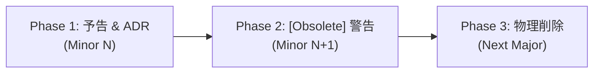

# 📜 Public API Surface & Compatibility Policy: VK.Blocks.Authentication

- **System ID / Package ID**: `VK.Blocks.Authentication`
- **Domain / Area**: `Security`
- **Target Layer**: L2 Domain BuildingBlock / L3 Infrastructure Adapters
- **Status**: 🏛️ Accepted
- **Last Verified**: 2026-10-29
- **Governing Rules**: `ARCH-07`, `AP.03`, `FS-09`, `BASE-01`, `CS.01`

---

## 1. 🎯 目的とスコープ (Purpose & Scope)

本文書は、`VK.Blocks.Authentication` が下流マイクロサービス、外部連携パッケージ、および AI コーディングエージェントに対してコミットする **Level 1 公開契約（Public API Surface）** の境界線と、**SemVer 互換性・非推奨化ガバナンス** を明文化する SSOT（単一の真実の源）です。

> [!IMPORTANT]
> `ARCH-07` に基づき、明示的に Level 1 公開契約として承認された型・メンバ以外はすべて `internal` でカプセル化されます。AI エージェントおよび開発者は、本ドキュメントに記載のない内部型を `public` 化したり、下流アセンブリから直接参照したりすることを固く禁じます。

---

## 2. 🏛️ Level 1 公開契約型一覧 (Public Exports Baseline — `AP.03`, `ARCH-07`)

Level 1 公開型は、すべてルート名前空間 `VK.Blocks.Authentication`（または公式拡張パッケージ名前空間）に平坦化され、原則として `VK` プレフィックスを冠します。

### 2.1 ブロックマーカーおよび DI エントリポイント (`BB.02`, `BB.03`)

| 公開シンボル (Symbol) | 種別 | 責務と利用規約 |
| :--- | :---: | :--- |
| `VKAuthenticationBlock` | `sealed partial class` | ブロック識別用マーカー型（Source Generator 連携）。モジュールルートに配置。 |
| `VKAuthenticationOptions` | `sealed partial record` | 認証共通オプション（`DefaultScheme`, `InMemoryCleanupIntervalMinutes`）。 |
| `IVKAuthenticationBuilder` | `partial interface` | 認証サブ機能（Jwt, ApiKey 等）のチェーン構成を司るビルダーインターフェイス。 |
| `VKAuthenticationBuilderExtensions` | `static class` | サブ機能・カスタムプロバイダーの登録拡張メソッド群。 |

### 2.2 垂直切片別オプション・列挙型 (`BB.05`, `AP.04`)

| 公開シンボル (Symbol) | 所属切片 | 説明 |
| :--- | :---: | :--- |
| `VKJwtOptions` | `Jwt/` | JWT 署名検証・OIDC Authority 設定オプション（`IVKToggleableBlockOptions`）。 |
| `VKJwtAuthMode` | `Jwt/` | 検証モード列挙型（`Symmetric` 自社署名 / `OidcDiscovery` 外部 JWKS）。 |
| `VKApiKeyOptions` | `ApiKeys/` | API Key 抽出ヘッダー名・レート制限・失効照合設定オプション。 |
| `VKOAuthOptions` | `OAuth/` | 外部 OAuth プロバイダー（GitHub 等）共通構成オプション。 |
| `VKOAuthProviderOptions` | `OAuth/` | 個別 OAuth プロバイダー固有設定。 |
| `VKCookieOptions` | `Cookies/` | Cookie セッション認証設定オプション。 |
| `VKFederationOptions` | `Federation/` | 外部フェデレーション・アカウント連携設定オプション。 |
| `VKTrackingOptions` | `Tracking/` | ログイン履歴追跡・監査設定オプション。 |

### 2.3 拡張プロバイダー・ポート契約 (`ARCH-11`, `AP.06`)

下流開発者によるオーバーライドが正式に許容されているポートインターフェイス：

| プロバイダー契約 (Port Interface) | 戻り値型 (`CS.04`) | ライフサイクル | 責務 |
| :--- | :---: | :---: | :--- |
| `IVKJwtRevocationProvider` | `ValueTask<VKResult<bool>>` | `Singleton` | JWT（JTI / ユーザー単位）の即時失効照合。 |
| `IVKJwtRefreshValidator` | `ValueTask<VKResult<bool>>` | `Singleton` | リフレッシュトークンの有効性照合と再発行検証。 |
| `IVKApiKeyRateLimiter` | `ValueTask<VKResult<bool>>` | `Singleton` | API Key ごとのアトミック流量制限判定。 |
| `IVKApiKeyRevocationProvider` | `ValueTask<VKResult<bool>>` | `Singleton` | API Key の失効状態照合。 |
| `IVKApiKeyStore` | `ValueTask<VKResult<VKApiKeyRecord>>` | `Scoped` | API Key ハッシュに紐づくメタデータ取得。 |
| `IVKClaimsProvider` | `ValueTask<VKResult<ClaimsPrincipal>>` | `Scoped` | 認証後プリンシパルへのカスタム Claims 付与。 |
| `IVKOAuthClaimsMapper` | `ValueTask<VKResult<VKExternalIdentity>>` | `Scoped` | 外部 OAuth ペイロードから標準属性への変換。 |
| `IVKLoginTracker` | `ValueTask<VKResult>` | `Scoped` | ログイン成功/失敗の監査追跡・永続化。 |
| `IVKSloHandler` | `ValueTask<VKResult>` | `Scoped` | シングルログアウト（SLO）の連携処理。 |

### 2.4 公開モデル・コンテキスト (`FS-03`)

| モデル名 (Model) | 種別 | 責務 |
| :--- | :---: | :--- |
| `VKAuthenticatedUser` | `sealed record` | 正規化された認証済みユーザーコンテキスト（`UserId`, `TenantId`, `Claims`）。 |
| `VKExternalIdentity` | `sealed record` | 外部 IdP / OAuth から抽出された標準ユーザー属性。 |
| `VKApiKeyRecord` | `sealed record` | API Key の所有者・有効期限・スコープ定義。 |
| `VKLoginRecord` | `sealed record` | ログイン履歴監査データ（IP, UserAgent, Success, Timestamp）。 |
| `VKEndpointAuthInfo` | `sealed record` | エンドポイント単位のセマンティック認証要求メタデータ。 |

### 2.5 宣言的セマンティック属性 (`ADR-020`)

| 属性名 (Attribute) | ターゲット | 役割 |
| :--- | :---: | :--- |
| `VKAuthGroupAttribute` | `Class`, `Method` | エンドポイントに必要な論理認証グループ（`User`, `Service`, `Internal`）を宣言。 |
| `VKJwtAuthorizeAttribute` | `Class`, `Method` | JWT 認証スキームを明示的に要求する宣言属性。 |
| `VKApiKeyAuthorizeAttribute` | `Class`, `Method` | API Key 認証スキームを明示的に要求する宣言属性。 |

### 2.6 公開エラーコード契約 (`CS.01`, `FS-02`)

外部ワイヤー（ProblemDetails）および `VKResult<T>` の失敗時に返却される不変のエラーコード定数：

```csharp
// VKAuthenticationErrors (Common/)
VKAuthenticationErrors.InvalidClaims         // "Auth.InvalidClaims" (401)
VKAuthenticationErrors.TenantIsolationFailed // "Auth.TenantIsolationFailed" (403)

// VKJwtErrors (Jwt/Errors/)
VKJwtErrors.EmptyToken                       // "Auth.EmptyToken" (400)
VKJwtErrors.InvalidFormat                    // "Auth.InvalidFormat" (400)
VKJwtErrors.ConfigurationError               // "Auth.ConfigurationError" (500)
VKJwtErrors.Invalid                          // "Auth.Invalid" (401)
VKJwtErrors.Revoked                          // "Auth.Revoked" (401)
VKJwtErrors.Expired                          // "Auth.Expired" (401)
VKJwtErrors.IssuerInvalid                    // "Auth.IssuerInvalid" (401)
VKJwtErrors.AudienceInvalid                  // "Auth.AudienceInvalid" (401)
VKJwtErrors.RateLimitExceeded                // "Auth.RateLimitExceeded" (429)

// VKApiKeyErrors (ApiKeys/Errors/)
VKApiKeyErrors.Empty                         // "ApiKey.Empty" (400)
VKApiKeyErrors.Invalid                       // "ApiKey.Invalid" (401)
VKApiKeyErrors.Revoked                       // "ApiKey.Revoked" (401)
VKApiKeyErrors.Expired                       // "ApiKey.Expired" (401)
VKApiKeyErrors.Disabled                      // "ApiKey.Disabled" (401)
VKApiKeyErrors.RateLimitExceeded             // "ApiKey.RateLimitExceeded" (429)
```

---

## 3. 🔒 内部境界と非公開領域 (Internal Boundaries — `BB.01`, `ARCH-06`)

以下のフォルダ配下に存在するすべての型は **`internal sealed`** または **`internal static`** でカプセル化されており、Level 1 公開面ではありません：

1. **`{Feature}/Internal/`**:
   - `ApiKeyAuthenticationHandler`, `ApiKeyValidator`, `ApiKeySemanticSchemeProvider`
   - `JwtAuthenticationService`, `JwtEventsFactory`, `JwtValidationFactory`
   - `InMemoryApiKeyRateLimiter`, `InMemoryApiKeyRevocationProvider`
   - `InMemoryJwtTokenRevocationProvider`, `InMemoryJwtRefreshTokenValidator`
2. **`Common/Internal/`**:
   - `AuthenticationResponseHelper`, `ClaimsTransformer`, `DefaultSloHandler`
   - `InMemoryCleanupBackgroundService`, `IInMemoryCacheCleanup`
3. **`Common/Diagnostics/Internal/`**:
   - `[LoggerMessage]` 生成部分クラス（`JwtLog`, `ApiKeyLog`, `ClaimsLog`, `TrackingLog`）

> [!CAUTION]
> `InternalsVisibleTo` はテストアセンブリに対してのみ付与されています。業務アプリケーションや他の BuildingBlock がリフレクション等でこれらの内部型を直接インスタンス化・参照することは固く禁止されます。

---

## 4. ⚖️ SemVer 互換性規約と破壊的変更の基準 (`FS-09`)

`VK.Blocks` はセマンティックバージョニング（`MAJOR.MINOR.PATCH`）を採用します。

### 4.1 破壊的変更（Breaking Change ➡️ MAJOR バージョン昇格必須）
以下の変更は破壊的変更とみなし、必ず事前の **ADR 起票（`DL.03`）** および **マイグレーションガイドの提示** を義務付けます：
- 既存の Level 1 公開インターフェース（`IVK*`）へのメソッド追加・変更・削除。
- 公開エラーコード文字列値（`VKError.Code`）の改名または削除（`FS-02`）。
- `VK*Options` におけるデフォルト値なしの必須プロパティ追加、または既存プロパティの型変更。
- DI 登録拡張メソッド名（`AddVKAuthenticationBlock` 等）の削除または必須引数の追加。
- デフォルトのフォールバック動作（InMemory 自動フォールバック等）の廃止。

### 4.2 後方互換な機能追加（Additive Change ➡️ MINOR バージョン昇格）
同一メジャーバージョン内で許容される変更：
- 新しい垂直切片（例: `WebAuthn/`）またはオプトインの拡張アダプターの追加。
- `IVKAuthenticationBuilder` に対する新しいオプトイン拡張メソッド（`WithXxx` / `TryAddXxx`）の追加。
- 新規エラーコード定数の追加。
- `VK*Options` に対する、デフォルト値を持つオプションプロパティの新規追加。

### 4.3 パッチ・修正（Bugfix & Performance ➡️ PATCH バージョン昇格）
- 内部ロジックの不具合修正（Public API 変更なし）。
- メモリ割り当ての最適化（`Span<T>`, `ValueTask` 適用強化）。
- ロギングおよびテレメトリの品質向上（PII マスク漏れの修正等）。

---

## 5. ⏳ 非推奨化（Deprecation）ライフサイクル (`BASE-04`)

機能や API を廃止する場合、以下の 3 段階の手順を厳格に踏みます：



1. **告知フェーズ（Minor N）**:
   - ADR を起票し、非推奨化の理由と代替手段（`Preferred API`）を採択。
2. **非推奨警告フェーズ（Minor N+1）**:
   - 対象シンボルに `[Obsolete("Use NewApi instead. Scheduled for removal in v{NextMajor}.", error: false)]` を付与。コンパイル時警告を発出。
   - リリースノートに Before / After の移行コードスニペットを掲載。
3. **完全撤去フェーズ（Next Major Version）**:
   - 次期メジャーバージョンにおいてシンボルを物理削除。

