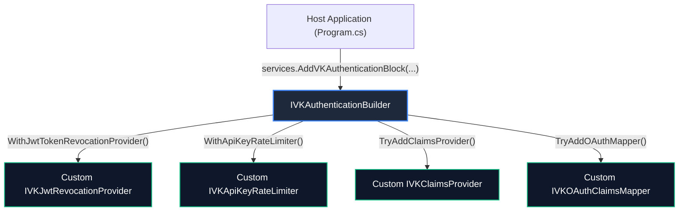

# 🔌 Extension & Customization Guide: VK.Blocks.Authentication

- **System ID / Package ID**: `VK.Blocks.Authentication`
- **Domain / Area**: `Security`
- **Target Audience**: プラットフォームエンジニア、下流マイクロサービス開発者、AI ペアプログラミング
- **Governing Rules**: `ARCH-11`, `AP.06`, `CS.01`, `CS.03`, `CS.04`, `CS.06`
- **Status**: 🏛️ Accepted

---

## 1. 🎯 概要と設計思想 (Philosophy)

`VK.Blocks.Authentication` は、**「堅牢なデフォルト（InMemory）と決定論的オーバーライド（`ARCH-05`, `AP.06`）」** を核とするプラガブル設計を採用しています。

すべての拡張は、内部実装を汚染することなく **ポートインターフェース（Ports）の実装** と **ビルダー拡張（`IVKAuthenticationBuilder`）による明示的登録** によって行われます。



---

## 2. 🧩 拡張可能ポート一覧 (Supported Extension Points)

| ポート (Port Interface) | デフォルト実装 (`ARCH-05`) | 推奨ライフサイクル | 主な拡張ユースケース |
| :--- | :--- | :---: | :--- |
| `IVKJwtRevocationProvider` | `InMemoryJwtTokenRevocationProvider` | `Singleton` | 分散 Redis / DynamoDB / CosmosDB への失効リスト永続化。 |
| `IVKApiKeyRateLimiter` | `InMemoryApiKeyRateLimiter` | `Singleton` | 分散 Redis Lua スクリプト / 分散トークンバケット流量制限。 |
| `IVKApiKeyRevocationProvider` | `InMemoryApiKeyRevocationProvider` | `Singleton` | 外部管理ポータルと同期した API Key 失効判定。 |
| `IVKApiKeyStore` | なし（利用側提供） | `Scoped` | リレーショナル DB（EF Core）や Vault からの API Key 取得。 |
| `IVKClaimsProvider` | なし | `Scoped` | 認証後に社内 DB や権限サービスから Claims を動的補加。 |
| `IVKOAuthClaimsMapper` | `GitHubClaimsMapper` | `Scoped` | GitLab / Google / 社内 SSO IdP 属性の標準化マッピング。 |
| `IVKLoginTracker` | `DefaultLoginTracker` (NoOp) | `Scoped` | ログイン成否の SIEM / 監査ログ DB への永続化。 |

---

## 3. 🛠️ ゴールデンコード実装例 (Step-by-Step Golden Paths)

### 3.1 カスタム JWT 失効ストアの実装 (`IVKJwtRevocationProvider`)

トークン失効（JTI / ユーザー全端末無効化）を外部 NoSQL ストアへ差し替える例です。

#### 規約遵守のチェックリスト (`CS.01`〜`CS.06`):
- [x] クラスは `sealed` であること（`AP.01`）。
- [x] 戻り値は `ValueTask<VKResult<bool>>` であり、アロケーションを最小化すること（`CS.04`）。
- [x] `CancellationToken` を末尾引数として受け取り、内部 I/O に伝搬すること（`CS.03`）。
- [x] 時刻取得は `DateTime.UtcNow` ではなく `TimeProvider` を注入すること（`CS.06`）。
- [x] 例外を握りつぶさず、予測可能な障害は `VKResult<bool>.Failure(...)` で返却すること（`CS.01`, `BASE-05`）。

```csharp
using System;
using System.Threading;
using System.Threading.Tasks;
using VK.Blocks.Authentication;
using VK.Blocks.Core;

namespace MyApp.Infrastructure.Authentication;

// [AP.01] sealed
public sealed class DistributedJwtRevocationProvider : IVKJwtRevocationProvider
{
    private readonly IDistributedStoreClient _storeClient;
    private readonly TimeProvider _timeProvider; // [CS.06] Injected time source

    public DistributedJwtRevocationProvider(
        IDistributedStoreClient storeClient,
        TimeProvider timeProvider)
    {
        _storeClient = VKGuard.NotNull(storeClient); // [AP.01] VKGuard boundary
        _timeProvider = VKGuard.NotNull(timeProvider);
    }

    public async ValueTask<VKResult<bool>> IsRevokedAsync(string jti, CancellationToken cancellationToken = default)
    {
        if (string.IsNullOrWhiteSpace(jti))
        {
            return VKResult<bool>.Failure(VKJwtErrors.EmptyToken); // [CS.01] Typed error
        }

        try
        {
            var key = $"vk:auth:revocation:jti:{jti}";
            var exists = await _storeClient.KeyExistsAsync(key, cancellationToken).ConfigureAwait(false); // [CS.03]
            
            return VKResult<bool>.Success(exists);
        }
        catch (TimeoutException)
        {
            // [BASE-05] Map foreseeable infra failure to Result at adapter boundary
            return VKResult<bool>.Failure(VKJwtErrors.ConfigurationError);
        }
    }

    public async ValueTask<VKResult> RevokeAsync(string jti, TimeSpan timeToLive, CancellationToken cancellationToken = default)
    {
        if (string.IsNullOrWhiteSpace(jti))
        {
            return VKResult.Failure(VKJwtErrors.EmptyToken);
        }

        var key = $"vk:auth:revocation:jti:{jti}";
        await _storeClient.SetWithTtlAsync(key, "revoked", timeToLive, cancellationToken).ConfigureAwait(false);
        return VKResult.Success();
    }
}
```

#### DI 登録コード (Program.cs / Composition Root):

```csharp
builder.Services.AddVKAuthenticationBlock(auth =>
{
    auth.AddVKJwt(jwt =>
    {
        jwt.Enabled = true;
        jwt.SecretKey = builder.Configuration["Jwt:SecretKey"]!;
    });

    // [AP.06] 明示的ビルダーオーバーライド
    auth.WithJwtTokenRevocationProvider<DistributedJwtRevocationProvider>();
});
```

---

### 3.2 認証後 Claims 動的付与プロバイダーの実装 (`IVKClaimsProvider`)

認証完了後、ユーザーの所属テナント情報や社内プロファイルを `ClaimsPrincipal` へ安全に追加します。

```csharp
using System.Security.Claims;
using System.Threading;
using System.Threading.Tasks;
using VK.Blocks.Authentication;
using VK.Blocks.Core;

namespace MyApp.Features.Identity;

public sealed class TenantEnrichmentClaimsProvider : IVKClaimsProvider
{
    private readonly IUserProfileRepository _repository;

    public TenantEnrichmentClaimsProvider(IUserProfileRepository repository)
    {
        _repository = VKGuard.NotNull(repository);
    }

    public async ValueTask<VKResult<ClaimsPrincipal>> TransformAsync(ClaimsPrincipal principal, CancellationToken cancellationToken = default)
    {
        VKGuard.NotNull(principal);

        var userId = principal.GetUserId(); // [VKClaimsPrincipalExtensions SSOT]
        if (!userId.HasValue)
        {
            return VKResult<ClaimsPrincipal>.Success(principal); // 変更せず返却
        }

        var profileResult = await _repository.FindByUserIdAsync(userId.Value, cancellationToken).ConfigureAwait(false);
        if (profileResult.IsFailure)
        {
            return VKResult<ClaimsPrincipal>.Failure(profileResult.Error);
        }

        var identity = (ClaimsIdentity)principal.Identity!;
        identity.AddClaim(new Claim("organization_code", profileResult.Value.OrgCode));

        return VKResult<ClaimsPrincipal>.Success(principal);
    }
}
```

#### DI 登録コード:

```csharp
builder.Services.AddVKAuthenticationBlock(auth =>
{
    // [BB.06] Scoped チェーン登録（複数登録可能）
    auth.TryAddClaimsProvider<TenantEnrichmentClaimsProvider>();
});
```

---

## 4. ⚠️ 厳格な回避アンチパターン (Anti-Patterns to Avoid)

カスタム拡張を実装する際、以下の設計はプロジェクトルール違反となります：

| アンチパターン | 違反ルール | 正しい対処法 |
| :--- | :---: | :--- |
| **ビジネス検証失敗時に例外を throw する** | `CS.01`, `BASE-05` | `VKResult<T>.Failure(VK{Module}Errors.Xxx)` を返却する。 |
| **`DateTime.UtcNow` や `DateTime.Now` を呼ぶ** | `CS.06`, `BASE-02` | コンストラクタから `TimeProvider` を注入して時刻を計算する。 |
| **`Task.Result` や `.Wait()` による同期ブロッキング** | `CS.03` | `await` と `.ConfigureAwait(false)` を徹底し、スレッドプール枯渇を防ぐ。 |
| **Captive Dependency（Singleton に Scoped を注入）** | `CS.07` | `IVKJwtRevocationProvider`（Singleton）内で Scoped の `DbContext` を直接抱え込まない（`IServiceScopeFactory` を使用）。 |
| **ログに生の API Key や Bearer Token を出力する** | `OR.01`, `FS-12` | プレフィックスと末尾 4 桁以外をマスクする（`ApiKeyLog.MaskKey()`）。 |
| **スライス間での内部実装クラス直接参照** | `AP.03`, `BB.01` | 必ず `Common/Protocols/` の公開ポート経由で依存させる。 |

