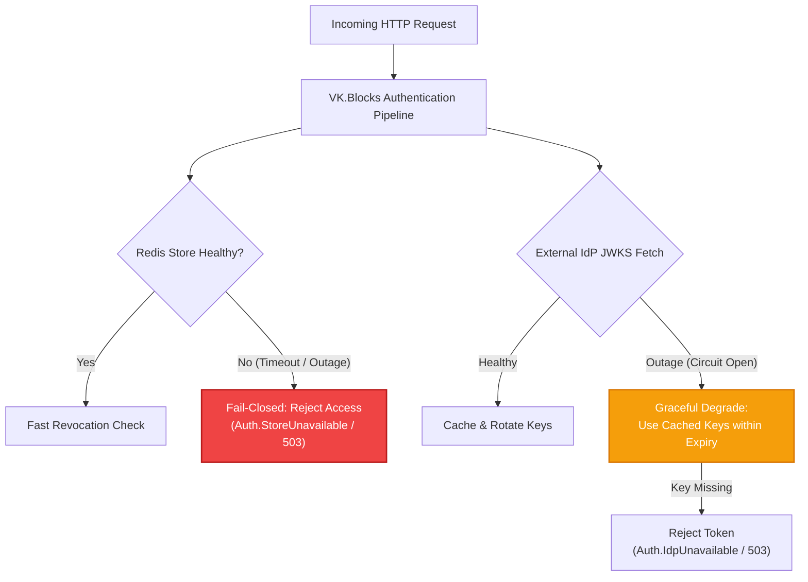
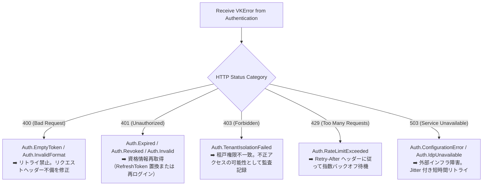

# 💥 Failure Modes & Resilience Runbook: VK.Blocks.Authentication

- **System ID / Package ID**: `VK.Blocks.Authentication`
- **Domain / Area**: `Security`
- **Target Audience**: SRE（Site Reliability Engineering）、インフラ運用担当者、下流マイクロサービス開発者
- **Governing Rules**: `OR.03`, `CS.01`, `FS-02`, `ARCH-12`, `FS-06`
- **Status**: 🏛️ Accepted

---

## 1. 🎯 概要と障害防衛原則 (Resilience Principles)

`VK.Blocks.Authentication` は、認証基盤として **「セキュア・フェイル（Fail-Closed 原則）」** と **「グレースフル縮退（Graceful Degradation）」** のバランスを厳格に制御します。

外部ストア（Redis）や外部 IdP（Entra ID / Auth0）が障害に陥った場合でも、未定義の例外によるプロセス停止（クラッシュ）を完全に防ぎ、RFC 7807 準拠の構造化エラーコード（`VKResult<T>`）として決定論的にハンドリングします。



---

## 2. ⚡ 依存インフラ障害マトリクス (Failure Modes Matrix)

| 依存コンポーネント | 障害事象 (Failure Scenario) | 基座の挙動 (System Behavior) | 返却 VKResult ErrorCode (`CS.01`) | HTTP 応答 | 推奨される呼び出し元の対処法 (`FS-06`) |
| :--- | :--- | :--- | :--- | :---: | :--- |
| **分散キャッシュ<br/>(Redis Cluster)** | 接続切断、コマンドタイムアウト（> 500ms） | **Fail-Closed（安全優先）**。<br/>失効トークンのすり抜けを防ぐため、照合失敗として即時拒否。 | `VKJwtErrors.ConfigurationError` / `Auth.RevocationStoreUnavailable` | `503` | 即時リトライ禁止。指数バックオフで再試行。SRE へ Redis アラート発報。 |
| **分散キャッシュ<br/>(Redis Cluster)** | API Key レート制限カウンターの書き込み失敗 | **Fail-Open（可用性優先）**。<br/>レート制限カウンター不能時は監査ログを発出しつつ、認証自体は通す（設定により Fail-Closed 切替可）。 | 正常処理継続（ログに警告記録） | `200` / 通常処理 | 監視アラートで検知し Redis ノードを復旧。 |
| **外部 IdP<br/>(OIDC Discovery)** | バックチャネル 5xx エラー / 通信断 | **Polly サーキットブレーカー開放（`OR.03`）**。<br/>3 回連続失敗で即時遮断。直前にキャッシュした JWKS 公钥が有効な間は検証を継続（グレースフル縮退）。 | `Auth.IdpUnavailable` (キャッシュ未取得時のみ) | `503` | IdP 側のステータスページ確認。IdP 復旧までリクエスト元へ 503 返却。 |
| **外部 IdP<br/>(JWKS 鍵ローテーション)** | 未認識の `kid` を持つ新規トークンが到来、かつ IdP 問い合わせ失敗 | オンデマンド単一再取得を試行。失敗時は該当トークンのみ検証拒否。既存鍵のトークンは検証継続。 | `VKJwtErrors.Invalid` (`Auth.Invalid`) | `401` | クライアント側で IdP から再認証・最新トークンを取得。 |
| **ホスト間クロック<br/>(Clock Skew)** | IdP サーバーとホスト API 間の時刻ズレ（> 5分） | `ClockSkew` 許容幅（既定 5分）を超過したトークンは即座に無効と判定。 | `VKJwtErrors.Expired` (`Auth.Expired`) | `401` | ホスト VM / コンテナの NTP 時刻同期デーモン（`chrony` 等）を修正。 |
| **マルチテナント<br/>(Tenant Context)** | トークン内の `tenant_id` が存在しない、または無効な GUID | 認証パイプライン境界で即座に遮断（`FS-07`, `CS.08`）。下流ビジネスロジックへの侵入を完全阻止。 | `VKAuthenticationErrors.TenantIsolationFailed` | `403` | クライアントはトークン発行要求スコープ（Tenant claim）を修正。 |
| **高頻度ブルートフォース<br/>(API Key 乱打)** | 同一 IP / Key から制限閾値（例: 100 req/s）を超過するリクエスト | アトミックカウンターで検知し、`Retry-After` ヘッダーを付与してパイプライン先頭で拒否。 | `VKApiKeyErrors.RateLimitExceeded` | `429` | クライアントは `Retry-After` 秒数待機後に再送。 |

---

## 3. 🚨 エラーコード対応ハンドブック (Downstream Handling Runbook)

下流サービスおよび API ゲートウェイは、返却された RFC 7807 `ProblemDetails` 内の `errorCode` に応じて以下のルールで振る舞う必要があります：



---

## 4. 🛠️ SRE 運用トラブルシューティング (On-Call Runbook)

### 4.1 構造化ログ検索クエリ (`OR.01`)

障害調査時、以下のキーでログをフィルタリングしてください：

- **認証失敗の急増調査**:
  ```kusto
  traces
  | where customDimensions["vk.module"] == "Authentication"
  | where customDimensions["vk.error.code"] startswith "Auth."
  | summarize count() by tostring(customDimensions["vk.error.code"]), bin(timestamp, 1m)
  | render timechart
  ```
- **テナント分離違反（不正アクセス疑い）の追跡**:
  ```kusto
  traces
  | where customDimensions["vk.error.code"] == "Auth.TenantIsolationFailed"
  | project timestamp, operation_Id, customDimensions["vk.tenant.id"], customDimensions["client.ip"]
  ```

### 4.2 緊急回避フラグ（Disaster Recovery Knobs）

大規模障害（例: 全社 Redis クラスタの完全ダウン）発生時、ホストサービスの `appsettings.json` または環境変数で以下の緊急回避を設定可能です：

```json
{
  "VK": {
    "Blocks": {
      "Authentication": {
        "Jwt": {
          // Redis 復旧まで一時的にインメモリ検証のみに切り替え（要 Security Lead 承認）
          "AuthMode": "Symmetric"
        }
      }
    }
  }
}
```

