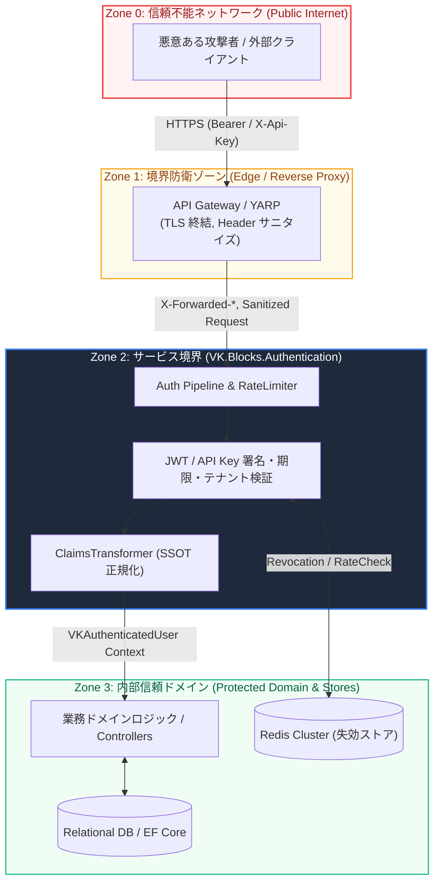

# 🛡️ Threat Model & Defense-in-Depth: VK.Blocks.Authentication

- **System ID / Package ID**: `VK.Blocks.Authentication`
- **Domain / Area**: `Security`
- **Security Lead / Architect**: Security Architecture Team & AI Pair
- **Governing Rules**: `BASE-01`, `FS-07`, `FS-12`, `OR.01`, `CS.08`
- **Methodology**: STRIDE (Spoofing, Tampering, Repudiation, Information Disclosure, Denial of Service, Elevation of Privilege)
- **Status**: 🏛️ Accepted
- **Last Verified**: 2026-10-29

---

## 1. 🎯 信頼境界とアタックサーフェス (Trust Boundaries & Attack Surface)

`VK.Blocks.Authentication` は、信頼できない外部クライアントと安全な内部ビジネスドメインを隔てる**最重要防衛境界**です。

---

## 2. 🛡️ STRIDE 脅威分析マトリクス (STRIDE Threat Analysis)

### 2.1 S: Spoofing（なりすまし）

| 脅威 ID | 脅威シナリオ (Threat Scenario) | 影響度 | 実装されている防衛策 (Countermeasures — `AP.01`, `CS.06`) |
| :---: | :--- | :---: | :--- |
| **S-01** | **JWT 署名の偽造・アルゴリズム混乱攻撃** `alg: none` の指定や、RS256 公開鍵を HS256 の共有秘密鍵として誤認させる攻撃。 | **Critical** | • `RequireSignedTokens = true` を強制（`none` を完全拒絶）。 • `VKJwtAuthMode`（Symmetric vs OidcDiscovery）ごとに受け入れ可能なアルゴリズムを明示的にホワイトリスト固定。 |
| **S-02** | **盗まれた API Key による認証すり抜け** ネットワーク盗聴やリポジトリ漏洩により奪取された API Key の不正行使。 | **High** | • データベースおよびストアには平文キーを保存せず、暗号学的 SHA-256 ハッシュ値のみを保持。 • 単一キーに対する IP 制限およびレート制限の二重防壁。 |
| **S-03** | **X-Forwarded-For ヘッダー偽造による IP 偽装** クライアントが偽の送信元 IP を注入して監査やアクセス制御を回避。 | **Medium** | • 信頼できるプロキシ（`KnownNetworks`）からのヘッダーのみを採用し、未認可ヘッダーは破棄（`ARCH-09`）。 |

---

### 2.2 T: Tampering（改ざん）

| 脅威 ID | 脅威シナリオ (Threat Scenario) | 影響度 | 実装されている防衛策 (Countermeasures — `FS-07`, `CS.08`) |
| :---: | :--- | :---: | :--- |
| **T-01** | **マルチテナント境界の突破（クロスオーバー攻撃）** 悪意あるユーザーが自テナントの有効なトークンを用いて別テナントのデータへアクセス。 | **Critical** | • **`Auth.TenantIsolationFailed` 強制遮断**：トークン内の `tenant_id` とリクエストコンテキストの一致を認証境界で検証（`FS-07`）。不一致は即時 403 拒絶。 • データベースクエリにおける EF Core Global Query Filter（`CS.08`）による二重壁。 |
| **T-02** | **Claims ペイロードのクライアント改ざん** トークン内の `roles` や `sub` を書き換えて上位権限を取得しようとする試み。 | **High** | • IdP のデジタル署名検証が成功しない限り、ClaimsTransformer は一切の属性変換を行わない。 • 外部 IdP の非標準 Claim 名を内部 `VKClaimTypes`（SSOT）へ厳格にマッピング（`ADR-008`）。 |

---

### 2.3 R: Repudiation（否認）

| 脅威 ID | 脅威シナリオ (Threat Scenario) | 影響度 | 実装されている防衛策 (Countermeasures — `OR.01`, `BB.04`) |
| :---: | :--- | :---: | :--- |
| **R-01** | **重要操作後のログインおよび認可の否認** 攻撃または内部不正者が「自身はリクエストを送信していない」と主張。 | **Medium** | • `[LoggerMessage]` Source Generator による構造化監査ログ（`OR.01`）。 • 全リクエストに `TraceId`、`jti`（JWT ID）、マスク済みユーザー識別子を不可逆・改ざん不能な形で記録。 |

---

### 2.4 I: Information Disclosure（情報漏洩）

| 脅威 ID | 脅威シナリオ (Threat Scenario) | 影響度 | 実装されている防衛策 (Countermeasures — `FS-11`, `FS-12`) |
| :---: | :--- | :---: | :--- |
| **I-01** | **ログおよびトレースへの資格情報・PII 漏洩** Bearer トークン、API Key、ユーザー氏名・メールアドレスがログ基盤に平文流出。 | **High** | • **Source Generator レベルの自動マスキング**：`ApiKeyLog.MaskKey()` により先頭 4 文字と末尾 4 文字以外を `****` 化。 • OpenTelemetry タグ契約（`05-DataDictionary`）において PII 禁止を強制（`FS-11`）。 |
| **I-02** | **API Key 検証におけるタイミング攻撃（Timing Attack）** 文字列の逐次比較時間の差異から正しい API Key を 1 文字ずつ特定。 | **Medium** | • すべてのハッシュ・秘密値の比較に `CryptographicOperations.FixedTimeEquals`（恒定時間比較）を採用。 |

---

### 2.5 D: Denial of Service（サービス拒否）

| 脅威 ID | 脅威シナリオ (Threat Scenario) | 影響度 | 実装されている防衛策 (Countermeasures — `OR.03`, `CS.04`) |
| :---: | :--- | :---: | :--- |
| **D-01** | **JWKS 鍵リフレッシュストーム攻撃** 攻撃者がランダムな未知の `kid` を含む大量の偽造トークンを送信し、外部 IdP へのリクエストを過負荷化。 | **High** | • **Polly 断路器（Circuit Breaker）＋再取得頻度制限**（`OR.03`）。 • 未知の `kid` に対するバックチャネル取得はアトミックな Lock およびレート制限で保護し、過剰な HTTP 要求を遮断。 |
| **D-02** | **極大 JWT によるメモリ枯渇 DoS** 数 MB の巨大な Claims ペイロードを持つトークンを送信して GC 圧迫・ヒープ枯渇を誘発。 | **Medium** | • パイプライン先頭でトークン最大バイト長（`MaxTokenSizeInBytes`）を制限。 • 高頻度パスでの `ValueTask` / `Span<T>` 採用によるゼロアロケーション（`CS.04`）。 |
| **D-03** | **API Key ブルートフォース攻撃** 数万 req/s の無差別リクエストによる認証プロセッサの飽和。 | **High** | • `IVKApiKeyRateLimiter` による Redis Lua スクリプト駆動のアトミック滑动窗口頻度制御（429 Too Many Requests）。 |

---

### 2.6 E: Elevation of Privilege（特権昇格）

| 脅威 ID | 脅威シナリオ (Threat Scenario) | 影響度 | 実装されている防衛策 (Countermeasures — `ADR-019`, `ADR-020`) |
| :---: | :--- | :---: | :--- |
| **E-01** | **認証スキームのすり替えによる管理者エンドポイント突破** 低権限の API Key 認証を用いて、ユーザー JWT のみを想定した内部 API を実行。 | **Critical** | • **セマンティック認証グループ（`[VKAuthGroup]`）**（`ADR-020`）。 • エンドポイントごとに要求される物理スキーム（User vs Service vs Internal）を厳密に分離・解決。 |
| **E-02** | **失効済みトークン（退職者・盗難）の継続利用** 有効期限内の JWT を失効させたにもかかわらず、分散環境で認証が通過。 | **Critical** | • `IVKTokenRevocationProvider` による JTI / User 単位のリアルタイム失効照合。 • 分散 Redis 瞬断時の安全設計（Fail-Closed 原則）。 |

---

## 3. 📋 OWASP API Security Top 10 (2023) 対応マッピング

| OWASP 項目 | 脆弱性の定義 | VK.Blocks.Authentication による対策実装 |
| :--- | :--- | :--- |
| **API1:2023** | Broken Object Level Authorization | `VKAuthenticatedUser.TenantId` を強制設定し、データアクセス層でオブジェクト所有権照合を担保。 |
| **API2:2023** | Broken Authentication | 厳格な署名検証、アルゴリズム固定、タイムアウト、恒定時間比較、トークン失効プロバイダー。 |
| **API3:2023** | Broken Object Property Level Authorization | Claims 変換器による公開属性の厳格なサニタイズ（不要な IdP 内部属性を排除）。 |
| **API4:2023** | Unrestricted Resource Consumption | `IVKApiKeyRateLimiter` によるアトミックな流量制限と `429 Too Many Requests`。 |
| **API5:2023** | Broken Function Level Authorization | セマンティックグループ（`User` / `Service` / `Internal`）によるエンドポイント分離（`ADR-020`）。 |
| **API8:2023** | Security Misconfiguration | ホスト起動時の `.ValidateOnStart()` による不備設定のフェイルファスト中断（`ADR-009`）。 |

