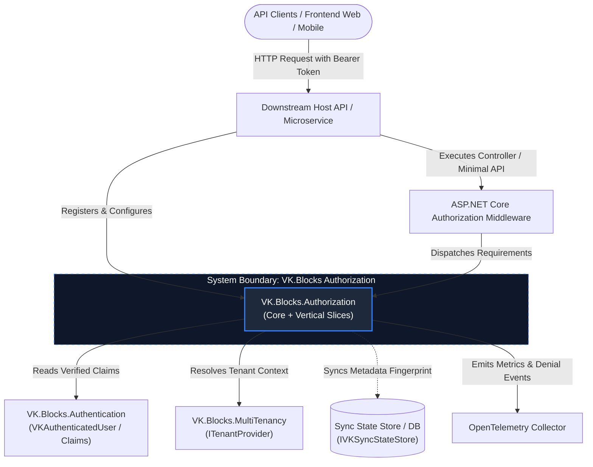
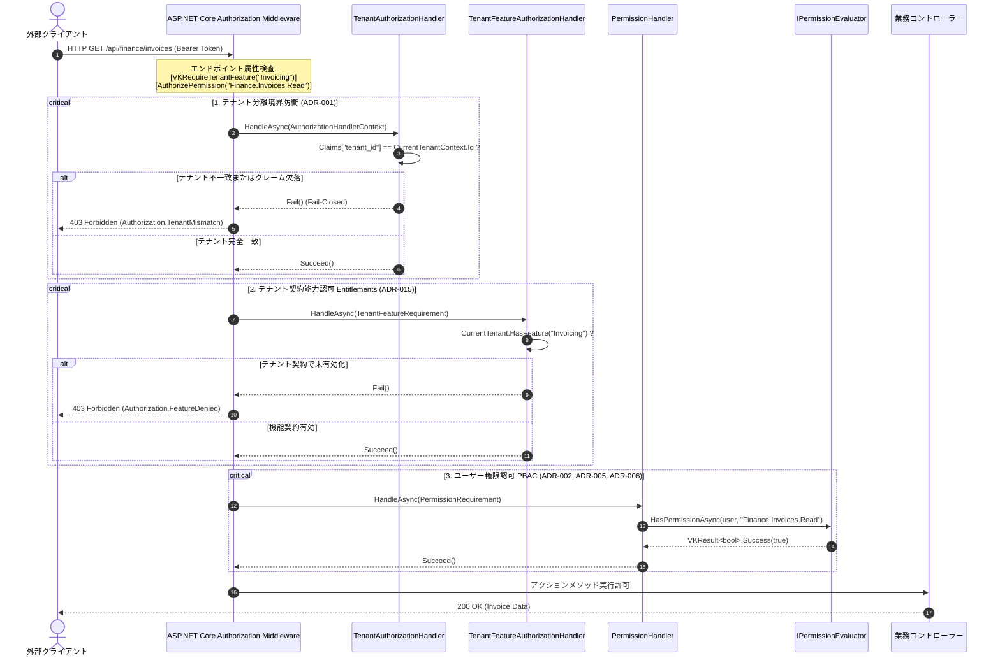
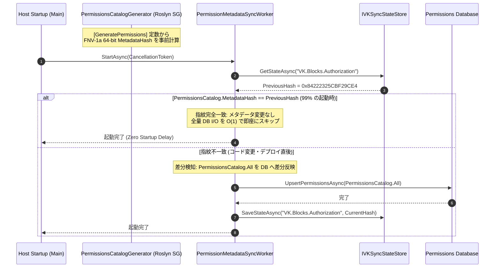
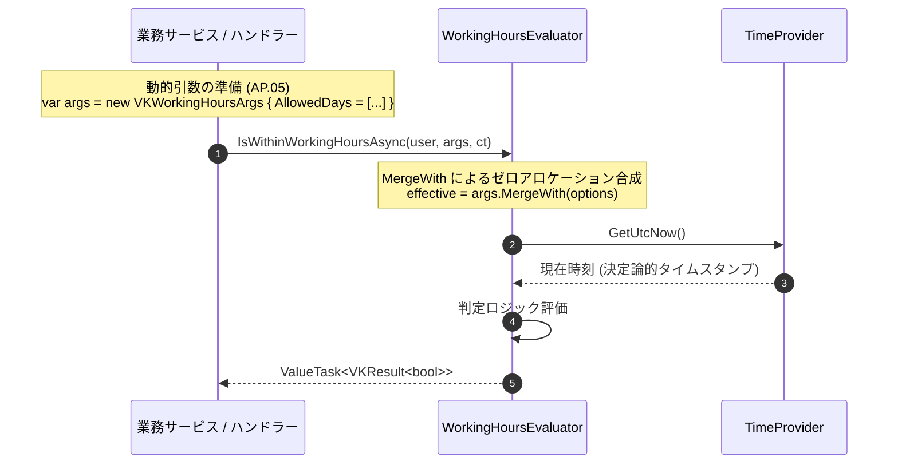

# 🏛️ Architecture: VK.Blocks.Authorization

- **System ID / Package ID**: `VK.Blocks.Authorization`
- **Domain / Area**: `Security`
- **Primary Owner / Architect**: Security Architecture Team & AI Pair
- **Target Layer**: L2 Domain BuildingBlock / L3 Infrastructure Adapters
- **Status**: 🏛️ Accepted
- **Last Verified**: 2026-10-30

---

## 1. 🎯 概要と範囲 (Overview & Scope)

### 1.1 エレベーターピッチ・要約 (Elevator Pitch)
`VK.Blocks.Authorization` は、ASP.NET Core の `IAuthorizationHandler` パイプラインを拡張し、エンタープライズマルチテナント環境において求められる多次元アクセス制御（**テナント境界隔離 × テナント契約能力 Entitlements × ユーザー権限 PBAC/RBAC × 業務制約**）を **Vertical Slice Architecture** で実装した認可基座です。.NET 8+ の `IAuthorizationRequirementData` ネイティブ統合とコンパイル時 Source Generator により、文字列ポリシーパースを完全排除し、ホットパスにおける極限のゼロアロケーション（`ValueTask`）と決定論的フェイルクローズ（Fail-Closed）セキュリティを保証します。

### 1.2 スコープ境界 (Goals & Non-Goals — `BASE-06`)

- **包含する領域 (In-Scope / Goals)**:
  - **ゼロトラスト・テナント隔離境界 (`ADR-001`, `FS-07`)**: リクエストクレーム内の `TenantId` と実行コンテキストの一致を最前線で検証し、不一致時は即座に遮断。
  - **多次元認可グリッド (`ADR-015`)**: 「テナントが契約プランで利用可能か（`[VKRequireTenantFeature]`）」と「ユーザーが操作権限を持つか（`[AuthorizePermission]`）」を直交分離して評価。
  - **定義優先・コード生成ガバナンス (`ADR-004`, `ADR-007`, `ADR-009`)**: コード内の `[GeneratePermissions]` 定数を SSOT とし、強タイプ属性と定数カタログをコンパイル時自動合成。モジュール名プレフィックス強制と `Misc` 治理タグによる命名競合根絶。
  - **FNV-1a 指紋による $O(1)$ 起動時メタデータ同期 (`ADR-008`)**: 全権限定義の 64-bit ハッシュ比較により、起動時の DB 同期処理を定数時間でスキップ。
  - **流暢なモジュラー登録ビルダー (`ADR-013`, `BB.03`)**: `IVKAuthorizationBuilder` による 8 段階べき等登録シーケンスとスライス単位の独立有効化。
  - **Semantic-Priority と設定合成 (`ADR-016`, `ADR-017`, `AP.05`)**: ドメイン特有メソッドの公開、明示的インターフェース実装による汎用隠蔽、`MergeWith` 拡張による静的 Options と動的 Args のゼロアロケーション合成。

- **明確に除外する領域 (Out-of-Scope / Non-Goals)**:
  - **身元証明・トークン検証 (`ARCH-01`)**: ユーザーの署名検証、暗号復号、セッション確立は `VK.Blocks.Authentication` の排他的責務とし、本ブロックは検証済み Claims のみを消費する。
  - **ユーザーアカウント・ロール割当の永続化管理**: ロールやユーザーマスタの CRUD、パスワード管理は `VK.Blocks.Identity` の責務とし、本ブロックは権限の検証契約のみに専念する。
  - **課金決済・サブスクリプションエンジン**: テナントのプラン契約変更や請求トランザクションは上位アプリケーションの責務とし、本ブロックは契約状態の判定のみを行う。
  - **動的プラグインの実行時アセンブリロード**: コンパイル時決定論（Compile-Time First, `BASE-03`）を堅持し、実行時の動的 DLL ロードは採用しない。

### 1.3 想定読者と適用バージョン
- **Target Audience**: プラットフォームアーキテクト、セキュリティ監査員、マイクロサービス開発者、AI コーディングエージェント
- **Target Runtime**: .NET 10+, C# 12+ (Strict Mode, Native AOT Ready)

### 1.4 伴生仕様書体系 (Companion Specifications)
本主アーキテクチャ仕様書を補完する個別特化仕様書：
- [api-surface.md](./api-surface.md) 📜: Level 1 公開契約型、`Internal/` カプセル化境界、SemVer 破壊的変更基準
- [extension-guide.md](./extension-guide.md) 🔌: カスタム Evaluator / Provider の実装手順、`builder.OverrideXxx<T>()` による明示的オーバーライド
- [failure-modes.md](./failure-modes.md) 💥: フェイルクローズ原則、各認可拒絶時のエラーコード体系、SRE 運用トラブルシューティング
- [threat-model.md](./threat-model.md) 🛡️: STRIDE 脅威分析、テナント越境攻撃防御、権限昇格対策

---

## 2. ⚡ アーキテクチャ牽引要因 (Architectural Drivers)

### 2.1 主要品質属性 (Quality Attributes)

- **性能・ゼロアロケーション (`CS.04`, `AP.01`, `ADR-016`)**:
  - 全リクエストが通過する評価パイプライン（`IPermissionEvaluator`, `IVKWorkingHoursEvaluator`）は `ValueTask<VKResult<bool>>` を採用し、キャッシュヒット時のヒープ割り当てをゼロ（$0$ B）に抑制。
  - `MergeWith` 拡張メソッドにより、構造体操作としてインライン展開し、静的オプションと動的引数の合成オーバーヘッドを極小化。
- **決定論的振る舞い・状態隔離 (`BASE-02`, `CS.06`)**:
  - 業務時間帯判定（`WorkingHours`）における `DateTime.UtcNow` の直接呼び出しを禁止し、`TimeProvider` を完全注入。タイムゾーンや休日の決定論的テストを保証。
- **Fail-Closed ゼロトラスト境界 (`CS.08`, `FS-07`, `OR.02`, `ADR-001`)**:
  - `TenantId` クレームの欠落、不一致、または評価器内部でのタイムアウト・例外発生時は、いかなる場合も拒絶（Deny）としてリクエストを即座にブロック。
- **テスタビリティ・疎結合 (`DL.01`, `ARCH-02`)**:
  - `IPermissionEvaluator` や `ITenantFeatureProvider` などの抽象ポートにより、トークン発行や DB 接続なしに特定権限セット・テナント機能を持つユーザーを単体テスト内で 100% 擬似実行可能。

### 2.2 厳格な技術制約 (Constraints)
- **Zero Implicit Reflection (`AP.01`, `BB.02`, `ADR-004`, `ADR-014`)**:
  - 実行時の全アセンブリスキャンを全廃。ハンドラーの DI 登録、定数カタログ生成、および `[VKBlockMarker]` によるブロック識別子（URN: `"VK.Blocks.Authorization"`）の合成はすべて Source Generator がコンパイル時に確定。
- **Contract-First & Options Vocabulary (`BASE-01`, `BB.05`, `ADR-017`)**:
  - レベル 1 公開契約には `VK` プレフィックスを強制。"Settings" 語彙を全廃し、開閉機能は `IVKToggleableBlockOptions` 階層に統一。

---

## 3. 🌐 コンテキストビュー (C4 Level 1: System Context)

システム境界と、それを取り巻く外部アクターおよび依存コンポーネントとの全体関係図：

**コンテキスト説明**:
- **Downstream Host**: `services.AddVKAuthorizationBlock(config)` を呼び出し、流暢な Builder（`IVKAuthorizationBuilder`）経由で必要な認可スライスをチェーン登録。
- **VK.Blocks.Authentication**: 署名検証済みトークンから抽出された Claims を提供。認可ブロックは身元確認を行わず、Claims のみを消費する（`ARCH-01`）。
- **VK.Blocks.MultiTenancy**: テナント分離（`TenantAuthorizationHandler`）および機能認可（`TenantFeatureAuthorizationHandler`）において、テナント状態を解決。
- **Sync State Store**: アプリケーション起動時に、コンパイル時生成された `PermissionsCatalog.MetadataHash` と保存済み指紋を $O(1)$ 比較し、差分同期を制御。

---

## 4. 🧩 コンテナ／モジュールビュー (C4 Level 2: Containers & Vertical Slices)

認可システムの内部物理構造（垂直スライス編成）と各モジュールの SSOT Manifest へのリンク：

```mermaid
graph TD
    HostApp["Host Application (Composition Root)"]

    subgraph AuthZBlock ["BuildingBlock: VK.Blocks.Authorization"]
        direction TB
        Marker["VKAuthorizationBlock (Marker)"]
        Options["VKAuthorizationOptions (Options)"]
        Common["Common/ (Builder, Protocols, Models, Diagnostics)"]
        
        SliceTenant["TenantIsolation/ Slice"]
        SliceEntitlements["Entitlements/ Slice"]
        SlicePerms["Permissions/ Slice"]
        SliceRoles["Roles/ Slice"]
        SliceRank["MinimumRank/ Slice"]
        SliceHours["WorkingHours/ Slice"]
        SliceNetwork["InternalNetwork/ Slice"]
        SliceDynamic["DynamicPolicies/ Slice"]

        SliceTenant --> Common
        SliceEntitlements --> Common
        SlicePerms --> Common
        SliceRoles --> Common
        SliceRank --> Common
        SliceHours --> Common
        SliceNetwork --> Common
        SliceDynamic --> Common
    end

    subgraph Tooling ["Compile-Time Tooling"]
        SG["VK.Tools.SourceGenerators<br/>(Handlers, Catalog, URN Synthesis)"]
    end

    HostApp --> Marker
    HostApp --> Common
    SG -.->|"Generates DI & Metadata"| AuthZBlock

    style Marker fill:#0f172a,stroke:#10b981,stroke-width:2px,color:#fff
    style Common fill:#1e293b,stroke:#3b82f6,stroke-width:2px,color:#fff
    style Tooling fill:#334155,stroke:#f59e0b,stroke-width:1.5px,color:#fff
```

### 4.1 垂直スライス一覧と責務

各機能スライスは `BB.01` に準拠し、公開 API（Root）、`Metadata/`（SG トリガー）、`Internal/`（内部実装）、`Persistence/`（永続化抽象）の 4 層構造を厳格遵守しています：

| スライス (Feature Slice) | 主要属性 / 契約 | 主な責務・役割 | 主要 ADR |
| :--- | :--- | :--- | :---: |
| **`TenantIsolation`** | `TenantAuthorizationHandler` | 全認可リクエストに先立ち、トークン内 `TenantId` と現行コンテキストの一致を強制検証 | `ADR-001` |
| **`Entitlements`** | `[VKRequireTenantFeature]` | テナント契約プラン・有効化機能に基づくマクロなシステム機能アクセス制御 | `ADR-015` |
| **`Permissions`** | `[AuthorizePermission]`, `IPermissionEvaluator` | きめ細かい PBAC 権限チェック、定数カタログ生成、ハッシュ同期 | `ADR-002`, `005`, `007`, `008` |
| **`Roles`** | `[AuthorizeRoles]`, `IVKRoleEvaluator` | 複数ロールの Any / All 判定、カスタムクレームマッピング | `ADR-010`, `013`, `017` |
| **`MinimumRank`** | `[RequireMinimumRank]`, `IRankProvider` | 数値抽象化された役職ランク・VIP レベルの階層判定 | `ADR-006` |
| **`WorkingHours`** | `[RequireWorkingHours]`, `IVKWorkingHoursEvaluator` | `TimeProvider` とタイムゾーンに基づく業務時間内アクセス制御 | `ADR-016` |
| **`InternalNetwork`** | `[RequireInternalNetwork]`, `IIpAddressProvider` | 送信元 IP アドレス・CIDR ブロックに基づく内部網制限 | `ADR-010` |
| **`DynamicPolicies`** | `[DynamicAuthorize]`, `IVKDynamicPoliciesEvaluator` | 属性とクレームの動的演算子（Equals, In, GreaterThan）評価 | `ADR-003`, `006` |

- **SSOT Manifest**: 詳細な L3 境界規則、禁止依存、および不変条件は [src/BuildingBlocks/Authorization/.prompts/module-manifest.md](/src/BuildingBlocks/Authorization/.prompts/module-manifest.md) に集約されています。

---

## 5. 🔄 ランタイムシーケンスビュー (Runtime Sequences)

### 5.1 シーケンス 1: 多次元認可リクエストフロー (Zero-Trust Multidimensional Evaluation)
下流 API エンドポイントにリクエストが到達した際の、多段階防御シーケンスです：

### 5.2 シーケンス 2: 定義優先スキャンと $O(1)$ 指紋メタデータ起動同期 (`ADR-007`, `ADR-008`)

### 5.3 シーケンス 3: Semantic-Priority と `MergeWith` 設定合成 (`ADR-016`, `ADR-017`)

---

## 6. 💾 データ・キャッシュアーキテクチャ (Data & Cache Architecture)

- **$O(1)$ ホットパス権限評価 (`Manifest 6`)**:
  - リクエストごとの DB 問い合わせを厳禁。ユーザーのロール・権限セットは、認証時にクレーム化されるか、またはテナント別に分割されたメモリキャッシュ（`IMemoryCache` / `FrozenSet<string>`）から $O(1)$ で解決。
- **マルチテナント分離キャッシュ (`Manifest 3`)**:
  - キャッシュキーは必ず `{TenantId}:{UserId}:permissions` の複合プレフィックスを用い、テナントを跨いだキャッシュ汚染を原理的に防止。
- **同期型キャッシュ無効化**:
  - 管理機能によってロールや権限の割り当てが変更された場合、即座に当該ユーザー／テナントのキャッシュキーを無効化（Synchronous Invalidation）。

---

## 7. 🛡️ 横断的関心事と運用監視 (Cross-Cutting Concerns)

### 7.1 フェイルクローズ原則 (Fail-Closed Default — `Manifest 5`)
認可判定処理において、ネットワークタイムアウト、DB 接続不能、または内部エラーが発生した場合は、**いかなる例外状況であってもアクセス拒絶（Fail-Closed）** とします。フェイルオープン（障害時のバイパス許可）は、明示的な ADR と許可リスト設定がない限り厳格に禁止されます。

### 7.2 特権バイパス (SuperAdmin Bypass)
プラットフォーム運用者向けの SuperAdmin ロールや特定クレームは、共通の `SuperAdminAuthorizationHandler` またはパイプライン前段で評価され、各スライスの重複チェックをバイパス可能。ただし、このバイパス動作は必ず監査ログ（`OR.01`）に記録されます。

### 7.3 運用テレメトリとメトリクス (`OR.01`, `BB.04`, `ADR-006`)
- **ActivitySource**: `"VK.Blocks.Authorization"`
- **Meter**: `"VK.Blocks.Authorization"`
  - `authz_evaluations_total`: 認可評価総数（Tags: `feature`, `decision` (`allowed` / `denied`), `tenant_id`）。
  - `authz_denials_total`: 拒絶数（Tags: `reason`, `requirement_type`, `tenant_id`）。
  - `authz_duration_seconds`: 評価所要時間ヒストグラム。

---

## 8. 🗺️ アーキテクチャ意思決定と RFC 対応索引 (ADR & RFC Traceability)

本アーキテクチャ仕様書は、以下の 17 篇の ADR および 3 つの進化の波（RFC）を基盤として成立しています：

- **概念設計書 (RFC)**:
  - [RFC-001: V1 Foundation, Tenant Isolation & Dynamic Evaluation](/docs/02-RFCs/Authorization/rfc-001-v1-foundation-and-dynamic-evaluation.md) (`ADR-001`〜`005`)
  - [RFC-002: V2 Native Integration, Definition-First Governance & Hash Sync](/docs/02-RFCs/Authorization/rfc-002-v2-native-integration-and-permission-governance.md) (`ADR-006`〜`010`)
  - [RFC-003: V3 Industrial Standardization & Multidimensional Authorization](/docs/02-RFCs/Authorization/rfc-003-v3-industrial-standardization-and-multidimensional-authorization.md) (`ADR-011`〜`017`)
- **個別技術意思決定 (ADR 原典)**:
  - [ADR Index: VK.Blocks.Authorization](/docs/04-ArchitectureDecisionRecords/Authorization/README.md)

