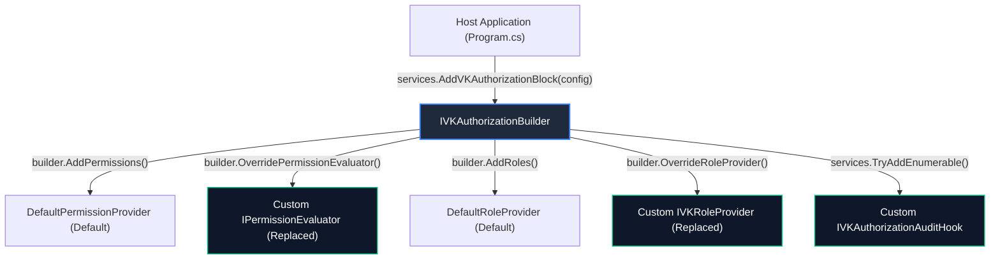

# 🔌 Extension & Customization Guide: VK.Blocks.Authorization

- **System ID / Package ID**: `VK.Blocks.Authorization`
- **Domain / Area**: `Security`
- **Target Audience**: プラットフォームエンジニア、マイクロサービス開発者、AI ペアプログラミング
- **Governing Rules**: `ARCH-05`, `ARCH-11`, `AP.02`, `AP.06`, `CS.01`, `CS.04`
- **Status**: 🏛️ Accepted

---

## 1. 🎯 概要と設計思想 (Philosophy)

`VK.Blocks.Authorization` は、**「堅牢なデフォルト実装と決定論的オーバーライド（`ARCH-05`, `AP.06`）」** を核とするプラガブル設計を採用しています。

開発者は、内部のハンドラーパイプラインを改変することなく、提供されている公式ポート（インターフェース）を実装し、明示的なビルダー API（`builder.OverrideXxx<T>()`）経由で登録することで、認可ロジックを安全かつ決定論的にカスタマイズできます。



---

## 2. 🧩 拡張可能ポート一覧 (Supported Extension Points)

| 拡張ポート (Port Interface) | デフォルト実装 (`ARCH-05`) | 推奨ライフサイクル | 主なカスタマイズユースケース |
| :--- | :--- | :---: | :--- |
| `IPermissionEvaluator` | `PermissionHandler` (内部) | `Scoped` | 分散 Redis キャッシュや外部認可エンジン（OPA/Cedar）と連動した権限評価。 |
| `IVKPermissionProvider` | `DefaultPermissionProvider` | `Scoped` | データベースや外部 RBAC サービスからユーザーの付与権限リストを取得。 |
| `IVKRoleProvider` | `DefaultRoleProvider` | `Scoped` | JWT クレーム外の動的グループ・ロール（IdP ディレクトリ同期）を動的解決。 |
| `IVKUserTenantProvider` | `DefaultUserTenantProvider` | `Scoped` | ユーザーがアクセス権を持つ所属テナント一覧（マルチテナント切替）の解決。 |
| `IVKWorkingHoursProvider` | `DefaultWorkingHoursProvider` | `Scoped` | 企業ごとの祝日カレンダー API やシフト管理システムと連動した勤務時間帯取得。 |
| `IVKAuthorizationAuditHook` | なし（複数注入可） | `Scoped` | 認可拒絶（Denial）イベントを SIEM / セキュリティ監査ログへ非同期送信。 |

---

## 3. 🛠️ ゴールデンコード実装例 (Step-by-Step Golden Paths)

### 3.1 カスタム権限評価器の実装 (`IPermissionEvaluator`)

外部の分散キャッシュと連動し、Result パターン（`CS.01`）およびホットパスゼロアロケーション（`CS.04`）を満たす実装例です：

```csharp
namespace MyApp.Infrastructure.Authorization;

using System.Security.Claims;
using System.Threading;
using System.Threading.Tasks;
using VK.Blocks.Authorization;
using VK.Blocks.Authorization.Features.Permissions;
using VK.Blocks.Core.Results;

// AP.01: sealed class 徹底
public sealed class DistributedCachePermissionEvaluator(
    IDistributedCache cache,
    IVKPermissionProvider fallbackProvider) : IPermissionEvaluator
{
    public async Task<VKResult<bool>> HasPermissionAsync(
        ClaimsPrincipal user, 
        string permission, 
        CancellationToken cancellationToken = default)
    {
        // 1. VKGuard による境界防御 (AP.01)
        VKGuard.NotNull(user);
        VKGuard.NotNullOrWhiteSpace(permission);

        var userId = user.FindFirstValue(ClaimTypes.NameIdentifier);
        if (string.IsNullOrEmpty(userId))
        {
            return VKResult.Failure<bool>(VKAuthorizationErrors.PermissionDenied);
        }

        // 2. キャッシュキーによる高速照合
        var cacheKey = $"perm:{userId}:{permission}";
        var cached = await cache.GetStringAsync(cacheKey, cancellationToken).ConfigureAwait(false);
        if (cached is not null)
        {
            return VKResult.Success(bool.Parse(cached));
        }

        // 3. キャッシュミス時はプロバイダーへフォールバック
        var userPermissionsResult = await fallbackProvider.GetPermissionsAsync(user, cancellationToken).ConfigureAwait(false);
        if (userPermissionsResult.IsFailure)
        {
            return VKResult.Failure<bool>(userPermissionsResult.Error);
        }

        var hasPerm = userPermissionsResult.Value.Contains(permission);
        await cache.SetStringAsync(cacheKey, hasPerm.ToString(), cancellationToken).ConfigureAwait(false);

        return VKResult.Success(hasPerm);
    }
}
```

### 3.2 認可拒絶監査フックの実装 (`IVKAuthorizationAuditHook`)

認可が失敗した際に、セキュリティ運用ログ（SIEM）へ即時通知するフックの実装例です：

```csharp
namespace MyApp.Infrastructure.Authorization;

using System.Security.Claims;
using System.Threading;
using System.Threading.Tasks;
using Microsoft.Extensions.Logging;
using VK.Blocks.Authorization;

public sealed class SecurityAuditLogHook(ILogger<SecurityAuditLogHook> logger) : IVKAuthorizationAuditHook
{
    public ValueTask OnAuthorizationDeniedAsync(
        ClaimsPrincipal user, 
        string requirementName, 
        string reason, 
        CancellationToken cancellationToken = default)
    {
        var userId = user.FindFirstValue(ClaimTypes.NameIdentifier) ?? "Anonymous";
        var tenantId = user.FindFirstValue("tenant_id") ?? "None";

        // OR.01: 構造化ログによるセキュリティインシデント記録
        logger.LogWarning(
            "SECURITY_DENIAL: User {UserId} in Tenant {TenantId} was DENIED access for {Requirement}. Reason: {Reason}",
            userId, tenantId, requirementName, reason);

        return ValueTask.CompletedTask;
    }
}
```

---

## 4. ⚙️ DI 登録と明示的オーバーライド (`AP.06`)

`Program.cs` において、`services.Replace()` を内包するビルダー拡張により、登録順序に依存しない決定論的オーバーライドを行います：

```csharp
var builder = WebApplication.CreateBuilder(args);

// 1. 認可ブロックの登録と機能チェーン
builder.Services.AddVKAuthorizationBlock(builder.Configuration)
    .AddTenantIsolation()
    .AddPermissions(options =>
    {
        options.Enabled = true;
    })
    .AddRoles()
    .AddWorkingHours()
    // 2. AP.06 準拠の明示的オーバーライド (services.Replace による決定論的置換)
    .OverridePermissionEvaluator<DistributedCachePermissionEvaluator>();

// 3. 監査フックの追加 (TryAddEnumerable パターン)
builder.Services.TryAddEnumerable(
    ServiceDescriptor.Scoped<IVKAuthorizationAuditHook, SecurityAuditLogHook>());

var app = builder.Build();
app.UseAuthentication();
app.UseAuthorization();
app.Run();
```

---

## 5. 🚫 頻出アンチパターンと回避策 (Anti-Patterns to Avoid)

| アンチパターン | 理由・リスク | 正しいアプローチ |
| :--- | :--- | :--- |
| **例外を投げて認可失敗を表現する** | 制御フローへの例外悪用（`BASE-05` 違反）。スレッドコンテキストスイッチと性能悪化。 | `VKResult.Failure<bool>(VKAuthorizationErrors.PermissionDenied)` を返却する。 |
| **`DateTime.Now` / `DateTime.UtcNow` の直呼び** | 非決定論的挙動（`BASE-02`, `CS.06` 違反）。タイムゾーンや休日テストの破壊。 | コンストラクタから `TimeProvider` を注入して時刻を解決する。 |
| **リクエストごとに DB から全権限をフェッチする** | ホットパスの I/O 爆発。高トラフィック時の DB 枯渇。 | `FrozenSet<string>` またはメモリキャッシュで $O(1)$ 解決する。 |
| **DI 順序に依存する `AddScoped` の手動重複登録** | 意図しないハンドラーの多重実行や順序依存バグ。 | `builder.OverrideXxx<T>()` または `services.Replace()` を使用する（`AP.06`）。 |

