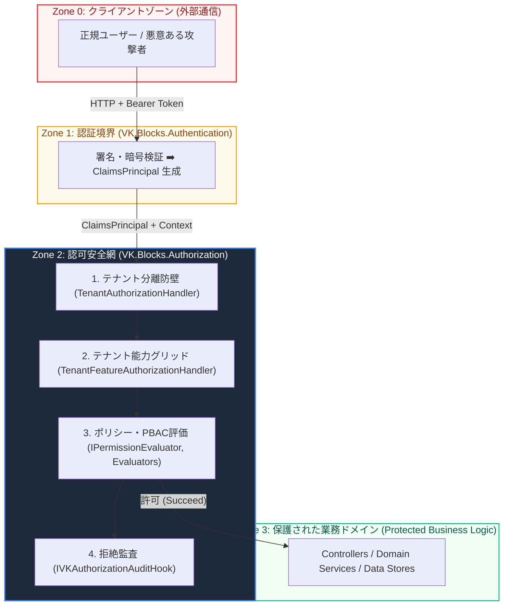

# 🛡️ Threat Model & Defense-in-Depth: VK.Blocks.Authorization

- **System ID / Package ID**: `VK.Blocks.Authorization`
- **Domain / Area**: `Security`
- **Security Lead / Architect**: Security Architecture Team & AI Pair
- **Governing Rules**: `BASE-01`, `FS-07`, `FS-12`, `OR.01`, `CS.08`, `Manifest 1-10`
- **Methodology**: STRIDE (Spoofing, Tampering, Repudiation, Information Disclosure, Denial of Service, Elevation of Privilege)
- **Status**: 🏛️ Accepted
- **Last Verified**: 2026-10-30

---

## 1. 🎯 信頼境界とアタックサーフェス (Trust Boundaries & Attack Surface)

`VK.Blocks.Authorization` は、認証済みユーザーの身元情報に基づき「何を許可し、何を拒絶するか」を裁定する**アクセス制御の中枢防壁**です。

---

## 2. 🛡️ STRIDE 脅威分析マトリクス (STRIDE Threat Analysis)

### 2.1 S: Spoofing（なりすまし）

| 脅威 ID | 脅威シナリオ (Threat Scenario) | 影響度 | 実装されている防衛策 (Countermeasures) |
| :--- | :--- | :---: | :--- |
| **S-01** | **テナント偽装による他テナントデータアクセス (Cross-Tenant Spoofing)** 攻撃者がヘッダーや URL で他テナントの ID を指定し、越境アクセスを試みる。 | **致命的** (Critical) | `TenantAuthorizationHandler`（`ADR-001`, `FS-07`）により、署名済み JWT 内の `TenantId` と現行コンテキストの一致をパイプライン先頭で強制検証。不一致時は即座に遮断。クライアント指定のヘッダーを身元ソースとして信用しない。 |
| **S-02** | **未認証トークンによる認可すり抜け** 署名検証されていないリクエストが認可ハンドラーに到達する。 | **高** (High) | `ClaimsPrincipal.Identity.IsAuthenticated` が `false` の場合、すべての認可ハンドラーが評価前に即座に拒絶（Fail-Closed）。 |

### 2.2 T: Tampering（改ざん）

| 脅威 ID | 脅威シナリオ (Threat Scenario) | 影響度 | 実装されている防衛策 (Countermeasures) |
| :--- | :--- | :---: | :--- |
| **T-01** | **権限定義・メタデータの実行時不正改ざん** 悪意あるコードがメモリ上の権限一覧やポリシーを書き換える。 | **高** (High) | 定義優先（Definition-First, `ADR-007`）に基づき、Source Generator が `PermissionsCatalog` の全量リストおよび FNV-1a `MetadataHash`（`ADR-008`）を `const` / `static readonly` の不変構造として生成。 |
| **T-02** | **動的ポリシー引数 (Args) の意図しない上書き** リクエストスコープの引数オブジェクトが他スレッドから改ざんされる。 | **中** (Medium) | Options および Args モデルはすべて `sealed record`（`AP.01`）であり、`with` 式による非破壊的クローン（不変性）を徹底。 |

### 2.3 R: Repudiation（否認）

| 脅威 ID | 脅威シナリオ (Threat Scenario) | 影響度 | 実装されている防衛策 (Countermeasures) |
| :--- | :--- | :---: | :--- |
| **R-01** | **不正アクセス拒絶の追跡不能 (Unlogged Denial)** 侵入試行や権限不足による拒絶が発生した際、誰がいつ何を実行しようとしたかが記録されない。 | **中** (Medium) | `IVKAuthorizationAuditHook`（`Manifest 9`）ポートを提供。拒絶時に `UserId`, `TenantId`, `RequirementName`, `Reason`, `TraceId` を構造化ログ（`OR.01`）または SIEM へ確実に送信。 |

### 2.4 I: Information Disclosure（情報漏洩）

| 脅威 ID | 脅威シナリオ (Threat Scenario) | 影響度 | 実装されている防衛策 (Countermeasures) |
| :--- | :--- | :---: | :--- |
| **I-01** | **ログ出力による PII および機密トークンの漏洩** 認可失敗時の詳細ログにユーザー個人情報やトークン文字列が混入する。 | **高** (High) | `[LoggerMessage]` Source Generator（`OR.01`）による型安全ログテンプレートを採用。生トークンや個人情報は一切ログ出力パラメータに含めず、識別子（Guid）とエラーコードのみを記録。 |
| **I-02** | **エラーレスポンスによる権限構造の過度な露出** 拒絶レスポンスを通じて、攻撃者に内部の全ポリシー構造を推測される。 | **低** (Low) | クライアントへは RFC 7807 形式で抽象的なエラーコード（例: `Authorization.PermissionDenied`）のみを返し、詳細な内部スタックトレースや評価ルールは隠蔽。 |

### 2.5 D: Denial of Service（サービス拒否）

| 脅威 ID | 脅威シナリオ (Threat Scenario) | 影響度 | 実装されている防衛策 (Countermeasures) |
| :--- | :--- | :---: | :--- |
| **D-01** | **大量権限登録による起動遅延とメモリ枯渇 (Startup DoS)** 数千件のポリシー事前静的登録により、コンテナの起動・スケールアウトが遅延する。 | **高** (High) | `IAuthorizationPolicyProvider` による動的生成（`ADR-002`）と、.NET 8+ `IAuthorizationRequirementData`（`ADR-006`）による中間ポリシー完全バイパス。さらに FNV-1a ハッシュ判定（`ADR-008`）により、起動時 DB I/O を $O(1)$ 抑制。 |
| **D-02** | **ホットパスにおける DB 問い合わせ集中によるリソース枯渇** リクエスト毎に権限 DB を走査し、DB 接続プールが枯渇する。 | **高** (High) | ホットパス権限評価はキャッシュ必須（`Manifest 6`）。`FrozenSet<string>` またはメモリキャッシュによる $O(1)$ 照合を強制。 |

### 2.6 E: Elevation of Privilege（権限昇格）

| 脅威 ID | 脅威シナリオ (Threat Scenario) | 影響度 | 実装されている防衛策 (Countermeasures) |
| :--- | :--- | :---: | :--- |
| **E-01** | **マルチモジュール統合時の権限名競合による誤許可** `Finance` と `Identity` で同じ `Read` 権限名が存在し、意図しないアクセスが許可される。 | **致命的** (Critical) | `ADR-009` に基づき、Source Generator がモジュール名プレフィックス（例: `RequireFinanceRefund`）を強制。直接文字列には `Misc` 治理タグを付与し、意図せぬ権限衝突を原理的に遮断。 |
| **E-02** | **ハンドラー手動 DI 登録忘れによる認可すり抜け** 開発者が新しいハンドラーの登録を忘れ、ポリシーがチェックされないまま通過する。 | **致命的** (Critical) | `AuthorizationHandlersGenerator`（`ADR-004`）がアセンブリ内のハンドラーをコンパイル時に自動検出して DI 登録を生成。人為的登録漏れを構造的に排除。 |
| **E-03** | **SuperAdmin 特権バイパスの濫用** 特権クレームを持つユーザーが無制限に全チェックをすり抜ける。 | **高** (High) | SuperAdmin によるバイパス時も、実行者および対象リソースの監査トレース（`OR.01`）を必須化。 |

---

## 3. 🛡️ 多層防御原則のまとめ (Defense-in-Depth Summary)

1. **第 1 層（境界防衛）**: `TenantAuthorizationHandler` による物理テナント越境の絶対阻止。
2. **第 2 層（契約能力）**: `TenantFeatureAuthorizationHandler` によるテナントプラン機能（Entitlements）の有効性判定。
3. **第 3 層（ユーザー権限）**: `IPermissionEvaluator` による最小権限原則（PoLP）に基づく PBAC 判定。
4. **第 4 層（コンテキスト制約）**: 業務時間帯（`WorkingHours`）、最低役職ランク（`MinimumRank`）、内部 IP（`InternalNetwork`）による付加的コンテキスト防衛。
5. **第 5 層（監査・可観測性）**: `IVKAuthorizationAuditHook` および OpenTelemetry による全拒絶事象のリアルタイム可視化。

