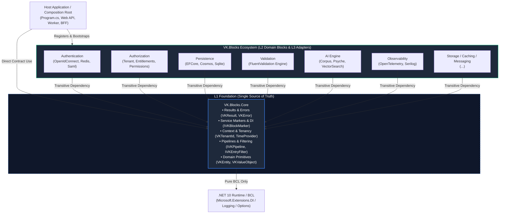
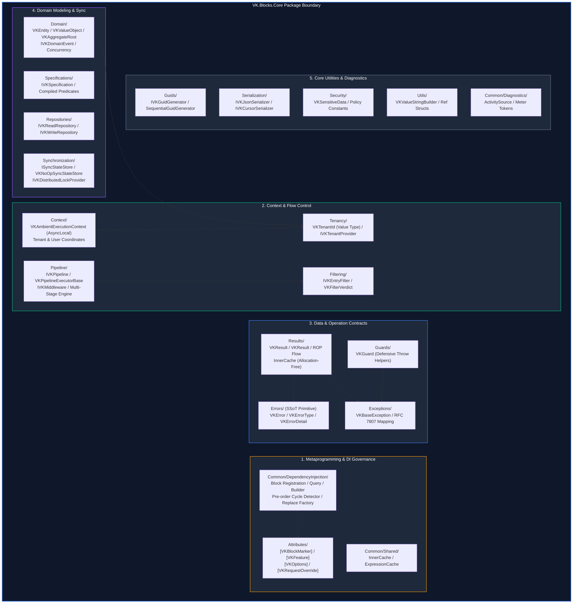
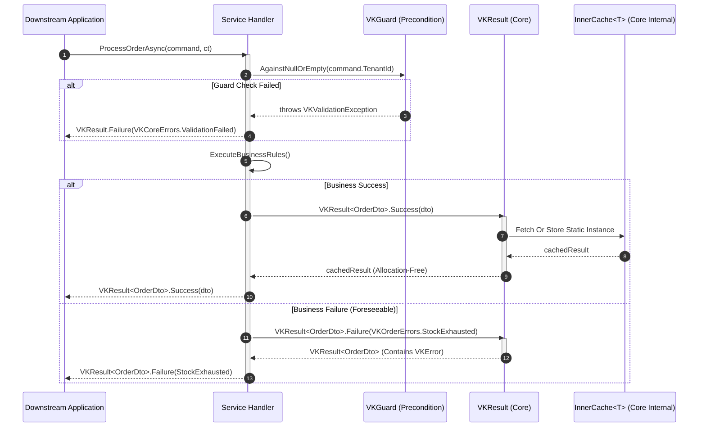
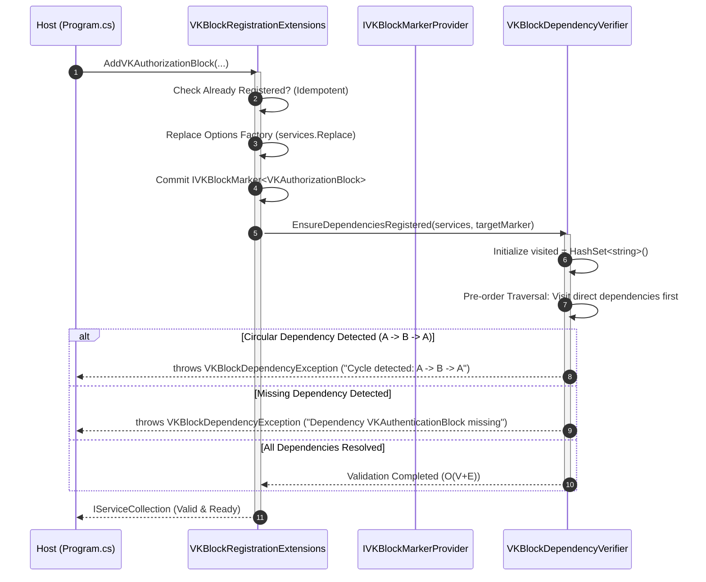
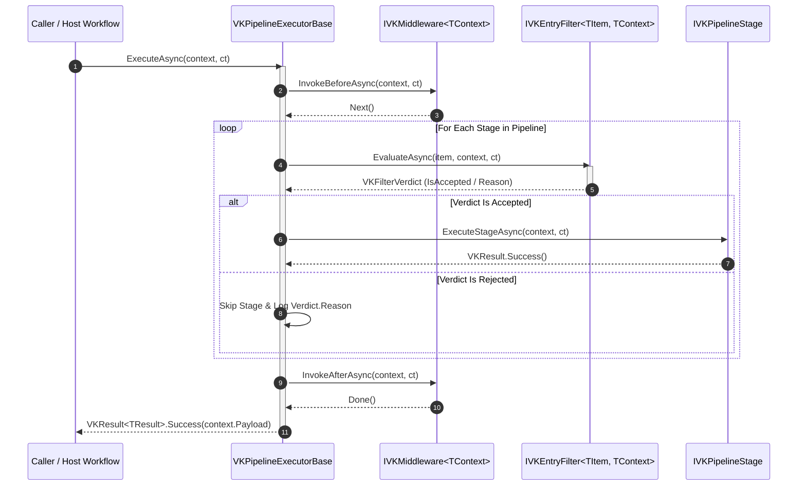

# 🏛️ Architecture: VK.Blocks.Core

- **System ID / Package ID**: `VK.Blocks.Core`
- **Domain / Area**: `Core / Foundation`
- **Primary Owner / Architect**: Framework Core Architecture Team & AI Pair
- **Target Layer**: L1 Foundation & Core Protocols (Single Source of Truth)
- **Status**: 🏛️ Accepted
- **Last Verified**: 2026-10-30
- **Governing Rules**: `BASE-01`〜`BASE-12`, `ARCH-01`〜`ARCH-13`, `CS.01`〜`CS.08`, `AP.01`〜`AP.07`, `BB.01`〜`BB.08`

---

## 1. 🎯 概要と範囲 (Overview & Scope)

### 1.1 エレベーターピッチ・要約 (Elevator Pitch)
`VK.Blocks.Core` は、VK.Blocks フレームワークの **最下層基盤モジュール（L1 Foundation & Single Source of Truth）** です。すべての BuildingBlock（Persistence, Authentication, Authorization, Validation, Observability, Caching, Storage, AI）および下流マイクロサービスが推移的に依存する「決定論的契約」「Result 型エラーモデル」「サービスマーカー統治」「不変オプション変換」「ゼロリフレクション・ゼロアロケーション機構」を一元的に提供します。外部ライブラリへの依存を一切持たず（BCL のみ）、極限の純粋性と Fail-Fast 原則を全社システムに貫通させます。

### 1.2 スコープ境界 (Goals & Non-Goals — `BASE-06`)

- **包含する領域 (In-Scope / Goals)**:
  - **Result パターンと RFC 7807 統一エラーモデル (`ADR-001`, `ADR-011`, `ADR-013`, `CS.01`, `FS-02`)**: フレームワーク唯一の戻り値契約としての `VKResult` / `VKResult<T>`、静的定数 `VKError`、および RFC 7807 準拠の構造化例外基底 `VKBaseException`。
  - **ゼロアロケーション最適化と高速基盤 (`ADR-010`, `CS.04`, `AP.01`)**: `VKResult.Success()` のシングルトンキャッシュ、ジェネリック型内部キャッシュ（`InnerCache`）、`ValueTask`、`Span<T>`、`stackalloc` によるヒープ割り当ての最小化。
  - **決定論的コア抽象の強制 (`ADR-015`, `CS.06`, `BASE-02`)**: システムクロック直読を排した `TimeProvider`、COMB / UUIDv7 互換の `IVKGuidGenerator`、および型安全な一意識別子基底。
  - **サービスマーカー統治と循環依存検知 (`ADR-003`, `ADR-007`, `ADR-008`, `BB.02`, `BB.03`)**: `IVKBlockMarker` によるモジュール稼働証明、Source Generator による `Instance` シングルトン自動注入、Pre-order 走査と `HashSet` による循環参照検知 ($O(V+E)$)。
  - **C# 11 Static Abstract Interface によるセクション解決 (`ADR-005`, `BB.05`)**: `IVKBlockOptions` によるリフレクション完全排除の構成バインド。
  - **関数型オプション不変変換と堅牢登録 (`ADR-016`, `ADR-017`, `AP.02`, `BB.05`)**: `Func<TOptions, TOptions>` と `with` 式による不変レコードの非破壊的変更、`services.Replace` による DI 登録順序依存性の完全排除。
  - **動的リクエスト上書きの凝集集約 (`ADR-014`, `ADR-020`, `AP.05`)**: `[VKOptions]` への Args 生成責務集約と、静的 Options × 動的 Args の階層的合成パターン。
  - **統一エントリー判定と多段パイプライン実行基底 (`ADR-018`, `ADR-019`, `ARCH-11`)**: インメモリ評価プロトコル `IVKEntryFilter` / 不変判定 `VKFilterVerdict`、および前後ミドルウェアを備えた多段ワークフロー基底 `IVKPipeline` / `VKPipelineExecutorBase`。
  - **純粋ドメインモデリングと同期状態抽象 (`ADR-004`, `ADR-006`, `ADR-015`)**: アロケーションフリーな `VKEntity<TId>` / `VKValueObject`、ドメインイベント抽象 `IVKDomainEvent`、およびメタデータ同期基盤 `ISyncStateStore`。

- **明確に除外する領域 (Out-of-Scope / Non-Goals)**:
  - **具象 I/O および外部インフラ依存 (`ARCH-03`)**: EF Core、Redis、HTTP クライアント、クラウド SDK などの具体的インフラ実装は Core に一切含めず、L3 アダプター層に委託する。
  - **業務ドメインロジックの実装 (`ARCH-10`)**: 特定業務のバリデーションやステートマシンは各ドメインブロックおよび上位アプリケーションの責務とする。
  - **DB トランスレート用クエリ仕様（Specification Pattern）**: `IVKEntryFilter` はインメモリの単一アイテム判定に特化し、SQL/NoSQL 式木翻訳は `VK.Blocks.Persistence` が所有する。
  - **動的プラグインの実行時 DLL ロード**: コンパイル時安全性（`BASE-03`）を堅持し、実行時リフレクションスキャンは行わない。

### 1.3 想定読者と適用バージョン
- **Target Audience**: プラットフォームアーキテクト、BuildingBlock 設計者、マイクロサービス開発者、AI コーディングエージェント
- **Target Runtime**: .NET 10+, C# 12+ (Strict Mode, Native AOT Ready, Zero-External-Dependency)

### 1.4 伴生仕様書体系 (Companion Specifications)
本文書を補完する個別特化仕様書：
- [api-surface.md](./api-surface.md) 📜: Level 1 公開契約型一覧、`Internal/` カプセル化境界、SemVer 破壊的変更基準
- [extension-guide.md](./extension-guide.md) 🔌: 決定論的プロバイダ拡張（`IVKGuidGenerator`, `TimeProvider`, `ISyncStateStore`, `IVKEntryFilter`）の実装ガイド
- [failure-modes.md](./failure-modes.md) 💥: DI 起動時循環依存、防御的ガード違反、ROP エラー伝搬の障害モードと縮退ハンドリング

---

## 2. ⚡ アーキテクチャ牽引要因 (Architectural Drivers)

### 2.1 主要品質属性 (Quality Attributes)

- **性能・ゼロアロケーション (`CS.04`, `AP.01`, `ADR-010`)**:
  - 全社で秒間数十万回呼び出される `VKResult.Success()` のヒープ割り当てをシングルトンキャッシュにより $0$ B に抑制。
  - ジェネリック型 `InnerCache<T>` による静的キャッシュおよび `AggressiveInlining` により、CA1000 警告を根絶しつつメソッド呼び出しオーバーヘッドを極小化。
  - 文字列連結やバッファ操作における `VKValueStringBuilder`（`ref struct`）および `ArrayPool<T>` の活用。
- **決定論的振る舞い・状態隔離 (`BASE-02`, `CS.06`, `ADR-015`)**:
  - `DateTime.UtcNow` や `Guid.NewGuid()` の直接呼び出しを静的解析レベルで禁止。
  - `TimeProvider` と `IVKGuidGenerator`（`SequentialGuidGenerator` / COMB）を介することで、並行テストや時間・ID 依存ロジックを 100% 再現可能・決定論的に制御。
- **Fail-Fast な起動時トポロジー統治 (`ADR-003`, `ADR-007`, `ADR-008`, `BB.03`)**:
  - 構成の有無ではなく実サービスの稼働証明（`IVKBlockMarker`）に基づき、依存関係の欠落をアプリケーション起動時に即座に検知。
  - 先行走査（Pre-order Traversal）により根本原因のブロックを正確に特定し、`HashSet` による循環参照検知で `StackOverflowException` を未然に防止。
- **関数型不変性と設定の堅牢性 (`ADR-014`, `ADR-016`, `ADR-017`, `BB.05`)**:
  - `sealed record` + `init` による完全不変な Options モデルを担保しつつ、`Func<TOptions, TOptions>` と `with` 式による非破壊的変換を実現。
  - `services.Replace` により、DI 登録呼び出し順序に関わらず確実にカスタム構成ファクトリをコミット。

### 2.2 厳格な技術制約 (Constraints)
- **Zero-Dependency Core (`ARCH-03`)**:
  - Core の参照は BCL（Base Class Library）および `Microsoft.Extensions.*` の抽象のみに限定。外部パッケージへの依存は許容されない。
- **Zero Implicit Reflection (`AP.01`, `BB.02`, `ADR-005`, `ADR-007`)**:
  - ホットパスでの実行時リフレクションおよび全アセンブリスキャンを禁止。`static abstract` メンバおよび Roslyn Source Generator によりコンパイル時にメタデータを確定。
- **Contract-First & Namespace 1:1 Alignment (`BASE-01`, `AP.03`, `BB.01`, `ADR-006`, `ADR-009`)**:
  - フォルダ構造と C# 名前空間を完全一致（12 の Capability Slices）。Level 1 公開型には `VK` プレフィックスを強制し、内部実装は `Internal/` に完全隠蔽。

---

## 3. 🌐 コンテキストビュー (C4 Level 1: System Context)

`VK.Blocks.Core` が全社エコシステムおよびホストアプリケーションに対して果たす基礎度量衡としてのコンテキスト関係図：

**コンテキスト説明**:
- **Downstream Hosts**: コアの戻り値契約（`VKResult`）、防御ガード（`VKGuard`）、実行コンテキスト（`VKTenantId`）を消費し、アプリケーションをブートストラップ。
- **Ecosystem BuildingBlocks**: 各ドメインブロックは例外なく Core を推移的に参照。ブロック間での独自エラー型やマーカーパターンの再定義は禁じられており、Core が全社共通の「通貨（Currency）」および「度量衡」を提供する。
- **.NET 10 Runtime / BCL**: サードパーティ外部ライブラリを挟まず、直接 .NET 10 BCL のみに立脚。

---

## 4. 🧩 コンテナ／モジュールビュー (C4 Level 2: Containers & Vertical Slices)

`VK.Blocks.Core` 内部は、大雑把な「ゴミ箱フォルダ」を排し、12 の高解像度なドメイン駆動垂直切片（Capability Slices）とシステム基盤で構成されています（`ADR-006`, `BB.01`）：

### 4.1 垂直切片（Capability Slices）と責務マトリクス

| スライス (Slice) | 名前空間 (Namespace) | 主な型と責務 | 可視性と単方向ルール (`ARCH-01`) |
| :--- | :--- | :--- | :--- |
| **`Errors/`** | `VK.Blocks.Core.Errors` | `VKError`, `VKErrorType`, `VKErrorDetail`, `VKErrorResponse`。 全社エラーデータの単一真実源（SSoT）。 | **最下層基底**。`Results/` を参照することは厳禁（単方向）。 |
| **`Results/`** | `VK.Blocks.Core.Results` | `VKResult`, `VKResult<T>`, `InnerCache<T>`。 ROP（Railway-Oriented Programming）戻り値契約。 | `Errors/` を保持。例外を戻り値に使用させない。 |
| **`Common/DI/`** | `VK.Blocks.Core.Common.DependencyInjection` | `IVKBlockMarker`, `IVKBlockOptions`, `VKBlockRegistrationExtensions`。 べき等登録、Pre-order 依存検証、循環参照検知。 | 全 BuildingBlock の DI ライフサイクルを統治。 |
| **`Tenancy/`** | `VK.Blocks.Core.Tenancy` | `VKTenantId`（`readonly record struct`）。 全社唯一の強型テナント識別子。 | **リーフスライス**。`Domain/` への依存禁止。`Domain/` からの参照のみ許可。 |
| **`Context/`** | `VK.Blocks.Core.Context` | `VKAmbientExecutionContext`, `IVKUserContext`。 `AsyncLocal` によるテナント・ユーザー・トレース座標の保持。 | `Tenancy/` を消費し、境界を貫通。 |
| **`Pipeline/`** | `VK.Blocks.Core.Pipeline` | `IVKPipeline`, `VKPipelineExecutorBase`, `IVKMiddleware`。 多段階ワークフロー実行エンジン。 | `Filtering/` と連携し、コンテキスト共有処理を統一。 |
| **`Filtering/`** | `VK.Blocks.Core.Filtering` | `IVKEntryFilter<TItem, TContext>`, `VKFilterVerdict`。 インメモリ単一アイテムの非同期合否判定プロトコル。 | クエリ仕様木（Specification）とは完全に分離。 |
| **`Domain/`** | `VK.Blocks.Core.Domain` | `VKEntity<TId>`, `VKValueObject`, `VKAggregateRoot<TId>`, `IVKDomainEvent`。 純粋なドメイン駆動設計（DDD）モデル基底。 | アロケーションフリーな等価性比較（LINQ 排除）。 |
| **`Synchronization/`** | `VK.Blocks.Core.Synchronization` | `ISyncStateStore`, `VKNoOpSyncStateStore`, `IVKDistributedLockProvider`。 メタデータ同期指紋および分散ロック抽象。 | デフォルトで安全な NoOp 実装を co-located 同梱。 |
| **`Guids/`** | `VK.Blocks.Core.Guids` | `IVKGuidGenerator`, `SequentialGuidGenerator`。 COMB / 連続 GUID 生成ポートと決定論的偽装基盤。 | 生 `Guid.NewGuid()` の直接呼び出しを遮断。 |
| **`Guards/`** | `VK.Blocks.Core.Guards` | `VKGuard`。 境界防衛用の流暢な事前条件表明ヘルパー。 | 違反時は構造化 `VKValidationException` 等をスロー。 |
| **`Security/`** | `VK.Blocks.Core.Security` | `VKSensitiveDataAttribute`, `VKRedactedAttribute`, `VKAuthPolicies`。 PII/秘匿性マーカーおよび静的ポリシー名定数。 | **メタデータ専用**。アクセス判定ロジックの実装は厳禁。 |

---

## 5. 🏛️ レイヤリングおよび依存性ルール (Layering & Governance — `ARCH-01`〜`ARCH-03`)

### 5.1 スライス間依存関係の厳格な階層規約
1. **Errors と Results の単方向性 (`module-manifest` Rule 4)**:
   - `Results/` は `Errors/`（`VKError`）を保持して下流へ伝搬します。
   - `Errors/` は独立したプリミティブであり、`Results/` の型を逆参照することは固く禁じられます。
2. **Tenancy スライスのリーフ性 (`module-manifest` Rule 7)**:
   - `Tenancy/` は独立した基盤であり、`Domain/` に依存してはなりません。`Domain/` が `Tenancy/` を参照して `IVKMultiTenantEntity` を形成することは許可されます。
3. **Security スライスのメタデータ限定原則 (`module-manifest` Rule 8)**:
   - `Security/` は属性（`[VKSensitiveData]`）およびポリシー名定数のみを保持します。「ユーザー X が権限 Y を持つか」という評価ロジックを Core に実装することは厳禁であり、`VK.Blocks.Authorization` の排他的責務です。
4. **Filtering と Specification の分離 (`module-manifest` Rule 9)**:
   - `Filtering/`（`IVKEntryFilter`）はインメモリ単一アイテムの合否判定プロトコルです。SQL や NoSQL へのトランスレートを伴う宣言的クエリ式木（Specification パターン）と混同・統合してはなりません。

### 5.2 厳格な禁止事項 (Anti-Patterns)
- ❌ **Core 内での具象インフラライブラリ参照**: `DbContext`, `StackExchange.Redis`, `HttpClient`, `Newtonsoft.Json` などの参照。
- ❌ **例外による業務制御フロー**: 回復可能な業務失敗で例外をスローすること。必ず `VKResult.Failure(error)` を返却する。
- ❌ **非決定論的 API の直接呼び出し**: `DateTime.UtcNow` や `Guid.NewGuid()` の直呼び出し。必ず `TimeProvider` / `IVKGuidGenerator` を使用する。
- ❌ **内部型の公開およびプレフィックス違反 (`AP.03`)**: `Internal/` 配下のクラスを `public` にすること、または内部クラスに `VK` プレフィックスを付与すること。

---

## 6. 🔄 主要シーケンス（ランタイムビュー — Runtime Sequence）

### 6.1 シナリオ A: Railway-Oriented Programming (ROP) 実行と成功インスタンスキャッシュ (`CS.01`, `ADR-010`, `ADR-013`)

### 6.2 シナリオ B: DI コンテナ起動時検証と循環参照検知 (`ADR-003`, `ADR-007`, `ADR-008`, `BB.03`)

### 6.3 シナリオ C: 多段パイプライン実行とエントリー判定エンジン (`ADR-018`, `ADR-019`)

---

## 7. 💾 データアーキテクチャ (Data Architecture & Storage — `CS.04`, `CS.08`)

### 7.1 強型識別子とテナント境界 (`CS.08`, `FS-04`, `ADR-015`)
- **`VKTenantId`**: `readonly record struct` として実装され、プライベートコンストラクタと `VKTenantId.From(Guid)` ファクトリにより無効な空 GUID の生成を防止。全サブシステムにおけるマルチテナント分離の絶対境界。
- **`IVKStronglyTypedId<TId>`**: 生の `string` や `Guid` がレイヤー境界を越えて流出することを防ぐ強タイプ ID 抽象。

### 7.2 RFC 7807 障害モデルと構造化エラープリミティブ (`CS.01`, `FS-02`, `ADR-001`, `ADR-011`)
- **`VKError`**: エラーコード（`Code`）、人間可読メッセージ（`Message`）、分類（`VKErrorType`）、詳細配列（`VKErrorDetail[]`）、および拡張メタデータ（`Dictionary<string, object?>`）をカプセル化する不変レコード。
- **`VKErrorType`**: HTTP 400（Validation）, 401（Unauthorized）, 403（Forbidden）, 404（NotFound）, 409（Conflict）, 429（TooManyRequests）, 502/504（ExternalError/Timeout）, 503（ServiceUnavailable）への 1:1 マッピングを保証。

### 7.3 同期状態抽象 (`ADR-004`)
- **`ISyncStateStore`**: 各 BuildingBlock が起動時または運用時にメタデータ（権限一覧、スキーマ指紋など）の同期ハッシュ（64-bit FNV-1a）を照合・永続化するための統一ポート。
- **`VKNoOpSyncStateStore`**: 分散ストレージや DB を設定していない環境向けに、常に安全にパスする NoOp フォールバック実装を同一パッケージ内に同梱（`ARCH-05`）。

---

## 8. 🛡️ 横断的関心事 (Cross-Cutting Concerns)

| 関心事 (Concern) | 統一プラクティス (Standard Pattern) | 準拠ルール / 実装場所 |
| :--- | :--- | :--- |
| **戻り値とエラー** | 全パブリックメソッドで `VKResult<T>` を返却。例外を制御フローに使用しない。静的 `VKError` 定数。 | `CS.01`, `BASE-05` / `Results/`, `Errors/` |
| **起動時トポロジー検証** | `IVKBlockMarker` による実体証明、Pre-order 走査、`HashSet` 循環参照検知。 | `BB.03`, `AP.02` / `Common/DI/` |
| **ゼロリフレクション** | C# 11 `static abstract SectionName`、Source Generator による `Instance` 自動合成。 | `AP.01`, `BB.02` / `Common/Config/` |
| **非決定論性の排除** | システムクロック直読禁止（`TimeProvider`）、生 GUID 発行禁止（`IVKGuidGenerator`）。 | `CS.06`, `BASE-02` / `Guids/` |
| **関数型不変性** | Options は `sealed record` + `init`。DI 登録時は `Func<T, T>` と `with` 式で非破壊変換。 | `BB.05`, `AP.04` / `Common/DI/` |
| **リクエスト動的制御** | `[VKOptions(ArgsMode = ...)]` により静的 Options と動的 Args をゼロアロケーション合成。 | `AP.05`, `ADR-020` / `Attributes/` |
| **事前条件表明** | 境界での防御的アサーションに `VKGuard` を適用。不整合時は構造化例外を即座に送出。 | `AP.01` / `Guards/` |
| **メモリ最適化** | `InnerCache<T>`、`ref struct VKValueStringBuilder`、`ArrayPool<T>` バッファリング。 | `CS.04`, `AP.01` / `Common/Shared/`, `Utils/` |

---

## 9. 📦 パッケージ配布・実行環境およびホストトポロジ (Packaging, Runtime & Host Constraints)

### 9.1 パッケージングとゼロ依存保証
- **NuGet 配布単位**: `VK.Blocks.Core`（フレームワーク唯一の純粋コアアセンブリ）。
- **推移的依存の純粋性 (`ARCH-03`)**: BCL 以外の外部依存（Third-party NuGet）を持たないため、下流のあらゆるプロジェクトとバージョン競合を起こさずに安全に参照可能。
- **Source Generator 連携**: `VK.Tools.SourceGenerators` が Core の属性（`[VKBlockMarker]`, `[VKOptions]`）を解析し、コンパイル時にボイラープレートを全自動生成。

### 9.2 ホストランタイム要件 (Host Container Requirements)
- **Target Framework**: .NET 10.0+（C# 12+ Strict Mode, Native AOT 完全対応）。
- **Native AOT Ready**: リフレクションや動的コード生成（IL Emit）を 100% 排除しているため、トリミングおよび事前コンパイル（Ahead-Of-Time）環境で一切の警告なく動作。
- **DI ライフサイクル**: 
  - `Singleton`: マーカー、Options、Guid ジェネレーター、静的キャッシュ。
  - `Scoped`: 実行コンテキスト（`VKAmbientExecutionContext`）、ユーザーコンテキスト。

---

## 10. 🔌 拡張ポイントと将来の進化方向 (Extension Points & Evolution — `ARCH-11`)

### 10.1 公式サポートされる拡張ポイント
- **`IVKGuidGenerator`**: デフォルトの `SequentialGuidGenerator`（COMB / UUIDv7）から、テスト用 `VKFakeGuidGenerator` や分散 SnowFlake への差し替え。
- **`TimeProvider`**: 本番用 `TimeProvider.System` から、テスト用 `FakeTimeProvider` への差し替え。
- **`ISyncStateStore`**: デフォルトの `VKNoOpSyncStateStore` から、分散 DB / Redis バッキングストアへの差し替え。
- **`IVKJsonSerializer`**: デフォルトの `DefaultJsonSerializer`（System.Text.Json）から、カスタム高速シリアライザーへの差し替え。
- **`IVKEntryFilter<TItem, TContext>`**: 業務スライスに応じたカスタム判定ロジックの実装。
- **`IVKDistributedLockProvider`**: クラスタ環境における分散ロック機構の提供。

### 10.2 歴史的進化の波 (Three Evolution Waves — `docs/02-RFCs/Core/`)
1. **第 1 波: 基盤確立と決定論的コア契約 (`RFC-001`)**:
   - `VKResult` / `VKError` 標準化、`VKBaseException` 障害モデル、決定論的抽象（`TimeProvider`, `IVKGuidGenerator`）、`InnerCache` ゼロアロケーション最適化。
2. **第 2 波: モジュラー形態学と依存性統治 (`RFC-002`)**:
   - サービスマーカー（`IVKBlockMarker`）、`static abstract SectionName`、12 Capability 切片解体、Pre-order 循環依存検知、`Internal/` カプセル化。
3. **第 3 波: 工業化パイプライン、関数型不変性とコード生成統合 (`RFC-003`)**:
   - 階層的構成パターン、`Func<T, T>` + `with` 不変変換、`services.Replace` による順序非依存登録、統一判定エンジン（`IVKEntryFilter`）、パイプライン基底（`IVKPipeline`）、`[VKOptions]` への Args 生成集約。

---

## 11. 📜 アーキテクチャ意思決定レコード索引 (Architecture Decision Records — `DL.03`, `PS.02`)

| ADR 番号 | タイトル (Title) | ステータス | 決定内容の要約と選定理由 |
| :---: | :--- | :---: | :--- |
| [ADR-001](/docs/04-ArchitectureDecisionRecords/Core/adr-001-expanding-global-errortype-for-enterprise-grade-error-handling.md) | Expanding Global ErrorType for Enterprise-Grade Error Handling | ✅ Accepted | 全局 `ErrorType` を拡張し、429, 503, 502/504 等のエンタープライズ HTTP マッピングを完備。 |
| [ADR-002](/docs/04-ArchitectureDecisionRecords/Core/adr-002-idempotent-buildingblock-options-registration-in-di-container.md) | Idempotent BuildingBlock Options Registration in DI Container | ✅ Accepted | `Any()` チェックと `TryAddSingleton` の組み合わせにより Options の二重登録を防止。 |
| [ADR-003](/docs/04-ArchitectureDecisionRecords/Core/adr-003-introducing-service-marker-pattern-for-buildingblock-modularization.md) | Introducing Service Marker Pattern for BuildingBlock Modularization | ✅ Accepted | 構成の存在確認を廃止し、`IVKBlockMarker` によるセマンティックな実サービス稼働確認を導入。 |
| [ADR-004](/docs/04-ArchitectureDecisionRecords/Core/adr-004-unified-synchronization-state-abstraction-in-core.md) | Unified Synchronization State Abstraction in Core | ✅ Accepted | メタデータ同期指紋（FNV-1a）を管理する `ISyncStateStore` 抽象と No-Op 実装を確立。 |
| [ADR-005](/docs/04-ArchitectureDecisionRecords/Core/adr-005-use-static-abstract-interface-for-configuration-section-resolution.md) | Use Static Abstract Interface for Configuration Section Resolution | ✅ Accepted | `IVKBlockOptions` に `static abstract SectionName` を導入しリフレクションを完全排除。 |
| [ADR-006](/docs/04-ArchitectureDecisionRecords/Core/adr-006-restructuring-core-module-into-semantic-pillars.md) | Granular Capability-Based Structure and Namespace Alignment in Core | ✅ Accepted | 5大ピラー案を却下し、12 の高解像度 Capability スライスとフォルダ・名前空間 1:1 対応を採用。 |
| [ADR-007](/docs/04-ArchitectureDecisionRecords/Core/adr-007-unified-buildingblock-identification-and-source-generated-zero-reflection-validation.md) | Unified BuildingBlock Identification and Source-Generated Zero-Reflection Validation | ✅ Accepted | プロパティを `IVKBlockMarker` に集約し、Source Generator による `Instance` シングルトン自動注入を実現。 |
| [ADR-008](/docs/04-ArchitectureDecisionRecords/Core/adr-008-robust-building-block-dependency-validation.md) | Robust BuildingBlock Dependency Validation through Pre-order Traversal and Cycle Detection | ✅ Accepted | Pre-order 先行走査と `HashSet` による循環参照検知を導入し、`StackOverflow` を防止。 |
| [ADR-009](/docs/04-ArchitectureDecisionRecords/Core/adr-009-standardization-of-building-block-naming-and-structural-conventions.md) | Standardization of Building Block Naming and Structural Conventions | ✅ Accepted | 公開 API への `VK` プレフィックス強制と、内部実装のプレフィックス除去・`Internal/` 隔離を全社標準化。 |
| [ADR-010](/docs/04-ArchitectureDecisionRecords/Core/adr-010-high-performance-infrastructure-optimizations-in-core-library.md) | High-Performance Infrastructure Optimizations in Core Library | ✅ Accepted | `AggressiveInlining`、成功結果のキャッシュ、および `InnerCache` による CA1000 警告根絶とゼロアロケーション。 |
| [ADR-011](/docs/04-ArchitectureDecisionRecords/Core/adr-011-standardized-exception-hierarchy-and-fault-modeling.md) | Standardized Exception Hierarchy and Fault Modeling | ✅ Accepted | `VKBaseException` を基底とする例外階層を導入し、エラーコード・RFC 7807 変換を一貫サポート。 |
| [ADR-012](/docs/04-ArchitectureDecisionRecords/Core/adr-012-functional-decoupling-of-dependency-injection-extensions.md) | Functional Decoupling of Dependency Injection Extensions | ✅ Accepted | DI 拡張メソッドを Registration, Query, Builder の 3 責務に明確分離し、DX と保守性を向上。 |
| [ADR-013](/docs/04-ArchitectureDecisionRecords/Core/adr-013-comprehensive-result-pattern-standardization-with-vkerror.md) | Comprehensive Result Pattern Standardization with VKError | ✅ Accepted | `Result` を `VKResult` へ刷新し、`VKError` による型安全定数管理とフレームワーク全社統一。 |
| [ADR-014](/docs/04-ArchitectureDecisionRecords/Core/adr-014-adoption-of-hierarchical-configuration-pattern-for-dynamic-call-behaviors.md) | Adoption of Hierarchical Configuration Pattern for Dynamic Call Behaviors | ✅ Accepted | 静的 Options と動的 Args を安全にマージする階層的構成パターンを全社標準として採用。 |
| [ADR-015](/docs/04-ArchitectureDecisionRecords/Core/adr-015-adopt-vertical-slices-and-mandatory-core-abstractions-in-building-blocks.md) | Adopt Vertical Slices and Mandatory Core Abstractions in Building Blocks | ✅ Accepted | 技術層フォルダを廃止してドメイン垂直切片を採用し、非決定論的 API（Guid, DateTime）の直接使用を禁止。 |
| [ADR-016](/docs/04-ArchitectureDecisionRecords/Core/adr-016-functional-options-transformation-for-immutable-building-blocks.md) | Functional Options Transformation for Immutable Building Blocks | ✅ Accepted | `Action<T>` を排し、`Func<T, T>` と `with` 式を用いた関数型不変オプション変換を採用。 |
| [ADR-017](/docs/04-ArchitectureDecisionRecords/Core/adr-017-options-registration-robustness-and-double-binding-elimination.md) | Options Registration Robustness and Double Binding Elimination | ✅ Accepted | 二重バインドを排除し、`services.Replace` を導入して DI コンテナ登録順序の依存脆弱性を解消。 |
| [ADR-018](/docs/04-ArchitectureDecisionRecords/Core/adr-018-standardized-entry-filtering-and-verdict-engine.md) | Standardized Entry Filtering and Verdict Engine | ✅ Accepted | 複数モジュール横断のデータ評価・サニタイズを統一する `IVKEntryFilter` と `VKFilterVerdict` を定義。 |
| [ADR-019](/docs/04-ArchitectureDecisionRecords/Core/adr-019-standardized-pipeline-execution-framework.md) | Standardized Pipeline Execution Framework | ✅ Accepted | 多段階ワークフローを標準化する `IVKPipeline`、`VKPipelineExecutorBase`、およびミドルウェア機構を導入。 |
| [ADR-020](/docs/04-ArchitectureDecisionRecords/Core/adr-020-decoupling-args-generation-from-vkfeature-to-vkoptions.md) | Decoupling Args Generation from VKFeature to VKOptions | ✅ Accepted | 動的 Args 生成設定を `[VKFeature]` から `[VKOptions]` へ返還し、モデル凝集度最大化と安全なオプトインを確立。 |

---

## 12. ⚠️ リスクと未解決事項 (Risks & Open Questions)

| ID | 潜在リスク / 未決事項 (Risk / Question) | 影響度 | 緩和策 / 次のアクション | 担当 |
| :---: | :--- | :---: | :--- | :--- |
| **R-01** | `VKResult<T>` のシリアライズ時の JSON プロパティ名の互換性（`IsSuccess` vs `isSuccess`） | Medium | `IVKJsonSerializer` における CamelCase 規約の強制（`FS-13`）と、OpenAPI スキーマ同期による検証。 | Core Team |
| **R-02** | 複雑な多段パイプライン実行時における ValueTask の多重消費による例外リスク | Low | パイプライン実行基底（`VKPipelineExecutorBase`）内で `await` 完了を保証し、`AsTask()` への退避方針を標準化。 | Core Team |
| **R-03** | 外部プロバイダー追加時における `ISyncStateStore` の分散ロック競合 | Medium | 分散ロック抽象（`IVKDistributedLockProvider`）と Polly リトライ（`OR.03`）を併用し、競合時の冪等性を保証。 | Infra Team |

