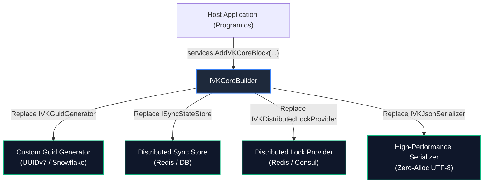

# 🔌 Extension & Customization Guide: VK.Blocks.Core

- **System ID / Package ID**: `VK.Blocks.Core`
- **Domain / Area**: `Core / Foundation`
- **Target Audience**: プラットフォームエンジニア、下流マイクロサービス開発者、AI ペアプログラミング
- **Governing Rules**: `ARCH-05`, `ARCH-11`, `AP.02`, `AP.06`, `CS.01`, `CS.03`, `CS.06`
- **Status**: 🏛️ Accepted

---

## 1. 🎯 概要と設計思想 (Philosophy)

`VK.Blocks.Core` は、**「堅牢なポートと決定論的オーバーライド（`ARCH-05`, `AP.06`）」** を核とするプラガブル設計を採用しています。

Core は基盤としての純粋性（Pure BCL）を維持するため、外部インフラに依存する具象実装を持ちません。代わりに、安全な **Fallback Tier 実装（NoOp, In-Memory）** を同一パッケージに co-located 同梱し、下流モジュールや上位ホストが明示的なビルダー API 経由で **Provided Tier（実インフラ実装）** に差し替える拡張モデルを確立しています。



---

## 2. 🧩 拡張可能ポート一覧 (Supported Extension Points)

| ポート (Port Interface) | デフォルト実装 (`ARCH-05`) | 推奨ライフサイクル | 主な拡張ユースケース |
| :--- | :--- | :---: | :--- |
| `IVKGuidGenerator` | `DefaultSequentialGuidGenerator` | `Singleton` | UUIDv7 形式のタイムスタンプ先行 GUID、Twitter Snowflake、またはテスト用確定 GUID（`VKFakeGuidGenerator`）。 |
| `TimeProvider` | `TimeProvider.System` | `Singleton` | 単体テスト環境における時間停止・早送り用の `FakeTimeProvider`。 |
| `ISyncStateStore` | `VKNoOpSyncStateStore` | `Singleton` | 権限一覧やスキーマの FNV-1a ハッシュ指紋を分散 Redis / Relational DB に永続化。 |
| `IVKDistributedLockProvider` | `InMemoryDistributedLockProvider` | `Singleton` | クラスタ環境における分散排他制御（Redis Redlock、Postgres アドバイザリロック）。 |
| `IVKJsonSerializer` | `DefaultJsonSerializer` | `Singleton` | AOT 最適化された Source Generator シリアライザーや MessagePack / Protocol Buffers 連携。 |
| `IVKEntryFilter<TItem, TContext>` | なし（複数注入可） | `Scoped` / `Singleton` | AI ナレッジ文書の著作権・機密判定、ブラックリストフィルタリング。 |

---

## 3. 🛠️ ゴールデンコード実装例 (Step-by-Step Golden Paths)

### 3.1 カスタム GUID 生成器の実装 (`IVKGuidGenerator`)

```csharp
namespace MyApp.Infrastructure.Guids;

using System;
using VK.Blocks.Core.Guids;

// [AP.01] sealed クラス、純粋実装
public sealed class UuidV7GuidGenerator : IVKGuidGenerator
{
    public Guid NewGuid()
    {
        // .NET 9+ ネイティブ UUIDv7 生成
        return Guid.CreateVersion7();
    }
}
```

**DI コンテナへの明示的登録 (`AP.06`, `ARCH-05`)**:
```csharp
// Program.cs
builder.Services.AddVKCoreBlock(core =>
{
    core.OverrideGuidGenerator<UuidV7GuidGenerator>();
});
```

---

### 3.2 分散同期状態ストアの実装 (`ISyncStateStore`)

メタデータ指紋を分散キャッシュに記録し、マルチインスタンス環境での起動時初期化の重複実行を完全に抑制します（`ADR-004`）：

```csharp
namespace MyApp.Infrastructure.Sync;

using System.Threading;
using System.Threading.Tasks;
using VK.Blocks.Core.Results;
using VK.Blocks.Core.Errors;
using VK.Blocks.Core.Synchronization;
using StackExchange.Redis;

public sealed class RedisSyncStateStore(IConnectionMultiplexer redis) : ISyncStateStore
{
    private readonly IDatabase _db = redis.GetDatabase();

    public async ValueTask<VKResult<ulong?>> GetFingerprintAsync(
        string moduleKey, 
        CancellationToken cancellationToken = default)
    {
        // [CS.03] CancellationToken の尊重
        var key = $"vk:sync:{moduleKey}";
        var value = await _db.StringGetAsync(key).ConfigureAwait(false);

        if (value.IsNullOrEmpty)
        {
            return VKResult<ulong?>.Success(null);
        }

        if (ulong.TryParse(value, out var hash))
        {
            return VKResult<ulong?>.Success(hash);
        }

        return VKResult<ulong?>.Failure(
            new VKError("Sync.InvalidFingerprint", "Stored fingerprint is not a valid ulong", VKErrorType.Conflict));
    }

    public async ValueTask<VKResult> SaveFingerprintAsync(
        string moduleKey, 
        ulong fingerprint, 
        CancellationToken cancellationToken = default)
    {
        var key = $"vk:sync:{moduleKey}";
        var success = await _db.StringSetAsync(key, fingerprint.ToString()).ConfigureAwait(false);

        return success 
            ? VKResult.Success() 
            : VKResult.Failure(new VKError("Sync.SaveFailed", "Failed to persist fingerprint", VKErrorType.ServiceUnavailable));
    }
}
```

---

### 3.3 エントリーフィルターの実装 (`IVKEntryFilter<TItem, TContext>`)

`ADR-018` に準拠し、任意のワークフロー内で不正な入力を排除するフィルターを定義します：

```csharp
namespace MyApp.Application.Filters;

using System.Threading;
using System.Threading.Tasks;
using VK.Blocks.Core.Filtering;
using VK.Blocks.Core.Results;

public sealed class SensitiveWordEntryFilter : IVKEntryFilter<string, PipelineContext>
{
    private static readonly string[] ForbiddenWords = ["MALICIOUS_PAYLOAD", "PROHIBITED_KEYWORD"];

    public ValueTask<VKFilterVerdict> EvaluateAsync(
        string item, 
        PipelineContext context, 
        CancellationToken cancellationToken = default)
    {
        foreach (var word in ForbiddenWords)
        {
            if (item.Contains(word, StringComparison.OrdinalIgnoreCase))
            {
                // [ADR-018] 排除理由を明示した不変 Verdict の返却
                return ValueTask.FromResult(VKFilterVerdict.Reject($"Contains prohibited word: {word}"));
            }
        }

        // 正常通過
        return ValueTask.FromResult(VKFilterVerdict.Accept());
    }
}
```

---

## 4. 🚫 よくあるアンチパターン (Anti-Patterns to Avoid)

### ❌ 1. 例外による業務フロー制御 (`CS.01`)
```csharp
// ❌ 違反: 予見可能な業務失敗で例外をスロー
if (string.IsNullOrEmpty(command.Name))
    throw new ArgumentException("Name is required");

// ✅ 適合: VKResult.Failure または VKGuard を適用
if (string.IsNullOrEmpty(command.Name))
    return VKResult.Failure(VKCoreErrors.ValidationFailed);
```

### ❌ 2. システムクロックおよび生 GUID の直読み (`CS.06`)
```csharp
// ❌ 違反: テストの非決定論化
var createdAt = DateTime.UtcNow;
var id = Guid.NewGuid();

// ✅ 適合: 抽象注入による制御
var createdAt = timeProvider.GetUtcNow();
var id = guidGenerator.NewGuid();
```

### ❌ 3. 不変 Options の原地変異 (`BB.05`, `ADR-016`)
```csharp
// ❌ 違反: .NET 標準の変異 Action (C# 12 init-only エラーまたはスレッド競合)
services.Configure<VKCoreOptions>(options => { options.MaxRetries = 5; });

// ✅ 適合: Func<T, T> と with 式による非破壊的変換
services.AddVKCoreBlock(options => options with { MaxRetries = 5 });
```

