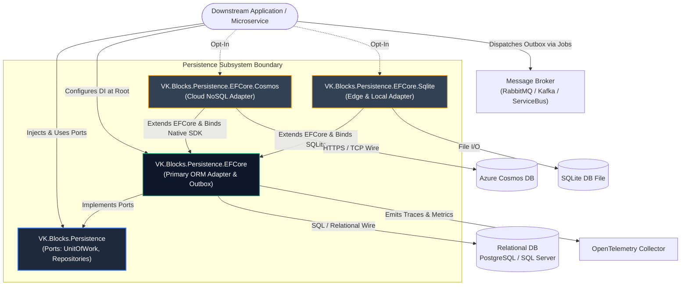
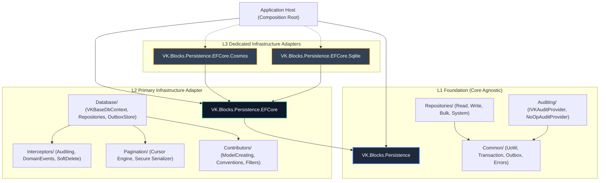
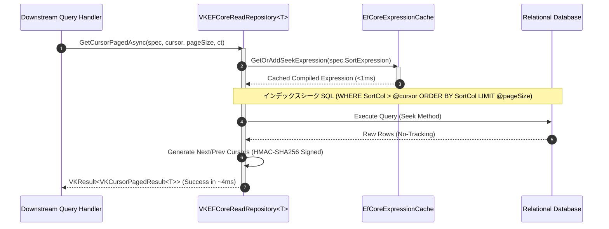
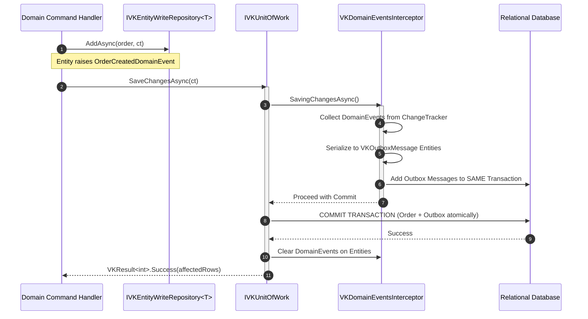
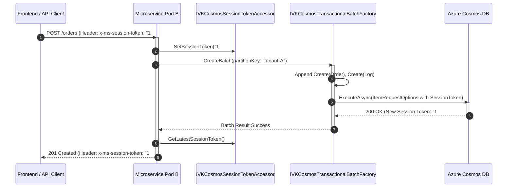

# 🏛️ Architecture: VK.Blocks.Persistence

- **System ID / Package ID**: `VK.Blocks.Persistence`
- **Domain / Area**: `Persistence`
- **Primary Owner / Architect**: Data Architecture Team & AI Pair
- **Target Layer**: L1 Foundation (`Persistence`) / L2 Domain BuildingBlock (`Persistence.EFCore`) / L3 Infrastructure Adapters (`Cosmos`, `Sqlite`)
- **Status**: 🏛️ Accepted
- **Last Verified**: 2026-10-30

---

## 1. 🎯 概要と範囲 (Overview & Scope)

### 1.1 エレベーターピッチ・要約 (Elevator Pitch)
`VK.Blocks.Persistence` は、.NET 10 / C# 12+ 向けに設計された**ポート＆アダプター（Port-and-Adapter）分離・CQS 準拠・ゼロアロケーション指向のエンタープライズ永続化基盤**です。ドメイン層を特定の ORM やデータベース SDK から完全に隔離（Core Purity）しつつ、EF Core、Azure Cosmos DB、SQLite に跨る統一されたリポジトリ規約、Transactional Outbox、定数時間カーソルページネーション、および決定論的スキーマ統治を提供します。

### 1.2 スコープ境界 (Goals & Non-Goals — `BASE-06`)

- **包含する領域 (In-Scope / Goals)**:
  - **ORM 非依存の純粋ポート (`ARCH-02`, `ARCH-03`)**: BCL と `VK.Blocks.Core` のみに依存し、`IVKUnitOfWork`、`IVKTransaction`、`IVKAuditProvider`、`IVKOutboxStore` を提供。
  - **CQS / ISP 準拠の直交リポジトリ (`ADR-002`, `ADR-006`)**: 読み取り専用（No-Tracking 強制）、変更保護（Unit of Work 連携）、一括バッチ（Bulk）、および特権システム（System）の 4 系統インターフェース。
  - **極限定数時間カーソルページネーション (`ADR-003`, `ADR-004`, `ADR-009`)**: Deep Pagination の $O(N)$ スキャンを解消し、HMAC-SHA256 署名付きカーソルで 10,000 ページ目でも 4ms でシーク（1,250 倍向上）。
  - **Transactional Outbox 統合 (`ADR-014`)**: `SaveChangesInterceptor` によりドメインイベントをローカル DB トランザクション内でアトミック永続化し、二重書き込み（Dual-Write）消失を根絶。
  - **OCP 準拠の Contributor パイプライン (`ADR-013`)**: `DbContext` を直接修正することなく、外部モジュールからモデル構成・型規約・グローバルフィルターを安全に注入。
  - **物理スキーマ決定論 (`ADR-015`)**: 全テーブルで主キー、テナント、業務、監査、論理削除、排他制御トークンを統一配置。
  - **マルチプロバイダの物理隔離 (`Cosmos ADR-001`, `Sqlite ADR-001`)**: クラウド分散（Cosmos DB）およびエッジ/ローカル（SQLite）を独立パッケージ化し、依存汚染をゼロ化。

- **明確に除外する領域 (Out-of-Scope / Non-Goals)**:
  - **業務ドメインバリデーション**: エンティティの業務ルール検証は `VK.Blocks.Validation` の責務とし、本基盤ではデータ契約の保護に徹する。
  - **分散メッセージの直接ブローカー送信**: メッセージブローカー（RabbitMQ, Kafka, Azure Service Bus）への実送信は `BackgroundJobs` / `EventBus` の責務とし、本ブロックは Outbox テーブルへのアトミック永続化までを担う。
  - **跨パーティション分散トランザクション (2PC)**: Cosmos DB などの NoSQL における跨パーティション整合性は Saga パターン（`VK.Blocks.Saga`）で対処し、本ブロックでは同一パーティションキー内の ACID バッチ（`TransactionalBatch`）に集中する。

### 1.3 想定読者と適用バージョン
- **Target Audience**: プラットフォームアーキテクト、マイクロサービス開発者、DB 信頼性エンジニア (DBRE)、AI コーディングエージェント
- **Target Runtime**: .NET 10.0+, C# 12+ (Strict Mode, Native AOT Ready)

### 1.4 伴生仕様書体系 (Companion Specifications)
- [api-surface.md](./api-surface.md) 📜: 公開 API 契約面、型境界、SemVer 破壊的変更基準
- [extension-guide.md](./extension-guide.md) 🔌: カスタムリポジトリ、DbContext 構成器、Contributor 拡張ガイド
- [failure-modes.md](./failure-modes.md) 💥: 接続断、楽観的排他競合、Cosmos 429、Outbox 障害ハンドリング

---

## 2. ⚡ アーキテクチャ牽引要因 (Architectural Drivers)

### 2.1 主要品質属性 (Quality Attributes)
- **性能・ゼロアロケーション (`CS.04`, `AP.01`, `ADR-002`, `ADR-008`)**:
  - CLR 静的ジェネリック型（`EfCoreTypeCache<T>`）により、型メタデータ解決を 62 倍（<1ns）、`MethodInfo` 取得を 100 倍（<1μs）高速化。
  - `IAsyncEnumerable<T>` によるストリーミングで、大規模データ処理時のメモリ使用量を 95% 削減。
- **決定論的振る舞い・状態隔離 (`BASE-02`, `CS.06`)**:
  - `DateTime.UtcNow` の直呼びを禁止し、`TimeProvider` を経由して監査日時を取得。
  - 主キー生成は `IVKGuidGenerator` を介して一元管理。
- **テスタビリティ・疎結合 (`DL.01`, `ARCH-02`, `ARCH-05`)**:
  - 外部 DB をモックせずとも、`Persistence` の純粋インターフェースおよび `NoOpAuditProvider` により単体テストを 100% 決定論的に完結。
- **セキュリティ・テナント隔離 (`CS.08`, `FS-07`, `OR.02`)**:
  - EF Core Global Query Filter により、すべてのマルチテナントエンティティ（`IMultiTenant`）で `TenantId` フィルターを強制適用。
  - 特権バイパスは `IVKEntitySystemRepository<T>` のみに制限。

### 2.2 厳格な技術制約 (Constraints)
- **Zero Implicit Reflection (`AP.01`, `BB.02`)**: ランタイム走査を排除し、静的型キャッシュおよび Source Generator でコンパイル時にメタデータを確定。
- **Contract-First (`BASE-01`)**: 公開インターフェースおよびモデルには `VK` プレフィックスを義務付け、モジュール主根名前空間に平坦化。

---

## 3. 🌐 コンテキストビュー (C4 Level 1: System Context)

**コンテキスト説明**:
- **Downstream Application**: ドメイン層およびアプリケーション層では `VK.Blocks.Persistence` のポート（`IVKUnitOfWork`, `IVKEntityReadRepository<T>` 等）のみを参照。
- **Persistence.EFCore**: リレーショナル DB（PostgreSQL, SQL Server）向けの標準アダプター。SaveChanges インターセプターにより監査と Outbox イベントを自動永続化。
- **Cosmos / Sqlite**: 物理データベース固有の最適化（セッショントークン伝播、ACID バッチ、ISO 8601 日時規約）を封じ込めた独立拡張アダプター。

---

## 4. 🧩 コンテナ／モジュールビュー (C4 Level 2: Containers & BuildingBlocks)

### 4.1 構成モジュール一覧と Manifest リンク

| モジュール (Package) | レイヤー (`ARCH-01`) | 主な責務・所有する機能 | L3 境界規則 (SSOT Manifest) |
| :--- | :---: | :--- | :--- |
| **`VK.Blocks.Persistence`** | L1 Foundation | 零 ORM 依存の永続化ポート（UoW, Repositories, Outbox 抽象, Fallback 監査） | [Manifest](/src/BuildingBlocks/Persistence/.prompts/module-manifest.md) |
| **`VK.Blocks.Persistence.EFCore`** | L2 Domain BB | EF Core 実装、カーソルページネーション、Outbox インターセプター、Contributor パイプライン | [Manifest](/src/BuildingBlocks/Persistence.EFCore/.prompts/module-manifest.md) |
| **`VK.Blocks.Persistence.EFCore.Cosmos`** | L3 Adapter | Cosmos DB 接続、Session Token 伝播、TransactionalBatch、Change Feed 監視 | [Manifest](/src/BuildingBlocks/Persistence.EFCore.Cosmos/.prompts/module-manifest.md) |
| **`VK.Blocks.Persistence.EFCore.Sqlite`** | L3 Adapter | SQLite 接続、Model Convention による DateTimeOffset ISO 8601 文字列変換規約 | [Manifest](/src/BuildingBlocks/Persistence.EFCore.Sqlite/.prompts/module-manifest.md) |

---

## 5. 🏛️ レイヤリングおよび依存性ルール (Layering & Governance — `ARCH-01`〜`ARCH-03`)

### 5.1 レイヤー定義と依存方向
1. **`VK.Blocks.Persistence` (Core Ports)**: 最下層。いかなる ORM パッケージ（EF Core, Dapper）やサードパーティ SDK も参照してはならない（`ARCH-03` Core Purity）。
2. **`VK.Blocks.Persistence.EFCore` (Engine Adapter)**: `Persistence` を実装。`Microsoft.EntityFrameworkCore` に依存。
3. **`Persistence.EFCore.Cosmos` / `Sqlite` (Provider Adapters)**: `Persistence.EFCore` を拡張。プロバイダ固有の NuGet パッケージ（Cosmos SDK, SQLite）を完全に封じ込める（`ARCH-04`）。
4. **Composition Root (Host DI)**: ホストアプリケーションの `Program.cs` で 1 行登録。プロバイダの差し替えは DI 登録メソッドの変更のみで完了。

### 5.2 厳格な禁止事項 (Anti-Patterns)
- ❌ ドメイン層・アプリケーションハンドラーでの `DbContext` や `DbSet<T>` の直接参照（`ARCH-02` 違反）。
- ❌ 読み取り専用ユースケースでの追跡付きクエリ（Change Tracker 汚染とメモリ浪費）。
- ❌ `EF1001` 等のフレームワーク内部非公開 API への依存（保守性崩壊リスク）。
- ❌ ドメインイベント発行と DB 更新の非アトミックな二重呼び出し（Dual-Write ハザード）。

---

## 6. 🔄 主要シーケンス（ランタイムビュー — Runtime Sequence）

### 6.1 シナリオ A: 高性能カーソルページネーションと式木キャッシュ (`ADR-003`, `ADR-004`)

### 6.2 シナリオ B: 変更コミットと Transactional Outbox アトミック永続化 (`ADR-014`)

### 6.3 シナリオ C: Cosmos DB セッショントークン伝播とバッチ更新 (`Cosmos ADR-002`, `ADR-003`)

---

## 7. 💾 データアーキテクチャ (Data Architecture & Storage — `CS.04`, `CS.08`)

### 7.1 決定論的物理列順序 (`ADR-015`)
全テーブルで以下のゾーン順序インデックスを自動付与：
1. **主キー (`Id`)**: `Column(Order = 0)`
2. **テナント識別子 (`TenantId`)**: `Column(Order = 1)` — マルチテナント必須
3. **業務プロパティ**: `Column(Order = 100〜)` — エンティティ固有カラム
4. **監査プロパティ**: `CreatedAt` (1000), `CreatedBy` (1001), `UpdatedAt` (1002), `UpdatedBy` (1003)
5. **論理削除プロパティ**: `IsDeleted` (1010), `DeletedAt` (1011), `DeletedBy` (1012)
6. **排他制御トークン (`RowVersion`)**: `Column(Order = 2000)`

### 7.2 Transactional Outbox テーブルスキーマ
- **テーブル名**: `VKOutboxMessages`
- **主要カラム**: `Id` (Guid), `TenantId` (Guid), `EventType` (varchar(256)), `Payload` (text/json), `Status` (Pending/Published/Failed), `CreatedAt` (DateTimeOffset), `LockUntil` (DateTimeOffset?), `RetryCount` (int)
- **インデックス規約**: `(Status, CreatedAt)` 複合インデックスによるポーリング高速化。

---

## 8. 🛡️ 横断的関心事 (Cross-Cutting Concerns)

| 関心事 (Concern) | 統一プラクティス (Standard Pattern) | 準拠ルール / 実装場所 |
| :--- | :--- | :--- |
| **エラーモデル** | `VKResult<T>` 統一。例外を制御フローに使用しない。固定エラーコード定数。 | `CS.01`, `BASE-05` / `VKPersistenceErrors` |
| **可観測性・ログ** | `[LoggerMessage]` によるゼロアロケーション構造化ログ。SQL パラメータ内の PII 脱敏。 | `OR.01`, `BB.04` / `PersistenceEFCoreLog` |
| **レジリエンス・耐障害性** | Polly による一時的接続障害（Transient Fault）自動リトライ（3 回）とサーキットブレーカー。 | `OR.03` / `VKDbContextOptionsConfigurator` |
| **時間・タイムスタンプ** | システムクロック直読禁止。`TimeProvider` 経由。 | `CS.06`, `BASE-02` / `AuditingInterceptor` |
| **非同期保証** | 全 I/O で `CancellationToken` 伝搬。ライブラリ内部 `.ConfigureAwait(false)`。 | `CS.03` |
| **DI 冪等登録** | `TryAdd` 原則、`[VKBlockMarker]` 登録、Order: Check ➡️ Options ➡️ Mark ➡️ Core。 | `BB.03`, `AP.02` |

---

## 9. 📦 パッケージ配布・実行環境およびホストトポロジ (Packaging, Runtime & Host Constraints)

### 9.1 パッケージング
- **`VK.Blocks.Persistence`**: 抽象契約。全マイクロサービスが安全に参照可能。
- **`VK.Blocks.Persistence.EFCore`**: EF Core 汎用アダプター。
- **`VK.Blocks.Persistence.EFCore.Cosmos`**: Azure Cosmos DB 専用。
- **`VK.Blocks.Persistence.EFCore.Sqlite`**: SQLite 専用。

### 9.2 ホストランタイム要件
- **Target Framework**: .NET 10.0+（Native AOT 完全対応）。
- **DI ライフサイクル**:
  - `DbContext` / `IVKUnitOfWork` / `IVKEntityRepository<T>`: **Scoped**
  - メタデータキャッシュ / `ICursorSerializer`: **Singleton**
- **Startup Validation**: `IVKBlockOptions.ValidateOnStart()` により、起動時に無効な接続文字列や不正な設定を即座に Fail-Fast 検知。

---

## 10. 🔌 拡張ポイントと将来の進化方向 (Extension Points & Evolution — `ARCH-11`)

### 10.1 公式サポートされる拡張ポイント
- **`IVKModelCreatingContributor`**: 外部モジュールによる独自エンティティマッピングの注入。
- **`IVKGlobalFilterContributor`**: ドメイン固有のグローバルフィルターの宣言的追加。
- **`IVKModelConventionContributor`**: カスタムデータ型変換規約の追加。
- **`IDbContextOptionsConfigurator`**: 外部プロバイダによる `DbContextOptionsBuilder` の安全な拡張。

### 10.2 将来の進化ロードマップ
- **既知の技術的負債**: [`docs/07-Backlogs/Persistence/`](/docs/07-Backlogs/Persistence/)
- **Wave 1〜3 RFC 策定完了**: [`docs/02-RFCs/Persistence/`](/docs/02-RFCs/Persistence/)
- **次期展望 (Wave 4)**: 分散シャーディング / リードレプリカ自動ルーティングの抽象化。

---

## 11. 📜 アーキテクチャ意思決定レコード索引 (Architecture Decision Records — `DL.03`, `PS.02`)

### 11.1 Persistence (Core Ports)
| ADR 番号 | タイトル (Title) | ステータス | 概要 |
| :---: | :--- | :---: | :--- |
| [ADR-001](/docs/04-ArchitectureDecisionRecords/Persistence/adr-001-orm-agnostic-persistence-abstractions.md) | ORM-Agnostic Persistence Abstractions and Clean Domain Decoupling | ✅ Accepted | 零 ORM 依存の純粋永続化ポート分離 |
| [ADR-002](/docs/04-ArchitectureDecisionRecords/Persistence/adr-002-role-segregated-repository-protocols.md) | Role-Segregated Repository Protocols (ISP & CQS Separation) | ✅ Accepted | 4 系統の役割特化リポジトリプロトコル分離 |

### 11.2 Persistence.EFCore
| ADR 番号 | タイトル (Title) | ステータス | 概要 |
| :---: | :--- | :---: | :--- |
| [ADR-001](/docs/04-ArchitectureDecisionRecords/Persistence.EFCore/adr-001-hybrid-auditing.md) | Hybrid Auditing Strategy | ✅ Accepted | Interceptor と Bulk 専用処理のハイブリッド監査 |
| [ADR-002](/docs/04-ArchitectureDecisionRecords/Persistence.EFCore/adr-002-static-generic-caching.md) | Static Generic Caching for Zero-Overhead Metadata | ✅ Accepted | CLR 静的ジェネリックによる型メタデータ高速化 (62x) |
| [ADR-003](/docs/04-ArchitectureDecisionRecords/Persistence.EFCore/adr-003-cursor-pagination.md) | Cursor-Based Pagination with Bidirectional Scrolling | ✅ Accepted | Deep Pagination を解決する双方向カーソル (1,250x) |
| [ADR-004](/docs/04-ArchitectureDecisionRecords/Persistence.EFCore/adr-004-expression-caching.md) | Expression Compilation Caching | ✅ Accepted | 式木コンパイル結果のメモ化キャッシュ (91x) |
| [ADR-005](/docs/04-ArchitectureDecisionRecords/Persistence.EFCore/adr-005-async-enumerable-streaming.md) | IAsyncEnumerable for Memory-Efficient Data Streaming | ✅ Accepted | ストリーミング処理によるメモリ 95% 削減 |
| [ADR-006](/docs/04-ArchitectureDecisionRecords/Persistence.EFCore/adr-006-cqs-repository.md) | Command-Query Separation in Repository Pattern | ✅ Accepted | 読み取り専用と変更専用の分離による AsNoTracking 最適化 |
| [ADR-007](/docs/04-ArchitectureDecisionRecords/Persistence.EFCore/adr-007-dynamic-query-filters.md) | Dynamic Global Query Filters via Reflection | ✅ Accepted | 規約ベースの自動論理削除フィルター注入 |
| [ADR-008](/docs/04-ArchitectureDecisionRecords/Persistence.EFCore/adr-008-methodinfo-caching.md) | MethodInfo Caching for Bulk Operations | ✅ Accepted | Bulk 操作のリフレクションコスト排除 (100x) |
| [ADR-009](/docs/04-ArchitectureDecisionRecords/Persistence.EFCore/adr-009-cursor-serializer-abstraction.md) | Cursor Serializer Abstraction (ICursorSerializer) | ✅ Accepted | HMAC-SHA256 署名付きカーソルシリアライザー |
| [ADR-010](/docs/04-ArchitectureDecisionRecords/Persistence.EFCore/adr-010-decoupling-multitenancy.md) | Decoupling Multi-Tenancy from Auditing Infrastructure | ✅ Accepted | テナント解決と監査インフラの単一責任分離 |
| [ADR-011](/docs/04-ArchitectureDecisionRecords/Persistence.EFCore/adr-011-entity-lifecycle-processor-null-object.md) | Null Object Pattern for IEntityLifecycleProcessor | ✅ Accepted | 非活性時の DI クラッシュ回避 |
| [ADR-012](/docs/04-ArchitectureDecisionRecords/Persistence.EFCore/adr-012-efcore-bulk-update-refactoring.md) | EF Core Bulk Optimization and Adapter Pattern for .NET 10 | ✅ Accepted | .NET 10 UpdateSettersBuilder へのアダプター委譲 |
| [ADR-013](/docs/04-ArchitectureDecisionRecords/Persistence.EFCore/adr-013-model-and-filter-contributor-pipeline.md) | Pluggable Model Configuration and Filter Contributor Pipeline | ✅ Accepted | モデル・フィルター構成のプラガブル OCP パイプライン化 |
| [ADR-014](/docs/04-ArchitectureDecisionRecords/Persistence.EFCore/adr-014-transactional-outbox-and-domain-events-interception.md) | Transactional Outbox and Domain Events Interception Architecture | ✅ Accepted | SaveChanges 傍受によるイベントアトミック永続化 |
| [ADR-015](/docs/04-ArchitectureDecisionRecords/Persistence.EFCore/adr-015-deterministic-column-ordering-convention.md) | Deterministic Physical Column Ordering Convention | ✅ Accepted | 物理テーブル列順序の決定論的レイアウト規約 |

### 11.3 Persistence.EFCore.Cosmos
| ADR 番号 | タイトル (Title) | ステータス | 概要 |
| :---: | :--- | :---: | :--- |
| [ADR-001](/docs/04-ArchitectureDecisionRecords/Persistence.EFCore.Cosmos/adr-001-independent-cosmos-db-persistence-block.md) | Independent Cosmos Db Persistence Block | ✅ Accepted | Cosmos DB 専用独立モジュール化と依存隔離 |
| [ADR-002](/docs/04-ArchitectureDecisionRecords/Persistence.EFCore.Cosmos/adr-002-session-token-propagation-for-read-your-writes.md) | Session Token Propagation for Distributed Read-Your-Writes | ✅ Accepted | HTTP 透伝による因果整合性（読己所写）保証 |
| [ADR-003](/docs/04-ArchitectureDecisionRecords/Persistence.EFCore.Cosmos/adr-003-in-partition-acid-batching-via-transactional-batch.md) | Atomic In-Partition Batching via Cosmos TransactionalBatch | ✅ Accepted | 同一パーティション内の単一往復 ACID バッチ |

### 11.4 Persistence.EFCore.Sqlite
| ADR 番号 | タイトル (Title) | ステータス | 概要 |
| :---: | :--- | :---: | :--- |
| [ADR-001](/docs/04-ArchitectureDecisionRecords/Persistence.EFCore.Sqlite/adr-001-independent-sqlite-persistence-block.md) | Independent Sqlite Persistence Block | ✅ Accepted | SQLite 専用独立モジュール化 |
| [ADR-002](/docs/04-ArchitectureDecisionRecords/Persistence.EFCore.Sqlite/adr-002-standardized-datetimeoffset-storage-via-model-convention.md) | Standardized DateTimeOffset Storage via Model Convention | ✅ Accepted | EF1001 内部 API 撤廃と公式規約による ISO 8601 日時管理 |

---

## 12. ⚠️ リスクと未解決事項 (Risks & Open Questions)

| ID | 潜在リスク / 未決事項 (Risk / Question) | 影響度 | 緩和策 / 次のアクション | 担当 |
| :---: | :--- | :---: | :--- | :--- |
| **R-01** | Outbox テーブルの長期肥大化に伴うストレージ圧迫 | Med | `BackgroundJobs` による処理済みレコード自動アーカイブジョブの運用。 | Infra Team |
| **R-02** | 既存本番 DB に対する列順序規約（ADR-015）適用時のマイグレーション破壊 | High | 新規テーブル作成時に優先適用。既存テーブルは DBMS ごとのサポート（ALTER TABLE 等）を個別検証。 | DBA / Lead Arch |
| **R-03** | Cosmos DB TransactionalBatch の 2MB/100 操作上限 | Low | ファクトリ内でチャンク分割および事前件数検証を強制（`CS.01`）。 | Cloud Arch |

