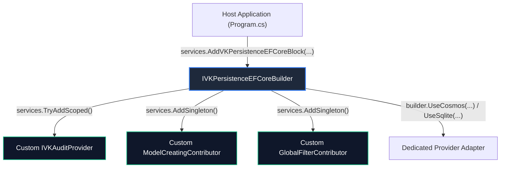

# 🔌 Extension & Customization Guide: VK.Blocks.Persistence

- **System ID / Package ID**: `VK.Blocks.Persistence`
- **Domain / Area**: `Persistence`
- **Target Audience**: プラットフォームエンジニア、マイクロサービス開発者、AI ペアプログラミング
- **Governing Rules**: `ARCH-05`, `ARCH-11`, `AP.02`, `AP.06`, `CS.01`, `CS.04`
- **Status**: 🏛️ Accepted

---

## 1. 🎯 概要と設計思想 (Philosophy)

`VK.Blocks.Persistence` は、**「堅牢なポートと決定論的オーバーライド（`ARCH-05`, `AP.06`）」** を核とするプラガブル設計を採用しています。

開発者は、基底の `VKBaseDbContext` やリポジトリ内部実装に手を入れることなく、DI コンテナ経由で公式拡張ポートを実装・登録することで、永続化パイプラインを安全にカスタマイズできます。



---

## 2. 🧩 拡張可能ポート一覧 (Supported Extension Points)

| ポート (Port Interface) | デフォルト実装 (`ARCH-05`) | 推奨ライフサイクル | 主な拡張ユースケース |
| :--- | :--- | :---: | :--- |
| `IVKAuditProvider` | `NoOpAuditProvider` | `Scoped` | 認証トークンや社内セッションからユーザーID/名前を抽出し監査ログに注入。 |
| `IVKModelCreatingContributor` | なし（複数注入可） | `Singleton` | 独自エンティティのマッピング、カスタム複合インデックス、テーブル名の命名規約追加。 |
| `IVKGlobalFilterContributor` | `SoftDeleteFilterContributor` | `Singleton` | 独自フラグ（例: 組織階層フィルター、論理アーカイブ）のグローバルクエリフィルター注入。 |
| `IVKModelConventionContributor` | なし（複数注入可） | `Singleton` | SQLite 等における `DateTimeOffsetToStringConverter` のような型レベル変換規約。 |
| `IDbContextOptionsConfigurator` | なし | `Singleton` | 接続リトライポリシー、ログ詳細度、外部プロバイダ固有設定の動的注入。 |
| `ICursorSerializer` | `SecureCursorSerializer` | `Singleton` | 開発環境用の `SimpleCursorSerializer` や、別鍵による署名アルゴリズムへの差し替え。 |

---

## 3. 🛠️ ゴールデンコード実装例 (Step-by-Step Golden Paths)

### 3.1 カスタム監査プロバイダーの実装 (`IVKAuditProvider`)

```csharp
// 1. IVKAuditProvider を実装 (CS.06 TimeProvider 連携, AP.01 sealed class)
public sealed class ApplicationAuditProvider(
    IVKUserContext userContext,
    TimeProvider timeProvider) : IVKAuditProvider
{
    public string? GetCurrentUserId() => userContext.UserId?.ToString();
    public string? GetCurrentUserName() => userContext.UserName;
    public DateTimeOffset GetCurrentTime() => timeProvider.GetUtcNow();
}

// 2. DI コンテナでのオーバーライド (AP.02 TryAdd 規約)
services.Replace(ServiceDescriptor.Scoped<IVKAuditProvider, ApplicationAuditProvider>());
```

### 3.2 独自の ModelCreating Contributor の注入 (`IVKModelCreatingContributor`)

外部ライブラリや独自機能スライスがエンティティのマッピングを追加する場合：

```csharp
// 1. Contributor を実装 (ADR-013 準拠)
public sealed class PaymentModelCreatingContributor : IVKModelCreatingContributor
{
    public void Configure(ModelBuilder modelBuilder)
    {
        modelBuilder.Entity<PaymentTransaction>(b =>
        {
            b.ToTable("Payments");
            b.HasIndex(p => p.ReferenceNumber).IsUnique();
        });
    }
}

// 2. DI 登録 (AddSingleton で複数登録可能)
services.AddSingleton<IVKModelCreatingContributor, PaymentModelCreatingContributor>();
```

### 3.3 独自グローバルフィルターの注入 (`IVKGlobalFilterContributor`)

特定のインターフェースを実装したエンティティに一律でフィルターを適用する場合：

```csharp
public interface IArchivable
{
    bool IsArchived { get; }
}

public sealed class ArchivableFilterContributor : IVKGlobalFilterContributor
{
    public void ApplyFilter(ModelBuilder modelBuilder, Type entityType)
    {
        if (typeof(IArchivable).IsAssignableFrom(entityType))
        {
            // 動的 LINQ 式を構築して HasQueryFilter を適用
            var param = Expression.Parameter(entityType, "e");
            var body = Expression.Equal(
                Expression.Property(param, nameof(IArchivable.IsArchived)),
                Expression.Constant(false));
            var lambda = Expression.Lambda(body, param);

            modelBuilder.Entity(entityType).HasQueryFilter(lambda);
        }
    }
}
```

---

## 4. ⚠️ 拡張時のアンチパターン (Anti-Patterns to Avoid)

- ❌ **`DbContext.OnModelCreating` の直書き変更**:
  - `VKBaseDbContext` を継承した具象クラス内で直接すべての設定を記述すると、モジュール間の再利用性が失われます。必ず `IVKModelCreatingContributor` を利用してください。
- ❌ **リポジトリメソッド内での例外スロー (`CS.01`)**:
  - レコードが見つからない場合に `KeyNotFoundException` をスローしてはなりません。`null` 返却（Read）または `VKResult.Failure(Errors.NotFound)` を使用してください。
- ❌ **`DateTime.UtcNow` や `Guid.NewGuid()` の直接呼び出し (`CS.06`)**:
  - 日時や ID 生成をハードコードすると、単体テストにおける時間旅行やモック検証が不可能になります。

