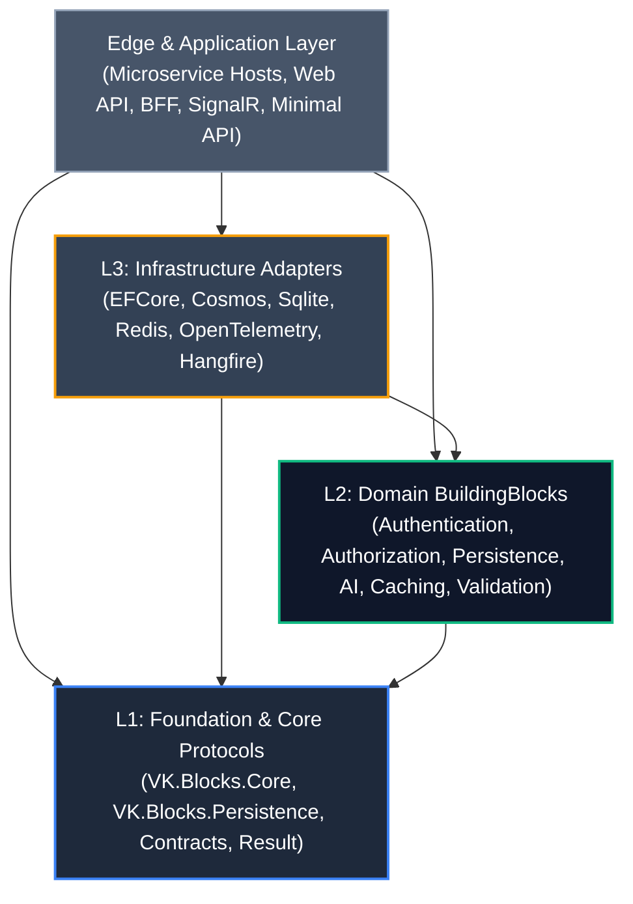

# 🌍 VK.Blocks Global System Architecture (`docs/03-Architecture`)

本文書は、`VK.Blocks` 全社マイクロサービス共通基盤の**全景アーキテクチャ（Global Architecture Landscape）**および各サブシステムの仕様書体系を統括するルートドキュメントです。

---

## 🏛️ アーキテクチャ分層地図 (System Layering Map)

`VK.Blocks` は、エンタープライズ C4 モデルおよび厳格な単方向レイヤリング（`ARCH-01`〜`ARCH-03`）に基づき、以下の 4 層構造で編成されています：

---

## 📦 サブシステム別アーキテクチャ仕様書一覧 (Subsystem Architecture Index)

各サブシステムの詳細アーキテクチャ仕様書（C4 Container、データ設計、シーケンス、API 面、障害モード）は以下の個別ディレクトリに集約されています：

| サブシステム (Domain) | 主要パッケージ (Packages) | 主仕様書 (Architecture README) | 伴生仕様書 (Companion Specifications) | 状態 |
| :--- | :--- | :--- | :--- | :---: |
| **Core** | `Core` | [Core/README.md](./Core/README.md) | • [api-surface.md](./Core/api-surface.md) • [extension-guide.md](./Core/extension-guide.md) • [failure-modes.md](./Core/failure-modes.md) | 🏛️ Accepted |
| **Authorization** | `Authorization` `VK.Tools.SourceGenerators` | [Authorization/README.md](./Authorization/README.md) | • [api-surface.md](./Authorization/api-surface.md) • [extension-guide.md](./Authorization/extension-guide.md) • [failure-modes.md](./Authorization/failure-modes.md) • [threat-model.md](./Authorization/threat-model.md) | 🏛️ Accepted |
| **Authentication** | `Authentication` `Authentication.OpenIdConnect` `Authentication.Saml` `Authentication.StackExchangeRedis` | [Authentication/README.md](./Authentication/README.md) | • [api-surface.md](./Authentication/api-surface.md) • [extension-guide.md](./Authentication/extension-guide.md) • [failure-modes.md](./Authentication/failure-modes.md) • [threat-model.md](./Authentication/threat-model.md) | 🏛️ Accepted |
| **Persistence** | `Persistence` `Persistence.EFCore` `Persistence.EFCore.Cosmos` `Persistence.EFCore.Sqlite` | [Persistence/README.md](./Persistence/README.md) | • [api-surface.md](./Persistence/api-surface.md) • [extension-guide.md](./Persistence/extension-guide.md) • [failure-modes.md](./Persistence/failure-modes.md) | 🏛️ Accepted |
| **Resilience** | `Resilience` `Resilience.Polly` | [Resilience/README.md](./Resilience/README.md) | • [api-surface.md](./Resilience/api-surface.md) • [extension-guide.md](./Resilience/extension-guide.md) • [failure-modes.md](./Resilience/failure-modes.md) | 🏛️ Accepted |
| **VectorStore** | `VectorStore` `VectorStore.Pgvector` `VectorStore.Qdrant` `VectorStore.Cosmos` `VectorStore.Sqlite` | [VectorStore/README.md](./VectorStore/README.md) | • [api-surface.md](./VectorStore/api-surface.md) • [extension-guide.md](./VectorStore/extension-guide.md) • [failure-modes.md](./VectorStore/failure-modes.md) | 🏛️ Accepted |
| **VectorSearch** | `VectorSearch` `VectorSearch.Sqlite` | [VectorSearch/README.md](./VectorSearch/README.md) | • [api-surface.md](./VectorSearch/api-surface.md) • [extension-guide.md](./VectorSearch/extension-guide.md) • [failure-modes.md](./VectorSearch/failure-modes.md) | 🏛️ Accepted |
| **VectorIngest** | `VectorIngest` | [VectorIngest/README.md](./VectorIngest/README.md) | • [api-surface.md](./VectorIngest/api-surface.md) • [extension-guide.md](./VectorIngest/extension-guide.md) • [failure-modes.md](./VectorIngest/failure-modes.md) | 🏛️ Accepted |

---

## 🧭 横断基盤コンテキスト中枢 (Cross-Cutting Context Backbone)

すべてのサブシステムは、以下の共通実行コンテキストを HTTP 境界またはメッセージ境界で確立し、内部ロジックへ透過的に貫通させます（`ARCH-09`, `FS-07`, `FS-11`）：

1. **`TenantId` (Guid)**: 多租戸分離の絶対境界。EF Core Global Query Filter および Cosmos DB 分区キーに必須適用（`OR.02`, `CS.08`）。
2. **`UserId` (Guid / string)**: 操作主体の一意識別子。監査（`CreatedBy`, `UpdatedBy`）に自動注入（`CS.06`）。
3. **`TraceId` / `CorrelationId`**: W3C TraceContext（`traceparent`）に準拠し、OpenTelemetry および構造化ログ（`OR.01`）へ完全伝播。
4. **`TimeProvider`**: システムクロック直読を排し、タイムスタンプを完全決定論的に制御（`BASE-02`, `CS.06`）。

---

## 🔗 関連ドキュメント体系

- [00-Blueprints/03-ArchitectureBlueprint.md](/docs/00-Blueprints/03-ArchitectureBlueprint.md) — アーキテクチャ仕様書策定基準
- [02-RFCs/](/docs/02-RFCs/) — Top-Down 概念設計書
- [04-ArchitectureDecisionRecords/](/docs/04-ArchitectureDecisionRecords/) — 個別技術意思決定レコード (ADR)
- [05-DataDictionary/](/docs/05-DataDictionary/) — 公開契約データ辞書

