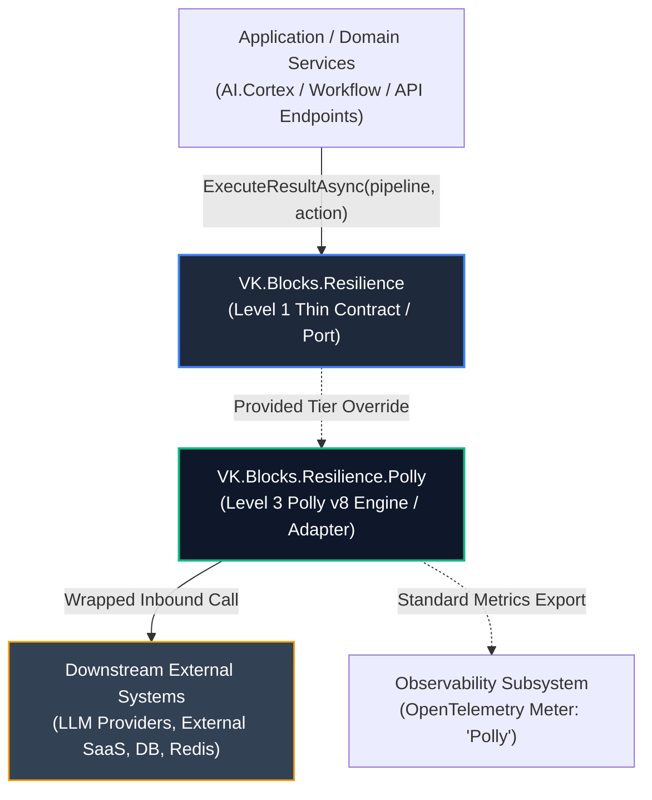
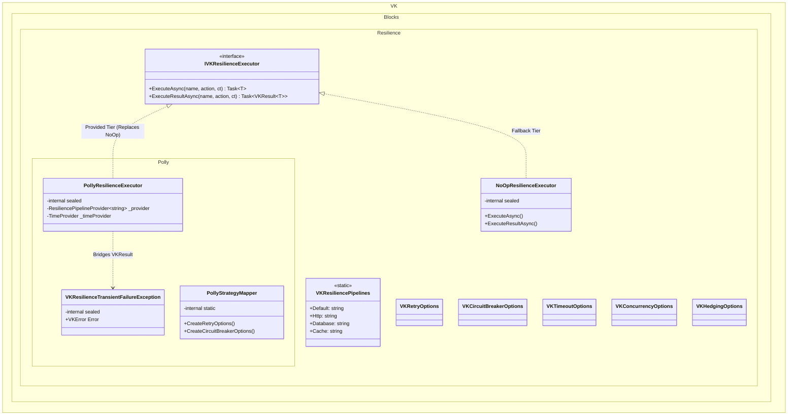
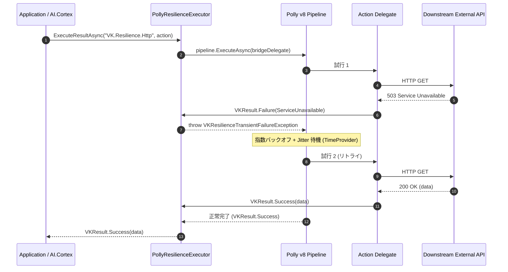
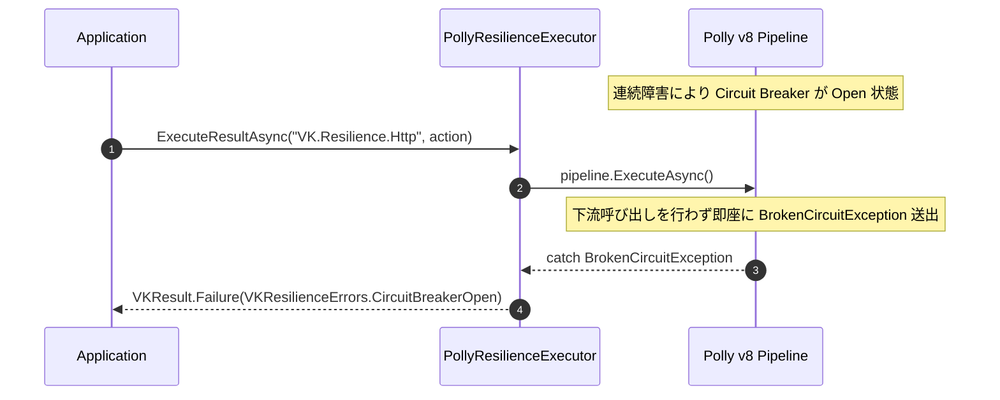

# 🏛️ Architecture: Resilience Subsystem

- **System ID / Package ID**: `VK.Blocks.Resilience` (Contract) / `VK.Blocks.Resilience.Polly` (Engine)
- **Domain / Area**: Foundation & Perimeter Defense
- **Primary Owner / Architect**: Architecture Core Team
- **Latest State**: ✅ Active (V3 Thin Contract & Polly v8 Engine)

---

## 1. 🌐 C4 Context & System Boundary (Level 1)

耐障害性サブシステム（Resilience）は、マイクロサービス内外で発生する一過性の障害（通信タイムアウト、HTTP 503/429、一時的なネットワーク断線）からシステムを保護し、自己回復または決定論的な安全遮断（Fast-Fail）を提供する防御壁です。

### 境界原則 (`ARCH-01`, `ARCH-02`)
- **呼出側の完全隔離**: `AI.Cortex` や `Workflow` などの上位ブロックは `VK.Blocks.Resilience`（`IVKResilienceExecutor`）のみに依存し、Polly のアセンブリや型を一切直接参照しません。
- **無例外制御流 (`BASE-05`, `CS.01`)**: ダウンストリームからの一過性エラーが `VKResult<T>` で戻る場合も、Adapter 内部の閉環例外ブリッジにより Polly にリトライを実行させ、ビジネス層へは常に純粋な `VKResult<T>` のみ返却されます。

---

## 2. 📦 C4 Container & Component Architecture (Level 2 & 3)

契約層（`Resilience`）とエンジン層（`Resilience.Polly`）は物理的に完全に分離されています。

### パイプライン固定スタッキング順序 (`OR.03`)
Polly v8 パイプライン構築時は、以下の順序を厳格に保持します：
1. **Total Timeout**: 全試行を通じた全体デッドライン。
2. **Hedging (対衝)**: P99 尾遅延削減のための投機並行試行（有効時）。
3. **Transient Retry**: 指数バックオフ + Jitter + `TimeProvider` による瞬態リトライ。
4. **Circuit Breaker**: 連続障害検知時に即座に Open し、後続試行を遮断。
5. **Concurrency / RateLimiter**: 単一試行ごとの並行度・レート制限。
6. **Attempt Timeout**: 単一 HTTP/ソケット試行のタイムアウト。

---

## 3. ⏱️ Runtime Sequence View (ランタイム時系列図)

### 3.1 一過性障害のリトライと自動回復 (Transient Retry & Recovery)

### 3.2 連続障害時のサーキットブレーカー遮断 (Circuit Breaker Fast-Fail)

---

## 4. 📂 Vertical Slices & Physical Boundary (`BB.01`, `AP.03`)

| ディレクトリ / ファイル | 可視性 (`AP.03`) | 責務と主な公開シンボル | 参照規約 |
| :--- | :--- | :--- | :--- |
| `Common/Protocols/IVKResilienceExecutor.cs` | `public` | 統一耐障害性実行ポート | 公開 Level 1 API |
| `Common/Constants/VKResiliencePipelines.cs` | `public` | 標準プロファイル名定数（`Default`, `Http`, etc.） | 公開 Level 1 API |
| `Common/Errors/VKResilienceErrors.cs` | `public` | 耐障害性エラー定数（`CircuitBreakerOpen`, etc.） | 公開 Level 1 API |
| `Common/Internal/NoOpResilienceExecutor.cs` | `internal sealed` | パススルーフォールバック実装 | 外部非公開 |
| `Options/VK*Options.cs` | `public sealed record` | 各ポリシー構成オプション（Immutability） | 公開 Level 1 API |
| `Resilience.Polly/Internal/PollyResilienceExecutor.cs` | `internal sealed` | Polly v8 具象実行エンジン | 外部非公開 |
| `Resilience.Polly/Internal/VKResilienceTransientFailureException.cs` | `internal sealed` | Adapter 内部閉環例外ブリッジ | 外部非公開 |

---

## 5. 🛡️ Cross-Cutting Concerns & Security Baseline

- **`TimeProvider` 決定論性 (`CS.06`, `BASE-02`)**:
  - すべてのバックオフ遅延・タイムアウトは、Core から注入される `TimeProvider` に従います。
  - テスト時は `FakeTimeProvider` を差し込むことで、現実の sleep なしで即座にタイムアウトやリトライをシミュレート可能です。
- **ゼロアロケーション方針 (`CS.04`)**:
  - Polly v8 の `ResilienceContextPool` を内部利用し、ホットパスにおけるオブジェクト生成を極小化。
- **可観測性 (`OR.01`, `BB.04`)**:
  - `VK.Blocks.Observability` が OpenTelemetry の Meter 名 `"Polly"` を直接エクスポート。
  - VK レベルの Activity には URL や機微トークンを含めず、プロファイル名と結果ステータスのみを安全に記録。

---

## 6. 📚 関連仕様書・ADR 索引

- **伴生仕様書 (Companion Specifications)**:
  - [api-surface.md](./api-surface.md) — 公開 API 面と SemVer 破壊的変更規約
  - [extension-guide.md](./extension-guide.md) — カスタムパイプライン登録・拡張ガイド
  - [failure-modes.md](./failure-modes.md) — 障害モードとハンドリングハンドブック
- **概念設計書 (RFC)**:
  - [003: V3 Thin Contract, Pure Delegation & Polly v8 Engine](/docs/02-RFCs/Resilience/rfc-003-v3-thin-contract-pure-delegation-and-polly-v8-engine.md)
- **アーキテクチャ意思決定記録 (ADR)**:
  - [ADR Index](/docs/04-ArchitectureDecisionRecords/Resilience/README.md)
  - [ADR-005: Transition to Thin Contract and Polly v8 Engine Architecture](/docs/04-ArchitectureDecisionRecords/Resilience/adr-005-transition-to-thin-contract-and-polly-v8-engine.md)

