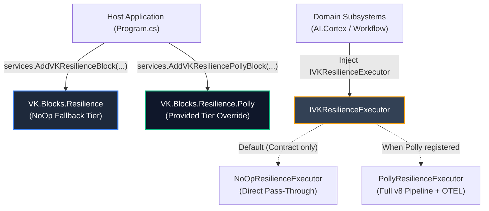

# 🔌 Extension & Customization Guide: VK.Blocks.Resilience

- **System ID / Package ID**: `VK.Blocks.Resilience` (Contract) / `VK.Blocks.Resilience.Polly` (Engine)
- **Domain / Area**: Foundation & Perimeter Defense
- **Target Audience**: プラットフォームエンジニア、下流マイクロサービス開発者、AI ペアプログラミング
- **Governing Rules**: `ARCH-05`, `ARCH-11`, `AP.02`, `AP.06`, `CS.01`, `CS.03`, `CS.06`, `OR.03`
- **Status**: 🏛️ Accepted

---

## 1. 🎯 概要と設計思想 (Philosophy)

`VK.Blocks.Resilience` は、**「薄い契機（Thin Contract）と決定論的オーバーライド（`ARCH-05`, `AP.06`）」** を核とする耐障害性フレームワークです。

上位のドメイン層（`AI.Cortex`、`Workflow`、Web API コントローラー）は、具象エンジン（Polly 等）に直接依存せず、純粋な BCL インターフェースである `IVKResilienceExecutor` のみを経由して耐障害性パイプラインを実行します。これにより、インフラエンジンの更新や差し替え（Polly v8 への移行、独自スケジューラーへの換装）がドメイン層へ一切波及しません（`ARCH-01`, `ARCH-02`）。



### 二重層化 (Tiered Lifecycle) の規約 (`ARCH-05`)
1. **Fallback Tier (`NoOpResilienceExecutor`)**:
   `VK.Blocks.Resilience` 契約パッケージ内に co-located 同梱され、`TryAddSingleton` で冪等登録されます。エンジン未登録時や単体テスト実行時も、追加の InMemory パッケージを導入することなく即座に透過実行されます。
2. **Provided Tier (`PollyResilienceExecutor`)**:
   `VK.Blocks.Resilience.Polly` を参照し `AddVKResiliencePollyBlock()` を呼び出すことで、`services.Replace()` により透過的に本番エンジンへ置換されます。

---

## 2. 🧩 拡張可能ポート一覧 (Supported Extension Points)

| ポート / 拡張点 | デフォルト実装 (`ARCH-05`) | 推奨ライフサイクル | 主な拡張ユースケース |
| :--- | :--- | :---: | :--- |
| `IVKResilienceExecutor` | `NoOpResilienceExecutor` | `Singleton` | ドメインごとの専用ディスパッチャー、単体テスト用の決定論的 `FakeResilienceExecutor`。 |
| **Named Pipeline Profiles** | `VKResiliencePipelines.Default`<br/>(`Http`, `Database`, `Cache`) | `Singleton` (Polly Registry) | サブシステム専用プロファイル（例: `AI.Cortex.ChatCompletion`, `Synapse.ToolExecution`）。 |
| `VKRetryOptions` | デフォルト値（3回、指数バックオフ） | `IOptions<T>` | サービス固有のリトライ回数・バックオフ係数・ジッター構成。 |
| `VKCircuitBreakerOptions` | サンプリング50%、最小閾値10 | `IOptions<T>` | 外部 API の SLA に応じた熔断閾値・開放時間ウィンドウ調整。 |
| `VKTimeoutOptions` | 試行30秒、全体90秒 | `IOptions<T>` | LLM ストリーミング等の長時間処理用個別タイムアウト。 |
| `VKConcurrencyOptions` | 最大並行100、キュー0 | `IOptions<T>` | ダウンストリーム保護のための並行度制限（バルクヘッド）。 |
| `VKHedgingOptions` | 無効（試行2回、遅延500ms） | `IOptions<T>` | P99 尾遅延削減のための投機並行実行（LLM セカンダリ呼び出し等）。 |

---

## 3. 🛠️ ゴールデンコード実装例 (Step-by-Step Golden Paths)

### 3.1 サブシステムによる専用プロファイル登録と実行 (`AI.Cortex`)

ドメインブロックが独自の耐障害性プロファイルを定義し、`IVKResilienceExecutor` を通じて `VKResult<T>` を安全に実行するパターンです。

#### 1. プロファイル定数の定義 (`CortexConstants.cs`)
```csharp
namespace VK.Blocks.AI.Cortex.Common;

public static class CortexConstants
{
    public static class Resilience
    {
        public const string ChatCompletionProfile = "VK.AI.Cortex.ChatCompletion";
        public const string FastToolCallProfile = "VK.AI.Cortex.FastToolCall";
    }
}
```

#### 2. DI でのパイプライン登録 (`Program.cs` / `CortexBlock.cs`)
```csharp
// Polly v8 の AddResiliencePipeline を用いてプロファイル固有のパイプラインを定義
services.AddResiliencePipeline(CortexConstants.Resilience.ChatCompletionProfile, builder =>
{
    builder
        .AddTimeout(TimeSpan.FromSeconds(120)) // LLM 全体タイムアウト
        .AddRetry(new RetryStrategyOptions
        {
            MaxRetryAttempts = 3,
            BackoffType = DelayBackoffType.Exponential,
            UseJitter = true
        })
        .AddCircuitBreaker(new CircuitBreakerStrategyOptions
        {
            SamplingDuration = TimeSpan.FromSeconds(60),
            FailureRatio = 0.5,
            MinimumThroughput = 5,
            BreakDuration = TimeSpan.FromSeconds(30)
        })
        .AddTimeout(TimeSpan.FromSeconds(45)); // 単一試行タイムアウト
});
```

#### 3. 実行側での呼び出し (`DefaultChatTurnOrchestrator.cs`)
```csharp
namespace VK.Blocks.AI.Cortex.TurnOrchestration.Internal;

using System.Threading;
using System.Threading.Tasks;
using VK.Blocks.Core.Results;
using VK.Blocks.Resilience.Common.Protocols;

internal sealed class DefaultChatTurnOrchestrator(
    IVKResilienceExecutor? resilienceExecutor = null) : IChatTurnOrchestrator
{
    public async Task<VKResult<ChatTurnResult>> ExecuteTurnAsync(
        ChatTurnRequest request, 
        CancellationToken cancellationToken)
    {
        // [CS.01] VKResult を感知し、一過性障害発生時は内部で自動リトライ・熔断判定
        if (resilienceExecutor != null)
        {
            return await resilienceExecutor.ExecuteResultAsync(
                CortexConstants.Resilience.ChatCompletionProfile,
                async ct => await CallLlmProviderAsync(request, ct).ConfigureAwait(false),
                cancellationToken).ConfigureAwait(false);
        }

        return await CallLlmProviderAsync(request, cancellationToken).ConfigureAwait(false);
    }
}
```

---

### 3.2 投機実行（ヘッジング / Hedging）パイプラインの構成

レイテンシに極めて敏感な検索や複数リージョンへの冗長リクエストにおいて、P99 遅延を劇的に削減します：

```csharp
using Polly;
using Polly.Hedging;

services.AddResiliencePipeline("VK.Search.Hedging", builder =>
{
    builder.AddHedging(new HedgingStrategyOptions<HttpResponseMessage>
    {
        MaxHedgedAttempts = 2,
        Delay = TimeSpan.FromMilliseconds(400), // 400ms 応答がなければ投機リクエスト発進
        ShouldHandle = new PredicateBuilder<HttpResponseMessage>()
            .Handle<HttpRequestException>()
            .HandleResult(res => (int)res.StatusCode >= 500)
    });
});
```

---

### 3.3 確定論的テストのための `FakeTimeProvider` 連携 (`CS.06`)

`VK.Blocks.Resilience.Polly` は Polly v8 の `TimeProvider` プロパティを完全配線しています。テスト時に `FakeTimeProvider` を DI 注入することで、テストコード内で何秒も `Thread.Sleep` することなく、確定論的にリトライ遅延や熔断ウィンドウを早送りできます：

```csharp
// テスト DI 構成
var fakeTime = new FakeTimeProvider();
services.AddSingleton<TimeProvider>(fakeTime);
services.AddVKResilienceBlock();
services.AddVKResiliencePollyBlock();

var sp = services.BuildServiceProvider();
var executor = sp.GetRequiredService<IVKResilienceExecutor>();

// 非同期実行タスクを開始
var task = executor.ExecuteResultAsync("VK.Resilience.Http", FlakyCallAsync, CancellationToken.None);

// 時間を進めてリトライ間隔を即座に消費
fakeTime.Advance(TimeSpan.FromSeconds(2));
var result = await task;
```

---

### 3.4 単体テスト用の完全インメモリ Fake 実装

特定テストにおいて Polly のパイプラインを完全にバイパスしたい場合、`IVKResilienceExecutor` を実装したカスタム Fake を注入します：

```csharp
public sealed class TestPassthroughResilienceExecutor : IVKResilienceExecutor
{
    public int InvocationCount { get; private set; }

    public async Task<T> ExecuteAsync<T>(
        string pipelineName, 
        Func<CancellationToken, Task<T>> action, 
        CancellationToken cancellationToken = default)
    {
        InvocationCount++;
        return await action(cancellationToken).ConfigureAwait(false);
    }

    public async Task<VKResult<T>> ExecuteResultAsync<T>(
        string pipelineName, 
        Func<CancellationToken, Task<VKResult<T>>> action, 
        CancellationToken cancellationToken = default)
    {
        InvocationCount++;
        return await action(cancellationToken).ConfigureAwait(false);
    }
}

// 登録
builder.Services.AddSingleton<IVKResilienceExecutor, TestPassthroughResilienceExecutor>();
```

---

## 4. ⚙️ 設定オプションと宣言的バインド (`AP.04`, `ARCH-13`)

`appsettings.json` による各戦略オプションの集中管理：

```json
{
  "VKBlocks": {
    "Resilience": {
      "Retry": {
        "MaxRetries": 4,
        "InitialDelayMs": 300,
        "BackoffMultiplier": 2.0,
        "UseJitter": true
      },
      "CircuitBreaker": {
        "FailureThresholdRatio": 0.4,
        "SamplingDurationSeconds": 30,
        "BreakDurationSeconds": 60,
        "MinimumThroughput": 10
      },
      "Timeout": {
        "AttemptTimeoutSeconds": 15,
        "TotalTimeoutSeconds": 60
      },
      "Concurrency": {
        "MaxParallelism": 50,
        "MaxQueuedActions": 100
      },
      "Hedging": {
        "MaxHedgedAttempts": 2,
        "HedgingDelayMs": 500
      }
    }
  }
}
```

---

## 5. ⚠️ アンチパターンと禁止事項 (`OR.03`, `CS.03`, `BASE-05`)

| アンチパターン | 理由 | 正しいアプローチ |
| :--- | :--- | :--- |
| **ドメインコード内で Polly を直接参照する** | インフラの漏洩（`ARCH-02`）。Polly の破壊的変更時にドメイン層全体に波及する。 | `IVKResilienceExecutor` をインジェクションして実行する。 |
| **業務エラーで `VKResult` ではなく例外を投げてリトライさせる** | パフォーマンス悪化と制御フロー破壊（`BASE-05`）。 | 適切な `VKErrorType`（`ServiceUnavailable` など）を含む `VKResult.Failure` を返却する。Executor が自動認識する。 |
| **`ValueTask<T>` を公開インターフェースの戻り値にする** | 多重 await や破棄タイミングの未定義動作リスク（`CS.03`）。 | 公開ポートは必ず `Task<T>` / `Task<VKResult<T>>` とする。 |
| **`DateTime.UtcNow` や `Thread.Sleep` で遅延を制御する** | 決定論的テストが不可能になる（`CS.06`）。 | `TimeProvider` および Polly 内蔵のディレイ機構に委ねる。 |
| **パイプライン順序を逆転させる** | 例: Timeout の内側に Retry を置くと、個別試行ではなく全体のタイムアウトが正しく機能しない。 | `Total Timeout → Hedging → Retry → Breaker → Concurrency → Attempt Timeout` の順序を厳守。 |

