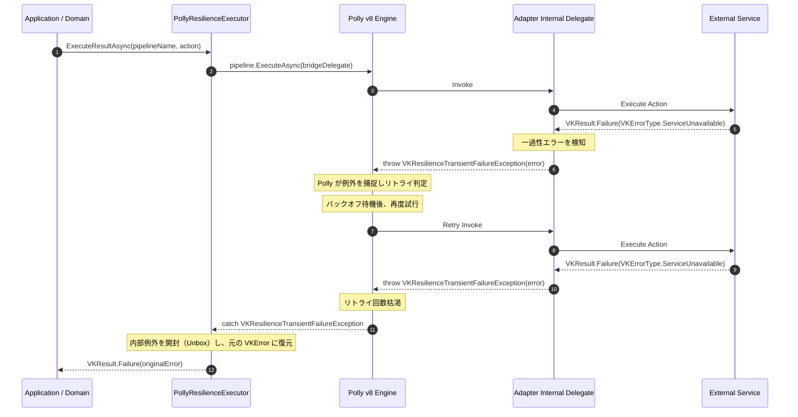

# 💥 Failure Modes & Resilience Handbook: VK.Blocks.Resilience

- **System ID / Package ID**: `VK.Blocks.Resilience` (Contract) / `VK.Blocks.Resilience.Polly` (Engine)
- **Domain / Area**: Foundation & Perimeter Defense
- **Target Audience**: SRE、プラットフォームエンジニア、下流サービス開発者、AI ペアプログラミング
- **Governing Rules**: `CS.01`, `BASE-05`, `FS-02`, `OR.03`, `BB.03`
- **Status**: 🏛️ Accepted

---

## 1. 🎯 目的と概要 (Purpose & Overview)

`VK.Blocks.Resilience` および `VK.Blocks.Resilience.Polly` は、分散システムにおける外部依存（HTTP API、データベース、キャッシュ、LLM推論サービス）の通信障害や高負荷に対する**境界防壁（Perimeter Defense）**です。

本文書は、耐障害性パイプライン実行時に発生し得る主要な **障害モード（Failure Modes）**、サーキットブレーカー遮断やタイムアウト時の **縮退・遮断挙動（Degraded / Fail-Fast Behavior）**、下流ハンドラーへ返却される **`VKResult` エラーコード（`CS.01`, `FS-02`）**、および本番環境でアラートが発生した際の **SRE 復旧手順（On-Call Runbook）** を定義します。

---

## 2. 📊 障害モードマトリクス (Failure Modes Matrix)

| 障害モード (Failure Mode) | トリガー条件 | システムの挙動 (Behavior) | 返却エラーコード / 送出例外 | HTTPステータス (`FS-02`) | 推奨回復アクション |
| :--- | :--- | :--- | :--- | :---: | :--- |
| **F-01: サーキットブレーカー遮断 (Circuit Breaker Open)** | 過去サンプリング期間内の失敗率が閾値（例: 50%）を超過した場合。 | **即座遮断（Fast-Fail）**。外部呼び出しを一切実行せず、直ちにエラー返却。 | `VKResilienceErrors.CircuitBreakerOpen` `"Resilience.CircuitBreakerOpen"` | `503 Service Unavailable` | ダウンストリームサービスの生死監視確認。障害継続中はリトライを停止し、キャッシュ応答等の縮退運転へ移行。 |
| **F-02: 全体実行タイムアウト (Total Timeout Exceeded)** | リトライ・遅延を含むパイプライン全体の総実行時間が制限（例: 90秒）を超過した場合。 | **全処理中断**。進行中の HTTP/非同期処理を `CancellationToken` 経由で強制中断。 | `VKResilienceErrors.Timeout` `"Resilience.Timeout"` | `504 Gateway Timeout` | 外部サービスのレイテンシ悪化原因の調査。必要に応じてバッチ処理化または非同期キューへのオフロード。 |
| **F-03: 単一試行タイムアウト (Attempt Timeout Exceeded)** | 個別の 1 試行がタイムアウト（例: 30秒）を超過した場合。 | **試行キャンセル & リトライ評価**。残試行回数があれば指数バックオフ後に再試行。 | `VKResilienceErrors.Timeout`（最終試行失敗時） | `504 Gateway Timeout` | 個別リクエストのタイムアウト設定が外部サービスの SLA に対して厳しすぎないか確認。 |
| **F-04: 一過性リトライ枯渇 (Retries Exhausted)** | 設定された最大リトライ回数（例: 3回）すべてが一過性エラーで失敗した場合。 | **最終エラー返却**。最後に発生した一過性エラー、または汎用リトライ枯渇エラーを返却。 | `VKResilienceErrors.RetryExhausted` または直前の `VKError` | `502 Bad Gateway` / `503 Unavailable` | 外部サービスの一時的過負荷・メンテナンス・ネットワーク経路障害を調査。 |
| **F-05: 並行度・流量制限超過 (Concurrency / Rate Limit Rejection)** | バルクヘッドの最大並行数またはレート制限トークンが枯渇した場合。 | **即時排撃（Fast-Fail）**。下流システムを保護するため新規リクエストを即座に拒絶。 | `VKResilienceErrors.ConcurrencyRejected` `VKResilienceErrors.RateLimitExceeded` | `429 Too Many Requests` | アプリケーションの同時実行数見直し、または外部プロバイダーのクォータ引き上げ。 |
| **F-06: 未知のパイプライン指定 (Pipeline Not Found)** | `ExecuteResultAsync` 呼び出し時に登録されていないパイプライン名を指定した場合。 | **エラー返却**。未定義のポリシー実行を防止。 | `VKResilienceErrors.PipelineNotFound` `"Resilience.PipelineNotFound"` | `500 Internal Error` | `Program.cs` / モジュール登録部でのパイプライン定義（`AddResiliencePipeline`）の確認。 |
| **F-07: 非一過性エラーの透過 (Non-Transient Error Pass-Through)** | 業務検証エラー（400 Bad Request、401/403 権限違反、404 NotFound）が発生した場合。 | **リトライ抑止・即時返却**。無駄なリクエスト連打を防止し、そのまま呼び出し元へ戻す。 | 発生したオリジナルの `VKError` | 発生元のステータス（400/401/404） | 呼び出し側のリクエスト内容や認証資格情報の修正。 |
| **F-08: クライアント明示キャンセル (CancellationToken Aborted)** | クライアント切断やホストシャットダウンによりキャンセルが発火した場合。 | **安全停止**。進行中のタスクを即座に破棄。 | `OperationCanceledException` 送出または Cancelled 結果 | `499 Client Closed Request` | クライアント側のタイムアウト設定やユーザーによる意図的キャンセルの有無を確認。 |

---

## 3. 🛡️ 一過性障害の感知と閉環例外ブリッジ (`BASE-05`, `CS.01`)

Polly v8 の非ジェネリック `ResiliencePipeline` は、C# 言語仕様上「例外（Exception）」のみをリトライトリガーとして扱います。

一方、VK.Blocks は「**制御フローに例外を使用しない（`BASE-05`）**」および「**すべてのビジネス失敗を `VKResult<T>` で表現する（`CS.01`）**」という鉄則を持ちます。

この相反する要請を両立させるため、`Resilience.Polly` 内部では **「閉環例外ブリッジ（Closed-Loop Exception Bridge）」** を採用しています：

### ブリッジの厳格な境界規約
- `VKResilienceTransientFailureException` は `internal sealed` であり、外部アセンブリへ決して露出・スローされません。
- 呼び出し元（Caller）から見ると、内部でどれだけリトライや熔断が発生しても、受け取る戻り値は純粋な `VKResult<T>` のみです。

---

## 4. 📋 SRE 運用トラブルシューティング (On-Call Runbook)

### 4.1 アラート: `CircuitBreakerOpen` 多発（HTTP 503 急増）
- **監視指標**: `polly.circuit-breaker.state{state="open"}` またはログ `Resilience.CircuitBreakerOpen`
- **症状**: 外部 API 呼び出しがすべて即座に 503 で遮断されている。
- **初動対応手順**:
  1. Grafana / APM で該当プロファイル名（例: `VK.AI.Cortex.ChatCompletion`）を特定。
  2. 外部依存先（OpenAI / Azure / 決済サービス）のステータスページを確認。
  3. 依存先が復旧しているにもかかわらず Open が継続している場合、`BreakDuration`（通常30秒〜60秒）の経過を待つ。
  4. 依存先障害が長期化する場合は、機能トグル（Feature Flag）で該当機能を一時無効化するか、フォールバックモデル（Azure OpenAI ➡️ AWS Bedrock 等）へ切り替える。

---

### 4.2 アラート: `RateLimitExceeded` / `ConcurrencyRejected`（HTTP 429 スパイク）
- **監視指標**: `polly.rate-limiting.lease.acquired{success="false"}` または `Resilience.ConcurrencyRejected`
- **症状**: 急激なアクセス集中により、リクエストがバルクヘッド境界で弾かれている。
- **初動対応手順**:
  1. トラフィックの急増要因（正常なプロモーション施策か、DoS / クローラー攻撃か）を Cloudflare / WAF ログで分析。
  2. 外部 API の Tier（クォータ制限）の上限に達していないかプロバイダーポータルを確認。
  3. 正常トラフィックの場合は、`appsettings.json` の `VKBlocks:Resilience:Concurrency:MaxParallelism` を安全な範囲で一時引き上げ（再起動不要な Options Reload またはパッチ適用）。

---

### 4.3 アラート: `Resilience.Timeout`（HTTP 504 滞留）
- **監視指標**: `polly.pipeline.execution.duration` の P99 が大幅に悪化。
- **症状**: スレッドプール枯渇や接続タイムアウトが連鎖している。
- **初動対応手順**:
  1. 単一試行タイムアウト（`AttemptTimeoutSeconds`）と全体タイムアウト（`TotalTimeoutSeconds`）の乖離を確認。
  2. 外部ネットワークの DNS 解決遅延または TCP 接続確立遅延（SYN 再送）がないかインフラ層でパケット分析。
  3. 必要に応じてヘッジングポリシー（Hedging）の適用を検討し、遅延ノードを投機的に迂回する。

