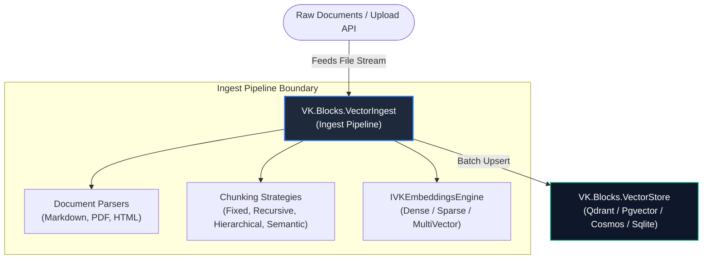
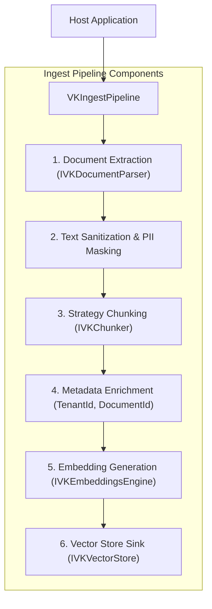
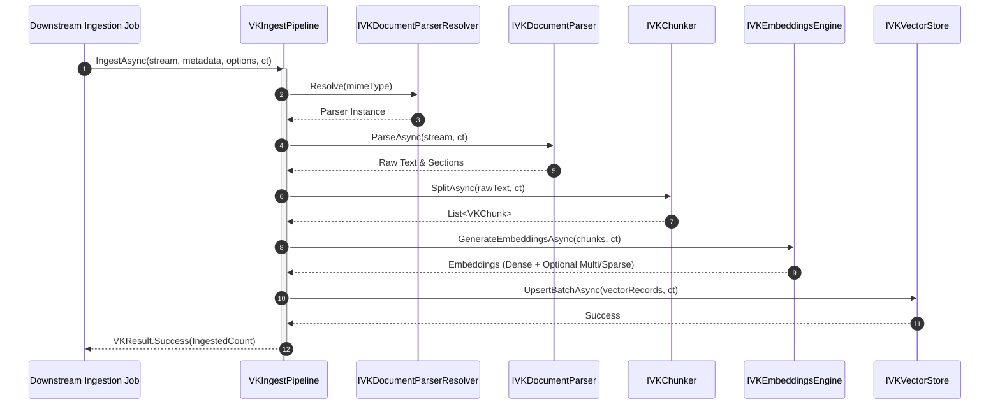

# 🏛️ Architecture: VK.Blocks.VectorIngest

- **System ID / Package ID**: `VK.Blocks.VectorIngest`
- **Domain / Area**: `AI / Vector Ecosystem / Document Ingestion & Chunking`
- **Primary Owner / Architect**: AI Knowledge & Data Engineering Team
- **Target Layer**: L2 Domain BuildingBlock (`VectorIngest`)
- **Status**: 🏛️ Accepted
- **Last Verified**: 2026-10-30

---

## 1. 🎯 概要と範囲 (Overview & Scope)

### 1.1 エレベーターピッチ・要約 (Elevator Pitch)
`VK.Blocks.VectorIngest` は、生ドキュメント（PDF, Markdown, HTML, Office）の解析から、4 種のチャンキング戦略（Fixed, Recursive, Hierarchical, Semantic）、多トークン Embedding 生成（Dense, Sparse, MultiVector / ColBERT）、およびベクトルストアへの一括格納までを一貫して統括する**モジュラー型ドキュメント取り込み・ベクトル化基盤**です。

### 1.2 スコープ境界 (Goals & Non-Goals — `BASE-06`)

- **包含する領域 (In-Scope / Goals)**:
  - **動的ドキュメントパーサー解決 (`ADR-001`)**: MIME タイプおよび拡張子に基づく `IVKDocumentParserResolver` とストリーミング構文解析。
  - **4 種の多段階チャンキング戦略 (`ADR-001`)**:
    1. **FixedSizeChunker**: 高速固定長トークン分割。
    2. **RecursiveChunker**: 段落、文、改行境界を考慮した自然言語フォールバック分割。
    3. **HierarchicalChunker**: 親ドキュメント（大文脈）と子チャンク（高密度検索用）の階層リンケージ。
    4. **SemanticChunker**: コサイン類似度変化点（トピック境界）を検知した動的意味分割。
  - **多トークン・疎ベクトル埋め込み生成統治 (`ADR-002`)**: 高密度ベクトルに加え、ColBERT 式トークン別多ベクトル（MultiVector）および BM25 スパースベクトルの生成を抽象化。巨大なストレージ消費を防ぐため、`EnableMultiVector` / `EnableSparseVector`（既定値: `false`）による厳格なガードレールを提供。
  - **非同期一括インジェストパイプライン**: 抽出 ➡️ サニタイズ ➡️ 分割 ➡️ 埋め込み ➡️ ストア格納の 5 段階オーケストレーション。

- **明確に除外する領域 (Out-of-Scope / Non-Goals)**:
  - **ベクトル物理格納とインデックス管理**: ベクトルの物理永続化は `VK.Blocks.VectorStore` に委譲。
  - **検索クエリのランキング融合**: 検索・リランキング・RRF は `VK.Blocks.VectorSearch` に委譲。

### 1.3 想定読者と適用バージョン
- **Target Audience**: AI ナレッジエンジニア、データパイプライン開発者、RAG システム開発者
- **Target Runtime**: .NET 10.0+, C# 12+ (Strict Mode, Native AOT Ready)

### 1.4 伴生仕様書体系 (Companion Specifications)
- [api-surface.md](./api-surface.md) 📜: 公開 API 契約面、型境界、SemVer 破壊的変更基準
- [extension-guide.md](./extension-guide.md) 🔌: カスタム DocumentParser / Chunker 実装ガイド
- [failure-modes.md](./failure-modes.md) 💥: 構文解析失敗、Embedding レートリミット時の縮退挙動

---

## 2. ⚡ アーキテクチャ牽引要因 (Architectural Drivers)

### 2.1 主要品質属性 (Quality Attributes)
- **スループットとメモリ効率 (`CS.04`)**:
  - `Stream` ベースの構文解析により、数百 MB の大容量ドキュメントでもヒープメモリ消費を定数オーダーに抑制。
- **拡張性と開放閉鎖性 (`ARCH-11`)**:
  - 新規ファイル形式（例: ePub, Notion）の追加は、既存コードを変更せず新しい `IVKDocumentParser` を登録するだけで完結。
- **コスト・ストレージ統治 (`ADR-002`)**:
  - ColBERT 多ベクトルは通常ベクトルの数十〜数百倍の容量を要するため、明示的オプトイン制を強制（Zero Over-Protection）。

---

## 3. 🌐 コンテキストビュー (C4 Level 1: System Context)

---

## 4. 🧩 コンテナ／モジュールビュー (C4 Level 2: Containers & BuildingBlocks)

### 4.1 構成モジュール一覧と Manifest リンク

| モジュール (Package) | レイヤー (`ARCH-01`) | 主な責務・役割カテゴリ | SSOT Manifest |
| :--- | :---: | :--- | :--- |
| `VK.Blocks.VectorIngest` | L2 BuildingBlock | ドキュメント抽出、4 種チャンキング、Embedding 調整、パイプライン統治 | [Manifest](/src/BuildingBlocks/VectorIngest/.prompts/module-manifest.md) |

---

## 5. 🔄 主要シーケンス（ランタイムビュー — Runtime Sequence）

### 5.1 ドキュメント取り込み・ベクトル化シーケンス

---

## 6. 🔌 関連 ADR 索引 (Architecture Decision Records)

- [ADR-001: モジュラー型ドキュメント取り込み・構文解析と多戦略チャンキング](/docs/04-ArchitectureDecisionRecords/VectorIngest/adr-001-modular-document-ingestion-parsing-and-multi-strategy-chunking.md)
- [ADR-002: スパースおよび多ベクトル (ColBERT) 埋め込みアーキテクチャ](/docs/04-ArchitectureDecisionRecords/VectorIngest/adr-002-sparse-and-multivector-colbert-embedding-architecture.md)
- [ADR 総合インデックス](/docs/04-ArchitectureDecisionRecords/VectorIngest/README.md)

