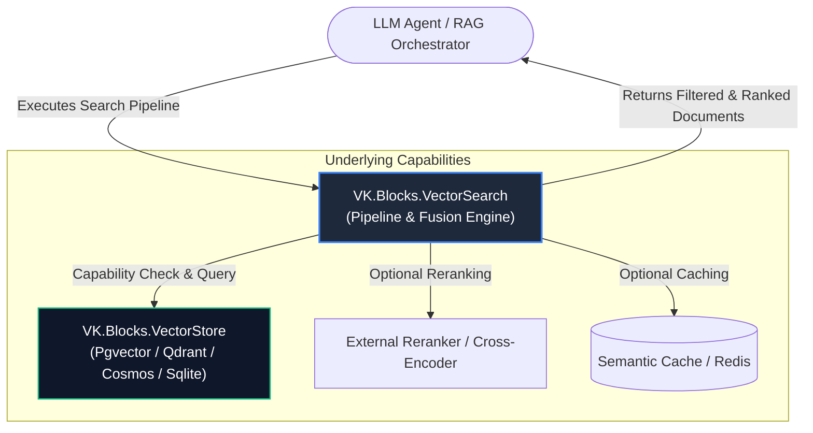
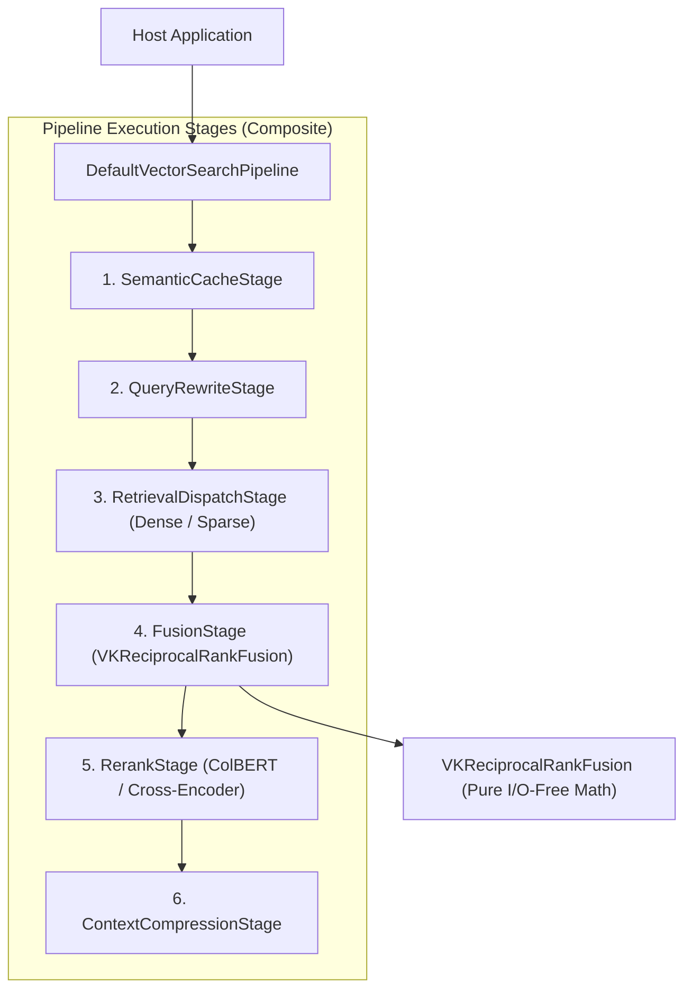
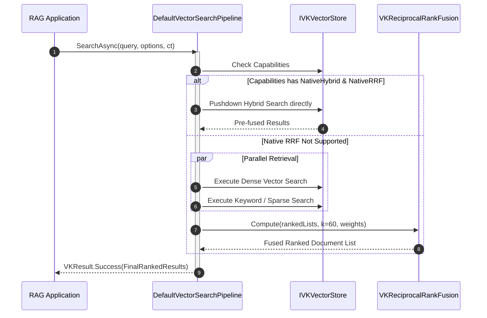

# 🏛️ Architecture: VK.Blocks.VectorSearch

- **System ID / Package ID**: `VK.Blocks.VectorSearch`
- **Domain / Area**: `AI / Vector Ecosystem / RAG Retrieval Pipeline`
- **Primary Owner / Architect**: AI Search & Retrieval Team
- **Target Layer**: L2 Domain BuildingBlock (`VectorSearch`) / L3 Infrastructure Adapters (`VectorSearch.Sqlite`)
- **Status**: 🏛️ Accepted
- **Last Verified**: 2026-10-30

---

## 1. 🎯 概要と範囲 (Overview & Scope)

### 1.1 エレベーターピッチ・要約 (Elevator Pitch)
`VK.Blocks.VectorSearch` は、高度な RAG（検索拡張生成）システム向けの**多段検索パイプライン編成・順位融合（RRF）・コンテキスト圧縮基盤**です。I/O に依存しない純粋数学関数としての順位融合計算（Core Purity, `ARCH-03`）と、下層ベクトルエンジンの能力に応じた動的プッシュダウン交渉（Capability Negotiation, `ADR-003`）を融合し、一貫したインターフェースで最高精度のハイブリッド検索を提供します。

### 1.2 スコープ境界 (Goals & Non-Goals — `BASE-06`)

- **包含する領域 (In-Scope / Goals)**:
  - **I/O 非依存の純粋順位融合関数 (`ADR-001`)**: `VKReciprocalRankFusion` による $RRF(d) = \sum \frac{w_m}{k + r_m(d)}$ の高速ゼロアロケーションスコア計算。
  - **ネイティブ能力下推とフォールバック交渉 (`ADR-003`)**: 下層ストアが `NativeHybrid` や `NativeRRF` を備える場合はエンジン側へクエリを下推（Pushdown）し、非対応の場合はクライアント側純粋関数 RRF へ透過フォールバック。
  - **多段拡張パイプライン (`ADR-002`)**:
    1. **セマンティックキャッシュ (SemanticCacheStage)**: 過去の類似クエリ結果を低遅延返却。
    2. **クエリ書き換え (QueryRewriteStage)**: HyDE（仮想回答生成）や Multi-Query 展開。
    3. **ハイブリッド検索ディスパッチ**: 高密度（Dense）＋疎（Sparse / BM25）の並列実行。
    4. **リランキング (RerankStage)**: Cross-Encoder、ColBERT MaxSim、または軽量 LLM による精排。
    5. **コンテキスト圧縮 (ContextCompressionStage)**: トークン予算内に重要文脈を凝縮。

- **明確に除外する領域 (Out-of-Scope / Non-Goals)**:
  - **物理ストレージの CRUD**: データの格納・インデックス作成は `VK.Blocks.VectorStore` の責務。
  - **Embedding ベクトル生成**: トークンからの埋め込み推論は `VK.Blocks.VectorIngest` または AI Core に委譲。

### 1.3 想定読者と適用バージョン
- **Target Audience**: RAG アプリケーション開発者、検索エンジニア、AI ソリューションアーキテクト
- **Target Runtime**: .NET 10.0+, C# 12+ (Strict Mode, Native AOT Ready)

### 1.4 伴生仕様書体系 (Companion Specifications)
- [api-surface.md](./api-surface.md) 📜: 公開 API 契約面、型境界、SemVer 破壊的変更基準
- [extension-guide.md](./extension-guide.md) 🔌: カスタム PipelineStage / Reranker 実装ガイド
- [failure-modes.md](./failure-modes.md) 💥: 検索タイムアウト、Rerank 縮退時の挙動

---

## 2. ⚡ アーキテクチャ牽引要因 (Architectural Drivers)

### 2.1 主要品質属性 (Quality Attributes)
- **純粋計算の完全分離 (`ARCH-03`)**:
  - `VKReciprocalRankFusion` は BCL のコレクションのみを操作し、I/O・ネットワーク・DB への依存を一切排除。
- **検索レイテンシとゼロアロケーション (`CS.04`)**:
  - ホットパスでの配列アロケーションを抑え、スコア集計を `Dictionary<string, double>` の効率的走査で実行。
- **決定論と再現性 (`BASE-02`)**:
  - 同一の入力ランキングリストと同一の重み・$k$ 値に対し、100% 決定論的で安定した順位を出力。

---

## 3. 🌐 コンテキストビュー (C4 Level 1: System Context)

---

## 4. 🧩 コンテナ／モジュールビュー (C4 Level 2: Containers & BuildingBlocks)

### 4.1 構成モジュール一覧と Manifest リンク

| モジュール (Package) | レイヤー (`ARCH-01`) | 主な責務・役割カテゴリ | SSOT Manifest |
| :--- | :---: | :--- | :--- |
| `VK.Blocks.VectorSearch` | L2 BuildingBlock | 検索パイプライン、純粋 RRF 順位融合、コンテキスト圧縮 | [Manifest](/src/BuildingBlocks/VectorSearch/.prompts/module-manifest.md) |
| `VK.Blocks.VectorSearch.Sqlite` | L3 Adapter | SQLite 向けローカル BM25 全文検索とハイブリッド連携 | [Manifest](/src/BuildingBlocks/VectorSearch.Sqlite/.prompts/module-manifest.md) |

---

## 5. 🔄 主要シーケンス（ランタイムビュー — Runtime Sequence）

### 5.1 ケイパビリティ交渉とハイブリッド検索シーケンス (`ADR-003`)

---

## 6. 📐 数学モデル契約: Reciprocal Rank Fusion (`ADR-001`)

順位融合スコアは以下の不変計算式に従います：

$$RRF\_Score(d) = \sum_{m \in M} \frac{w_m}{k + rank_m(d)}$$

- $M$: 検索エンジン群（例: Dense, Sparse / BM25）。
- $w_m$: 各検索系統の重み係数（既定値: 各 $1.0$）。
- $k$: ランク飽和定数（平滑化パラメーター、既定値: $60$）。
- $rank_m(d)$: 検索系統 $m$ におけるドキュメント $d$ の 1 始まりの順位（1-based rank）。

---

## 7. 🔌 関連 ADR 索引 (Architecture Decision Records)

- [ADR-001: 順位融合エンジンと RRF 契約の完全分離](/docs/04-ArchitectureDecisionRecords/VectorSearch/adr-001-standalone-rank-fusion-engine-and-rrf.md)
- [ADR-002: プラガブル検索パイプラインとコンテキスト圧縮アーキテクチャ](/docs/04-ArchitectureDecisionRecords/VectorSearch/adr-002-pluggable-search-pipeline-and-context-compression.md)
- [ADR-003: ケイパビリティ動的交渉とハイブリッド検索・RRF 下推設計](/docs/04-ArchitectureDecisionRecords/VectorSearch/adr-003-capability-negotiation-and-native-hybrid-pushdown.md)
- [ADR 総合インデックス](/docs/04-ArchitectureDecisionRecords/VectorSearch/README.md)

