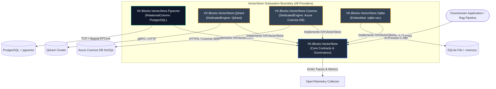
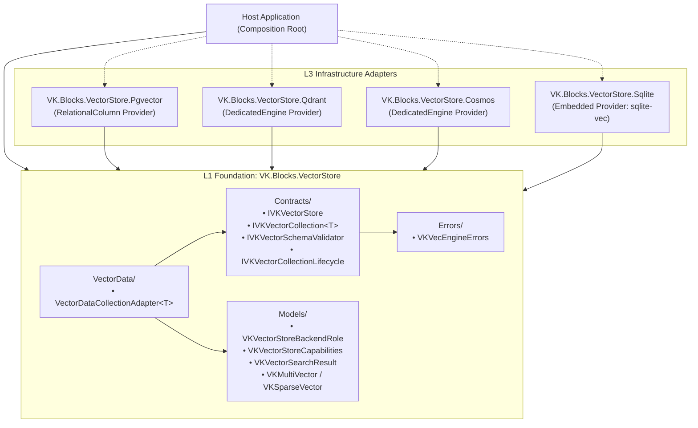
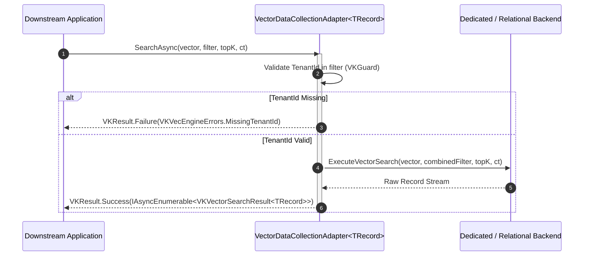
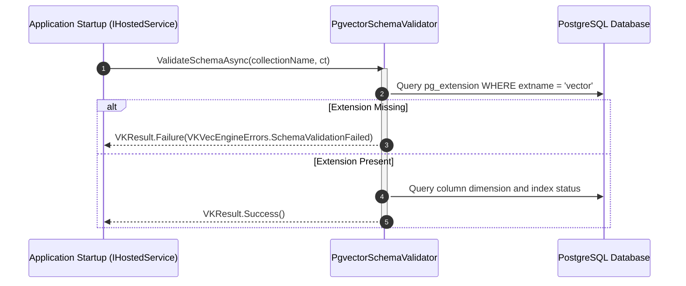
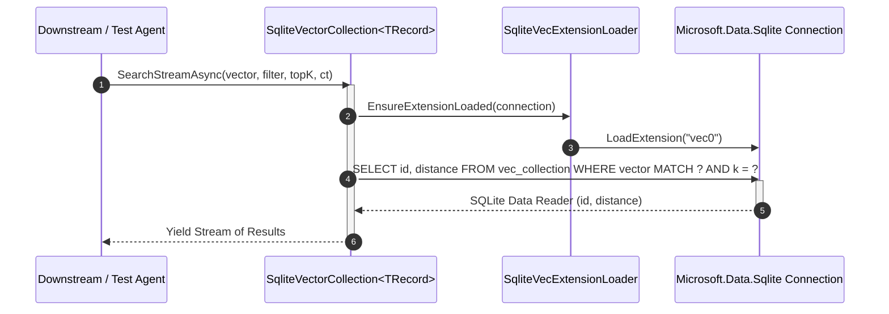

# 🏛️ Architecture: VK.Blocks.VectorStore

- **System ID / Package ID**: `VK.Blocks.VectorStore`
- **Domain / Area**: `AI / Vector Ecosystem`
- **Primary Owner / Architect**: AI & Data Platform Architecture Team
- **Target Layer**: L1 Foundation (`VectorStore`) / L3 Infrastructure Adapters (`VectorStore.Pgvector`, `VectorStore.Qdrant`, `VectorStore.Cosmos`, `VectorStore.Sqlite`)
- **Status**: 🏛️ Accepted
- **Last Verified**: 2026-10-30

---

## 1. 🎯 概要と範囲 (Overview & Scope)

### 1.1 エレベーターピッチ・要約 (Elevator Pitch)
`VK.Blocks.VectorStore` は、.NET 10 / C# 12+ 環境において、業界標準の `Microsoft.Extensions.VectorData` 抽象を土台としつつ、全社マルチテナント隔離・`VKResult<T>` ゼロ例外制御流・バックエンド 3 種役割分担（RelationalColumn, DedicatedEngine, Embedded）およびケイパビリティ動的交渉を統合した**エンタープライズ高信頼ベクトルストレージ基盤**です。

### 1.2 スコープ境界 (Goals & Non-Goals — `BASE-06`)

- **包含する領域 (In-Scope / Goals)**:
  - **`Microsoft.Extensions.VectorData` との境界明確化 (`ADR-003`)**: 公式レコードモデル、コレクション CRUD、ベクトル検索契約を再発明せず、公式抽象上にエンタープライズ統治ラッパー（`VectorDataCollectionAdapter<TRecord>`）を構築。
  - **バックエンド 3 種役割分担モデル (`ADR-003`)**:
    1. **RelationalColumn (`Pgvector`, `Azure SQL`)**: ベクトルはリレーショナル表の 1 カラム。DDL/インデックスは EF Core 移行が主権を握り、VectorStore は起動時スキーマ検証（`IVKVectorSchemaValidator`）のみを担当。
    2. **DedicatedEngine (`Qdrant`, `Cosmos`, `Azure AI Search`)**: コレクションライフサイクル（`IVKVectorCollectionLifecycle`）、動的エイリアス、バックアップ・復元を VectorStore が完全管理。
    3. **Embedded (`Sqlite`, `HnswLite`)**: 外部サーバー不要のプロセス内組み込み実行（開発、テスト、エッジ環境）。`sqlite-vec` ネイティブ拡張ローダーと仮想テーブル（`vec0`/`vec_f32`）による高速近傍探索。
  - **ケイパビリティ自己申告と動的交渉 (`ADR-004`)**: ハイブリッド検索、多ベクトル（MultiVector / ColBERT）、スパースベクトル（SparseVector / BM25）、ディスク索引（DiskANN）の有無をフラグ宣言し、上流検索パイプラインへの下推（Pushdown）を可能にする。
  - **絶対的テナント分離の強制 (`CS.08`, `FS-07`, `OR.02`)**: すべてのレコード操作およびベクトル検索において `TenantId` フィルターを境界ガードで強制付与。
  - **エラーモデル統合 (`CS.01`, `BASE-05`)**: 外部ドライバの接続断やメタデータ不整合を捕捉し、一元管理された `VKVecEngineErrors` 定数にマッピング。

- **明確に除外する領域 (Out-of-Scope / Non-Goals)**:
  - **ランキング融合計算 (RRF)**: 順位融合計算は I/O 非依存の純粋数学関数として `VK.Blocks.VectorSearch` に委譲。
  - **ドキュメント解析およびチャンキング**: 生テキストの構文解析およびトークン分割は `VK.Blocks.VectorIngest` に委譲。
  - **Embedding ベクトル生成**: テキストからベクトルへの推論処理は `IVKEmbeddingsEngine`（AI Core / VectorIngest）に委譲。

### 1.3 想定読者と適用バージョン
- **Target Audience**: プラットフォームアーキテクト、AI エンジニア、マイクロサービス開発者、AI コーディングエージェント
- **Target Runtime**: .NET 10.0+, C# 12+ (Strict Mode, Native AOT Ready)

### 1.4 伴生仕様書体系 (Companion Specifications)
- [api-surface.md](./api-surface.md) 📜: 公開 API 契約面、型境界、SemVer 破壊的変更基準
- [extension-guide.md](./extension-guide.md) 🔌: カスタム VectorStore プロバイダー実装ガイド
- [failure-modes.md](./failure-modes.md) 💥: 接続断、スキーマ不整合、多租戸違反、組込ファイル競合時の縮退挙動

---

## 2. ⚡ アーキテクチャ牽引要因 (Architectural Drivers)

### 2.1 主要品質属性 (Quality Attributes)
- **性能・ゼロアロケーション (`CS.04`, `AP.01`)**:
  - `ReadOnlyMemory<float>` をベクトル表現の基盤型とし、内部コピーや無駄なヒープ割り当てを根絶。
  - SQLite 仮想テーブルバインド時には `MemoryMarshal.AsBytes(vector.Span)` による生バイト列渡しでシリアライズオーバーヘッドをゼロ化。
  - ストリーミング検索において `IAsyncEnumerable<VKVectorSearchResult<TRecord>>` を採用。
- **決定論的振る舞い・状態隔離 (`BASE-02`, `CS.06`)**:
  - 暗黙の静的コレクションキャッシュを排除。すべてのストアは DI コンテナから取得され、`TimeProvider` を介してメタデータタイムスタンプを管理。
- **テスタビリティ・疎結合 (`DL.01`, `ARCH-02`, `ARCH-05`)**:
  - 外部 Docker やクラウドインフラなしに、`VectorStore.Sqlite`（`:memory:` モード）により 100% 決定論的かつ高速な単体テスト・結合テストを実行可能。
- **セキュリティ・テナント隔離 (`CS.08`, `FS-07`, `OR.02`)**:
  - `VKTenantId` が未指定の要求は境界ガード `VKGuard` で即座に `VKVecEngineErrors.MissingTenantId` を返却（Fail-Fast）。

### 2.2 厳格な技術制約 (Constraints)
- **Zero Implicit Reflection (`AP.01`, `BB.02`)**: リフレクション走査を排除し、`[VKBlockMarker]` による明示的 DI 構成を強制。
- **Contract-First (`BASE-01`)**: 公開インターフェースおよびモデルには `VK` プレフィックスを義務付け（`IVKVectorStore`, `IVKVectorCollection<TRecord>`）。

---

## 3. 🌐 コンテキストビュー (C4 Level 1: System Context)



**コンテキスト説明**:
- **Downstream Application**: アプリケーション層は `IVKVectorStore` または `IVKVectorCollection<TRecord>` のみを意識し、バックエンドの物理差異から完全隔離。
- **VectorStore.Pgvector**: リレーショナル表の一列としてベクトルを扱い、EF Core と協調。
- **VectorStore.Qdrant / Cosmos**: 独立エンジンとしてコレクションライフサイクルをフル管理。
- **VectorStore.Sqlite**: プロセス内 C 拡張モジュール `sqlite-vec` を透過ロードし、外部デーモン不要で実行。

---

## 4. 🧩 コンテナ／モジュールビュー (C4 Level 2: Containers & BuildingBlocks)



### 4.1 構成モジュール一覧と Manifest リンク

| モジュール (Package) | レイヤー (`ARCH-01`) | 主な責務・役割カテゴリ | SSOT Manifest |
| :--- | :---: | :--- | :--- |
| `VK.Blocks.VectorStore` | L1 Foundation | コア抽象、`VectorData` アダプター、ケイパビリティ交渉契約、エラー定数 | [Manifest](/src/BuildingBlocks/VectorStore/.prompts/module-manifest.md) |
| `VK.Blocks.VectorStore.Pgvector` | L3 Adapter | `RelationalColumn`: PostgreSQL pgvector 統合、起動時スキーマ検証 | [Manifest](/src/BuildingBlocks/VectorStore.Pgvector/.prompts/module-manifest.md) |
| `VK.Blocks.VectorStore.Qdrant` | L3 Adapter | `DedicatedEngine`: Qdrant gRPC クライアント統合、多ベクトル・ネイティブ RRF | [Manifest](/src/BuildingBlocks/VectorStore.Qdrant/.prompts/module-manifest.md) |
| `VK.Blocks.VectorStore.Cosmos` | L3 Adapter | `DedicatedEngine`: Azure Cosmos DB NoSQL ベクトル統合、分区キー統治 | [Manifest](/src/BuildingBlocks/VectorStore.Cosmos/.prompts/module-manifest.md) |
| `VK.Blocks.VectorStore.Sqlite` | L3 Adapter | `Embedded`: SQLite + `sqlite-vec` 仮想テーブル統合、ローカル完結 | [Manifest](/src/BuildingBlocks/VectorStore.Sqlite/.prompts/module-manifest.md) |

---

## 5. 🏛️ レイヤリングおよび依存性ルール (Layering & Governance — `ARCH-01`〜`ARCH-03`)

### 5.1 レイヤー定義と依存方向
1. **Core Abstraction Layer (`VK.Blocks.VectorStore`)**: 最下層。Microsoft 公式 `Microsoft.Extensions.VectorData.Abstractions` と BCL のみに依存し、特定の DB ドライバ（Npgsql, Qdrant.Client, Microsoft.Data.Sqlite）への直接参照は厳禁。
2. **Infrastructure Adapter Layer (`VectorStore.*`)**: Core のポートを具象化。各アダプターパッケージは相互に完全独立（Lateral Dependency 禁止）。
3. **Composition Root (Host DI)**: `services.AddVKVectorStore(options => ...)` または各プロバイダー専用の `services.AddVKVectorStoreSqlite(...)` により、必要なプロバイダーのみを選択登録。

### 5.2 厳格な禁止事項 (Anti-Patterns)
- ❌ `RelationalColumn` プロバイダー内でのテーブル作成 DDL (`CREATE TABLE`) 実行（EF Core の移行責務を侵害）。
- ❌ 検索要求における `TenantId` フィルターの省略（多租戸データ漏洩）。
- ❌ 例外（`NpgsqlException`, `SqliteException`, `RpcException`）を上位に透過スローすること（必ず `VKResult.Failure` に変換）。

---

## 6. 🔄 主要シーケンス（ランタイムビュー — Runtime Sequence）

### 6.1 ベクトル検索実行フロー (Filtered Vector Search)



### 6.2 RelationalColumn 起動時スキーマ検証フロー (Startup Schema Validation)



### 6.3 Embedded SQLite ネイティブ拡張ロード & 仮想テーブル探索フロー (`sqlite-vec`)



---

## 7. 💾 データアーキテクチャ (Data Architecture & Storage — `CS.04`, `CS.08`)

### 7.1 レコードモデルと多租戸規約
- **一意識別子**: レコードキーは文字列形式の一意識別子（GUID または複合キー）。
- **テナント境界**: 全エンティティおよびクエリにおいて `tenant_id` フィールドが必須。
- **ベクトル表現**: `ReadOnlyMemory<float>`（高密度ベクトル）、`VKSparseVector`（スパース）、`VKMultiVector`（ColBERT 多トークンベクトル）。

### 7.2 物理ストレージレイアウト (SQLite 組込エンジン例)
組込プロバイダー（`VectorStore.Sqlite`）では、ベクトル仮想テーブルとメタデータ通常テーブルを分離して ACID トランザクション結合します：

1. **仮想テーブル (`{collection}_vectors`)**:
   ```sql
   CREATE VIRTUAL TABLE IF NOT EXISTS {collection}_vectors USING vec0(
       id TEXT PRIMARY KEY,
       embedding float[{dimension}] distance_metric=cosine
   );
   ```
2. **メタデータテーブル (`{collection}_metadata`)**:
   ```sql
   CREATE TABLE IF NOT EXISTS {collection}_metadata (
       id TEXT PRIMARY KEY,
       tenant_id TEXT NOT NULL,
       payload_json TEXT NOT NULL,
       created_at TEXT NOT NULL
   );
   CREATE INDEX IF NOT EXISTS idx_{collection}_tenant ON {collection}_metadata(tenant_id);
   ```

### 7.3 エラータクソノミ (`VKVecEngineErrors`)
- `VectorStore.MissingTenantId`: テナント分離コンテキストが未指定。
- `VectorStore.DimensionMismatch`: 投入ベクトル長とコレクション定義の不一致。
- `VectorStore.LifecycleNotSupported`: `RelationalColumn` 等における非サポート操作。
- `VectorStore.SchemaValidationFailed`: 必須の拡張機能やインデックスが存在しない。
- `VectorStore.MultiVectorNotSupported`: プロバイダーが多ベクトルに対応していない。
- `VectorStore.ExternalFailure`: 外部ベクトルエンジン通信失敗、または組込ネイティブライブラリロード失敗。

---

## 8. 🛡️ 横断的関心事 (Cross-Cutting Concerns)

| 関心事 (Concern) | 統一プラクティス (Standard Pattern) | 準拠ルール / 実装場所 |
| :--- | :--- | :--- |
| **エラーモデル** | 全操作で `VKResult<T>` を返却。例外制御流の排除。 | `CS.01`, `BASE-05` / `VKVecEngineErrors.cs` |
| **可観測性・ログ** | `[LoggerMessage]` による構造化ログ。ベクトル値自体のログ出力を禁止（プライバシー保護）。 | `OR.01`, `BB.04` / `VectorStoreDiagnostics.cs` |
| **レジリエンス** | Polly による外部エンジン呼び出し 3 回リトライ、Circuit Breaker、組込ファイル競合時の BusyTimeout。 | `OR.03` / Adapter Perimeter |
| **非同期保証** | 全 I/O で `CancellationToken` 伝搬。ライブラリ内部 `.ConfigureAwait(false)`。 | `CS.03` |
| **DI 冪等登録** | `TryAdd` 原則、`[VKBlockMarker]` による 8 段階べき等 DI。 | `BB.03`, `AP.02` |

---

## 9. 🔌 関連 ADR 索引 (Architecture Decision Records)

本サブシステムの詳細な設計トレードオフおよび意思決定履歴は以下の ADR に記録されています：

### VectorStore コア & 各種プロバイダー意思決定
- [ADR-001: ベクトルストアコア抽象とバルク操作プロトコル](/docs/04-ArchitectureDecisionRecords/VectorStore/adr-001-vectorstore-core-abstractions-and-bulk-operations.md)
- [ADR-002: ベクトル類似度計算とインデックス戦略](/docs/04-ArchitectureDecisionRecords/VectorStore/adr-002-vector-similarity-and-indexing-strategy.md)
- [ADR-003: Microsoft.Extensions.VectorData 境界策定と 3 種バックエンド役割分担](/docs/04-ArchitectureDecisionRecords/VectorStore/adr-003-vectordata-abstraction-boundary-and-backend-roles.md)
- [ADR-004: ケイパビリティ動的交渉とハイブリッド検索・RRF 下推設計](/docs/04-ArchitectureDecisionRecords/VectorStore/adr-004-capability-negotiation-and-rrf-pushdown.md)
- [VectorStore ADR 総合インデックス](/docs/04-ArchitectureDecisionRecords/VectorStore/README.md)

### SQLite 組込エンジン意思決定
- [ADR-001: SQLite によるインプロセスベクトルストレージエンジン選定](/docs/04-ArchitectureDecisionRecords/VectorStore.Sqlite/adr-001-sqlite-based-in-process-vector-storage-engine.md)
- [ADR-002: sqlite-vec ネイティブ拡張ローダーと仮想テーブルアーキテクチャ](/docs/04-ArchitectureDecisionRecords/VectorStore.Sqlite/adr-002-sqlite-vec-native-extension-loader-and-virtual-table-architecture.md)
- [VectorStore.Sqlite ADR 総合インデックス](/docs/04-ArchitectureDecisionRecords/VectorStore.Sqlite/README.md)
