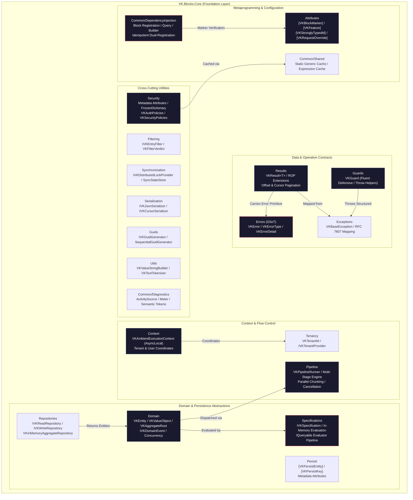

# VK.Blocks.Core

[](https://dotnet.microsoft.com/)
[](/LICENSE)
[](/docs/06-AuditReports/Core/Core_20260422.md)

## はじめに

`VK.Blocks.Core` は、VK.Blocks フレームワークの **最下層基盤モジュール（Foundation Layer / Single Source of Truth）** です。すべての BuildingBlock（Persistence, Storage, Web, Observability, Auth, Authz, Validation, AI など）が推移的に依存する共通の横断的関心事（Cross-Cutting Concerns）と抽象規約を一元的に定義・提供します。

本モジュールは以下の厳格な産業級設計原則（Industrial DNA）を貫徹しています:

- **純粋な抽象（Zero-Dependency）**: BCL（Base Class Library）および Microsoft.Extensions のみへの最小依存。外部インフラライブラリへの直接依存を完全排除。
- **ゼロリフレクション（Zero-Reflection）**: 静的ジェネリックキャッシュ（Static Generic Caching）、式木キャッシュ（Expression Tree Cache）、Source Generator を徹底活用し、ランタイムリフレクションを排除。
- **アロケーションフリー（Allocation-Free）**: ホットパスにおける LINQ 排除、`Span<T>` / `ref struct` / `stackalloc` / `ArrayPool<T>` / `HashCode` 構造体によるヒープ割り当ての最小化。
- **Fail-Fast 検証**: DI コンテナ起動時の再帰的依存関係検証と循環依存検出により、設定ミスを起動時に即座に検出。
- **Railway-Oriented Programming (ROP)**: `Result<T>` パターンによる例外制御フローの排除と、RFC 7807 準拠の構造化エラーモデルの統一。

---

## アーキテクチャ構成



### 設計原則と適用パターン

| カテゴリ | 適用パターン・設計思想 | 主な対象コンポーネント |
| :--- | :--- | :--- |
| **Architectural Principles** | Separation of Concerns, Dependency Inversion, Zero-Reflection, Zero-External-Dependency | `Common/`, `VKCoreBlock` |
| **Reliability & Flow** | Result Pattern (Railway-Oriented), Fail-Fast Validation, Defensive Boundary Guards | `Results/`, `Errors/`, `Guards/` |
| **Context & Isolation** | Ambient Execution Context, Tenant & User Coordinates, Structural Immutability | `Context/`, `Tenancy/` |
| **Domain Modeling** | Entity, Value Object, Aggregate Root, Domain Event Dispatching, Optimistic Concurrency | `Domain/` |
| **Data Query & Rules** | Specification Pattern (In-Memory Compiled Expressions + IQueryable Providers) | `Specifications/` |
| **Execution Engines** | Multi-Stage Pipeline Execution, Ordered Chunking, Distributed Lock Abstractions | `Pipeline/`, `Synchronization/` |
| **Performance Engineering** | Static Generic Caching, ArrayPool Buffers, Ref Struct StringBuilder, Sequential COMB GUIDs | `Common/Shared/`, `Utils/`, `Guids/` |

---

## 全機能モジュール詳細

### 1. 🏷️ グローバル・メタデータ属性 (`Attributes/`)

Source Generator と連携し、コンパイル時にボイラープレートコードを完全自動化するための宣言的アトリビュート群です。

- **`[VKBlockMarker]` / `[VKFeature]`**: BuildingBlock および Feature のメタデータをマーク。DI 自動解決・モジュール依存グラフ構築の起点。
- **`[VKStronglyTypedId]`**: プリミティブ・オブセッションを排除する型安全な ID（`record struct`）およびヘルパー拡張メソッドを自動生成。
- **`[VKRequestOverride]` / `[VKNoRequestOverride]`**: `IVKBlockOptions` からリクエスト単位のオーバーライド用 Args レコードを自動抽出。
- **`[VKBlockDiagnostics]` / `[VKAppDiagnostics]`**: OpenTelemetry 統合用の `ActivitySource` および `Meter` 計装コードを自動生成。
- **`[VKValueObject]` / `[VKDomainIgnore]`**: ドメイン値オブジェクトのコード生成および永続化除外メタデータ。

### 2. 🧱 依存性注入パイプライン (`Common/DependencyInjection/`)

フレームワーク全体の拡張性・決定性・冪等性を担保するコア DI パイプラインです。

- **マーカーパターン**: `IVKBlockMarker` と `IVKBlockMarkerProvider<TSelf>` による型安全なブロック識別。
- **4ファイル責務分離**: Query（検証）、Registration（登録）、Builder（拡張）、ServiceCollection（公開 API）に完全分離。
- **再帰的依存解決 (`EnsureDependenciesRegistered`)**: 依存モジュールの先行登録トラバーサルと循環依存のコンパイル/起動時検出。
- **冪等二重登録 (`AddVKBlockOptions<T>`)**: `IOptions<T>` バインディングと起動時高速アクセスのための Singleton 登録を同時に完了。

### 3. 🌐 アンビエント実行コンテキスト (`Context/`)

非同期呼び出しチェーン全体（`AsyncLocal<T>`）を通じて、空間座標（テナント）と主体座標（ユーザー）を安全に伝搬する信頼できる単一の情報源（SSoT）です。

- **`VKAmbientExecutionContext`**: スレッドセーフなアンビエント実行コンテキストコンテナ。
- **`VKExecutionContext`**: 空間（`IVKTenantCoordinate`）および主体（`IVKUserCoordinate`）を保持する不変エンベロープ。
- **スコープトークン (`BeginScope`)**: `IDisposable` パターンにより、スコープ終了時に以前の実行コンテキストへ自動復元。
- **強型座標 (`VKTenantId`, `VKUserId`)**: 型安全な識別子によるテナント分離と監査ログ統合。

### 4. 🏛️ ドメインプリミティブ (`Domain/`)

DDD（ドメイン駆動設計）の戦術的設計パターンをゼロアロケーションで実現する基盤モデルです。

- **`VKEntity<TId>`**: 識別子ベースの等価比較と ORM 透過性を備えたエンティティ基底。
- **`VKValueObject`**: LINQ 非依存のアロケーションフリーな構造的等価比較（`HashCode` 構造体活用）。
- **`VKAggregateRoot<TId>`**: ドメインイベント（`IVKDomainEvent`）のステージングとライフサイクル管理。
- **監査規約 (`IVKAuditable`, `IVKSoftDeletable`, `IVKFullAuditable`)**: 作成・更新・削除・論理削除の自動監査インターフェース。
- **オプティミスティック並行性 (`IVKConcurrency`, `VKConcurrencyExtensions`)**: バージョン比較と排他制御拡張。

### 5. ⚠️ エラーモデルの所有権 (`Errors/`)

システム全体で共通利用される、不変でシリアライズ可能なエラーデータ構造の唯一の定義層です。

- **`VKError`**: エラーコード、メッセージ、種別（`VKErrorType`）、詳細コレクション、デバッグ情報を含む不変レコード。
- **`VKErrorType`**: `Validation`, `NotFound`, `Conflict`, `Unauthorized`, `Forbidden`, `Unexpected`, `Failure` などのカテゴリ分類。
- **`VKErrorDetail`**: フィールド単位の検証違反やサブエラーの詳細情報。
- **`VKCoreErrors`**: フレームワーク共通のエラーコード体系（`Core.Validation.Failed`, `Core.NotFound` など）。
- **一方向依存の徹底**: `Results/` は `Errors/` に依存しますが、`Errors/` が `Results/` を参照することは禁止されています。

### 6. 🎯 Result Pattern & Railway プログラミング (`Results/`)

例外による制御フロー（Exception as Flow Control）を排除し、処理の成功・失敗を明示的な型で表現します。

- **`VKResult` / `VKResult<T>`**: `null` 返却を厳禁とする戻り値の唯一の規約。
- **成功シングルトンキャッシュ**: `VKResult.Success()` の静的キャッシュによる GC アロケーションゼロ化。
- **Railway 拡張メソッド (`VKResultExtensions`)**: `Bind`, `Map`, `Tap`, `Ensure`, `Match`, `OnFailure` の同期・非同期チェーン。
- **ページネーションモデル**: オフセット型 `VKPagedResult<T>` およびカーソル型 `VKCursorPagedResult<T>`（前後方向トラバーサル対応）。

### 7. 🛡️ ガード節 (`Guards/`)

メソッド境界およびコンストラクタにおける前提条件を高速に検証する防御的プログラミング API です。

- **`VKGuard`**: `NotNull`, `NotNullOrWhiteSpace`, `NotEmpty`, `Positive`, `NotDefault`, `DefinedEnum`, `Against`。
- **Fluent アサイン**: 単一行でのフィールド初期化（例: `_service = VKGuard.NotNull(service);`）。
- **JIT 最適化 Throw Helper**: `[DoesNotReturn]` と `[CallerArgumentExpression]` によるインライン展開阻害の防止とパラメータ名の自動キャプチャ。

### 8. 🚨 例外階層と RFC 7807 マッピング (`Exceptions/`)

インフラ層やプロトコル境界で発生する回復不能な例外を、標準化された HTTP セマンティクスへ変換します。

- **`VKBaseException`**: `VKError` と直接連動する基本例外型。
- **セマンティック例外**: `VKNotFoundException`, `VKConflictException`, `VKValidationException`, `VKForbiddenException`, `VKUnauthorizedException`, `VKDependencyException`。
- **RFC 7807 変換拡張**: `VKBaseExceptionExtensions` による ProblemDetails への自動マッピング。

### 9. 🔀 実行パイプラインエンジン (`Pipeline/`)

複雑なビジネスプロセスやバッチワークフローを多段ステージ・ジョブ・タスクとして組み立て・実行する汎用エンジンです。

- **`VKPipelineRunner`**: 並列グループ実行と順序直列実行を組み合わせたステージ実行エンジン。
- **チャンキングアルゴリズム (`ChunkStages`)**: 優先度と並列グループセレクターに基づく動的ステージ分割。
- **短絡評価とキャンセル**: `Abort` 判定および `CancellationToken` による安全なフェイルファスト停止。
- **コンポーネント規約**: `IVKPipeline`, `IVKPipelineStage`, `IVKPipelineJob`, `IVKPipelineTask`, `IVKMiddleware`。

### 10. 🧩 仕様パターン (`Specifications/`)

クエリ条件とドメインルールをカプセル化し、DB クエリ（`IQueryable`）とインメモリ検証の両方で共有可能な強型規約です。

- **`IVKSpecification<T>` / `VKSpecification<T>`**: 式木（Expression Tree）をベースとする仕様定義。
- **論理合成**: `And`, `Or`, `Not` による仕様の動的合成。
- **インメモリ評価 (`IsSatisfiedBy`)**: 内部式木を `Func<T, bool>` へ自動コンパイル・キャッシュし、極小オーバーヘッドで判定。
- **Evaluator パイプライン**: `WhereEvaluator`, `OrderEvaluator`, `PaginationEvaluator`, `IncludeEvaluator` によるクエリ自動最適化。

### 11. 🗄️ リポジトリ規約 (`Repositories/`)

データアクセス実装を抽象化し、Clean Architecture の依存性逆転を達成するためのポート規約です。

- **`IVKReadRepository<T, TId>`**: 読み取り専用操作（ID 検索、仕様検索、一覧取得）。
- **`IVKWriteRepository<T, TId>`**: 変更操作（追加、更新、削除）。
- **`IVKRepository<T, TId>`**: 読み書き統合規約。
- **`VKInMemoryAggregateRepository<T, TId>`**: テストおよびモック用途のインメモリ実装。

### 12. 💾 永続化メタデータ (`Persist/`)

ドメインモデルおよび DTO を、EF Core / Dapper / Redis などの個別ストレージ技術から切り離したままマッピングを宣言するアトリビュート群です。

- **`[VKPersistEntity]` / `[VKPersistKey]`**: エンティティおよび主キーのマッピング。
- **`[VKPersistColumn]` / `[VKPersistIndex]`**: カラム名・インデックス・一意性制約の定義。
- **`[VKPersistJson]` / `[VKPersistConverter]`**: JSON 列格納およびカスタム型変換器の指定。
- **`[VKPersistIgnore]`**: 永続化対象外プロパティの除外宣言。

### 13. 🔍 単一エントリフィルタリング (`Filtering/`)

命令型パイプライン（AI コーパス処理、イベントストリーム等）において、単一アイテムの動的な合否判定を行うプロトコルです。

- **`IVKEntryFilter<TEntry, TContext>`**: 順序付けられた（`FilterOrder`）非同期判定契約。
- **`VKFilterVerdict`**: 判定結果列挙（`Accept`, `Reject`, `Skip`）。
- **`VKFilterExtensions`**: コレクションに対するフィルタ適用パイプライン拡張。

### 14. 🔒 セキュリティと PII 保護 (`Security/`)

機密情報（PII）の保護および認可ポリシー名のメタデータ定義を提供します（ポリシー判定ロジック自体は Authorization モジュールに分離）。

- **`[VKSensitiveData]` / `[VKRedacted]`**: プロパティレベルの機密データマスキング宣言。
- **`VKSensitiveString`**: メモリ内の不用意な漏洩を防ぐ安全な文字列ラッパー。
- **`VKPropertySecurityCache`**: .NET 8+ の `FrozenDictionary` を活用したゼロアロケーション・メタデータルックアップ。
- **ポリシー定数**: `VKAuthPolicies`, `VKSecurityPolicies` による認可ルールの定数化。

### 15. 🔄 同期と分散ロック規約 (`Synchronization/`)

マルチプロセスおよび分散環境における排他制御・状態同期を統一的に扱う抽象インターフェースです。

- **`IVKDistributedLockProvider`**: 分散ロックの非同期取得プロトコル（タイムアウト・有効期限管理）。
- **`IVKDistributedLockHandle`**: `IAsyncDisposable` による安全なロック解放ハンドル。
- **`IVKSyncStateStore`**: 同期状態追跡ストアの抽象規約。
- **ベースライン実装**: `InProcessMemoryLockProvider`, `VKNoOpSyncStateStore`。

### 16. 📦 シリアライゼーション規約 (`Serialization/`)

フレームワーク全体の JSON 変換およびページングカーソル暗号化・復号化を抽象化します。

- **`IVKJsonSerializer`**: High-performance な JSON 直列化・逆直列化規約。
- **`IVKCursorSerializer`**: カーソルページネーション用トークンの安全なシリアライズ規約。
- **`SystemTextJsonSerializer`**: `System.Text.Json` に最適化された標準実装。

### 17. 🆔 高性能 GUID 生成 (`Guids/`)

データベースの B-Tree インデックス断片化を防止し、挿入性能を最大化する GUID 生成基盤です。

- **`IVKGuidGenerator`**: GUID 生成プロトコル。
- **`SequentialGuidGenerator`**: `BinaryPrimitives` と `stackalloc` を駆使した、アロケーションゼロの時系列 COMB GUID 生成器。

### 18. 🗺️ オブジェクトマッピング (`Mapping/`)

リフレクションを用いず、コンパイル時または事前定義されたマッピングを呼び出す軽量マッピング基盤です。

- **`[VKMapper]`**: マッパー型マーキングアトリビュート。
- **`IVKMapper<TSource, TDestination>`**: 型安全なオブジェクト変換プロトコル。

### 19. 🏢 テナント抽象化 (`Tenancy/`)

マルチテナントアーキテクチャのアイデンティティとアクティブプロバイダーを規定するリーフスライスです。

- **`VKTenantId`**: プリミティブ・オブセッションを排除した不変構造体識別子。
- **`IVKTenantProvider` / `IVKActiveTenantProvider`**: 現在のコンテキストにおけるアクティブテナント解決規約。
- **`VKTenancyConstants`**: システムテナント識別子（`DefaultTenantId` 等）の定数。

### 20. ⚡ ハイパフォーマンス・ユーティリティ (`Utils/`, `Common/Shared/`)

ホットパスでのメモリフットプリントを極限まで低減するためのユーティリティです。

- **`VKValueStringBuilder`**: スタックメモリ（`Span<char>`）または `ArrayPool<char>.Shared` 上で動作するアロケーションフリーな `ref struct`。
- **`VKTextTokenizer`**: ゼロコピーで文字列をスライシング・チャンキングするトークナイザー。
- **`VKTypeMetadataCache`**: JIT 特殊化を利用した静的ジェネリックキャッシュ。
- **`VKExpressionCache`**: 式木（Expression Tree）の同一性比較（`ExpressionEqualityComparer`）とキャッシュ。

---

## 採用技術とランタイム

| 技術 | バージョン / 用途 | 採用理由・メリット |
| :--- | :--- | :--- |
| **.NET 10** | ランタイム・SDK | 最新のランタイム最適化、JIT 向上、ハードウェア組み込み関数の活用 |
| **C# 12+** | 言語バージョン | Collection expressions (`[]`), Primary constructors, Ref struct, Required properties |
| **Microsoft.Extensions.DependencyInjection.Abstractions** | 10.0+ / DI 抽象 | ベンダーロックインのない標準 DI コンテナ抽象化 |
| **Microsoft.Extensions.Options** | 10.0+ / 構成管理 | 型安全なオプションバインディングとバリデーション |
| **Microsoft.Extensions.Configuration.Abstractions** | 10.0+ / 構成解決 | 階層的構成セクションのバインドと遅延ロード |
| **System.Diagnostics.DiagnosticSource** | 10.0+ / 診断 | OpenTelemetry ネイティブな ActivitySource および Meter 計装 |
| **FrozenDictionary** | .NET 8+ BCL | 読み取り専用メタデータアクセスの O(1) 極限最適化 |

---

## 開始方法

### 1. ビルドとテストの実行

```powershell
# ソリューションルートからビルド
dotnet build src/BuildingBlocks/Core/VK.Blocks.Core.csproj

# 単体テストの実行
dotnet test test/BuildingBlocks/Core/VK.Blocks.Core.UnitTests.csproj
```

### 2. アプリケーションおよび他モジュールでの登録

```csharp
// Program.cs または BuildingBlock の登録処理
using VK.Blocks.Core;

var builder = WebApplication.CreateBuilder(args);

// Core モジュールの登録 (依存関係解決および基本サービスの初期化)
builder.Services.AddVKCoreBlock();
```

---

## 関連ドキュメント

- [ADR 一覧 (Core)](/docs/04-ArchitectureDecisionRecords/Core/README.md) — アーキテクチャ決定記録
- [監査レポート (2026-04-22)](/docs/06-AuditReports/Core/Core_20260422.md) — 適合度スコア 100/100
- [コーディング規約一覧](/docs/01-Standards/README.md) — VK.Blocks コアコーディング規約

---

**Last Updated**: 2026-10-04 (Architecture Full Review & Sync)
